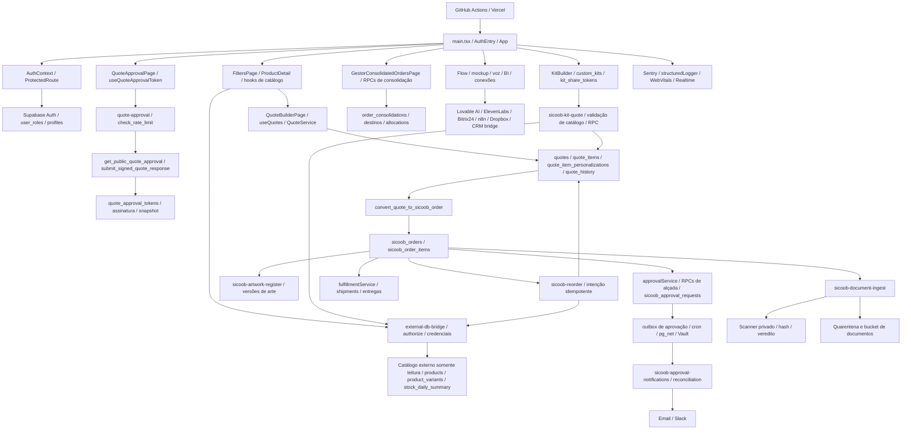

# Auditoria técnica — Brindes Sicoob V2

Data: 24/09/2026. Diagnóstico somente leitura; sem correções, deploy ou gravações no banco.

## 1. Estado geral

Portal B2B de brindes Sicoob em construção, React/Vite/TypeScript e Supabase.
Foram registrados 36 achados: P0=0, P1=19, P2=14, P3=3.
A auditoria cobre código local, compare com main congelada, metadados GitHub, HTTP de leitura e simulações em memória.
Acesso administrativo ao banco não foi obtido; não se comprova sincronismo completo nem cobertura remota integral.
Risco 1: dispatcher e sincronização n8n/Bitrix sem autorização no handler (A-022/A-026; exposição remota condicionada).
Risco 2: criação/edição e mudanças de status sem contrato atômico confiável (A-004–006/A-011/A-033).
Risco 3: replay de migrations falhou no Supabase Preview por conflito de retorno SQL (A-028).
Risco 4: trilha de histórico quebra no join real e possui policy versionada mutável (A-009/A-010).
Risco 5: cópia divergente, CI impedido por orçamento e reconciliação sem secret (A-001–003/A-029/A-036).
Ausência de P0 confirmado não equivale a ausência de vulnerabilidades.
Este relatório não certifica ambiente pronto nem nota 10/10; PLANO_100.md contém somente correções sustentadas.

## 2. Mapa de conexões



O apêndice A enumera 443 origens com conexões literais, os 105 handlers locais e 53 variáveis lidas do código. O diagrama agrega famílias; chamadas dinâmicas e infraestrutura externa não têm cobertura total comprovada.

### Fase 1 — Cinco fluxos rastreados e comportamento de falha

| Fluxo | Caminho lido | Autorização/validação observada | Falha e lacuna |
|---|---|---|---|
| Login e papéis | main.tsx → AuthContext → authService → Auth/user_roles/profiles → ProtectedRoute | sessão, rolesLoaded e rolesError controlam guarda; role-policy resolve papel | consulta inicial getSession sem catch observada; efeito de rejeição não reproduzido, mantido como hipótese em NÃO VERIFICADO |
| Catálogo e orçamento | ProductDetail/useStockHistory → external-db-bridge → catálogo; useQuotes → QuoteService → quotes/itens/personalizações | applySellerScope no cliente e RLS esperado no banco; IDs recebidos nas chamadas | falhas de create/update propagam toast, mas efeitos intermediários não são revertidos: A-004–006; histórico: A-007–009 |
| Aprovação e conversão | QuoteApprovalPage → quote-approval → check_rate_limit/get_public_quote_approval/submit_signed_quote_response → convert_quote_to_sicoob_order | token, assinatura obrigatória, sucesso estrito true, lock e auth.uid na migration | sem execução mutante remota; erro de consulta tem mensagem, mas sem botão de retry; atomicidade remota não comprovada |
| Documento, arte e logística | OrderDetail → documentIngestService → sicoob-document-ingest → RPC de escopo → scanner → Storage → register_sicoob_clean_document; fulfillmentService → RPC de shipment | getUser, escopo por pedido, limite de bytes, assinatura de arquivo e veredito obrigatório | configuração ausente retorna 503; erros de cleanup Storage não são checados; retorno shipment é cast sem validação estrutural |
| Kit, recompra e distribuição | useKitAutoSave → custom_kits; sicoob-kit-quote/reorder → catálogo → RPC; GestorConsolidatedOrdersPage → consolidação/destinos | fila local no autosave; intenção idempotente e consulta com JWT na recompra; RPCs de consolidação | catálogo/credenciais/integrações autenticadas não exercitados; cobertura real de estoque e falhas de previsão verificadas em A-019/A-020 |

Evidências de código: src/components/layout/ProtectedRoute.tsx:25–50; src/contexts/AuthContext.tsx:92–199; src/services/QuoteService.ts:141–244; supabase/functions/quote-approval/index.ts:28–84; supabase/migrations/20260922224500_convert_quote_to_sicoob_order.sql:39–76; supabase/functions/sicoob-document-ingest/index.ts:26–120; src/hooks/useKitAutoSave.ts:84–150; src/services/sicoob/orderService.ts:244–255.


### Contexto e limites do snapshot

- Local: `/home/joaquim_ataides/projetos/Brindes_Sicoob_V2`; repositório `adm01-debug/Brindes_Sicoob_V2`.
- HEAD local observado: `6b71bdc09`; referência local origin/main: `6193793a7`; GitHub main consultada: `afcc1e2ba5c697c4d7cbf4d0c273d30afbf9c4b5`.
- Lockfile: React 18.3.1, Vite 6.4.3, TypeScript 5.8.3, supabase-js 2.98.0, React Router 7.18.3, Vitest 4.1.11, Recharts 2.15.4. Versão instalada será distinguida de lock quando verificável.
- Acessos confirmados: filesystem e GitHub REST por gh. Acesso administrativo ao banco Sicoob não obtido nesta sessão; MCP informado retornou 403. MCPs disponíveis com outros nomes/projetos não serão tratados como Sicoob.
- Sem orçamento numérico imposto. Nenhum teste com mutação remota, instalação, build com artefatos, commit, PR ou deploy será executado.
- A instrução atual permite apenas dois arquivos; por isso não se cria worktree nem se altera branch nesta auditoria documental. Alterações locais preexistentes serão preservadas.
- Fluxos escolhidos: autenticação/autorização; catálogo → orçamento; aprovação → pedido; documentos/arte → logística; kit/recompra/consolidação.
- RLS: falta de policy de escrita não implica permissão; com RLS ativo, sem policy aplicável ocorre negação. Índice com idx_scan=0 isoladamente não prova inutilidade. NUMERIC para dinheiro é aceitável.
- O grafo `graphify-out/graph.json` foi consultado: 947 nós; consulta focal retornou 220 conexões com saída limitada a 31. Trata-se de índice auxiliar, não prova de completude ou atualidade.

### Estrutura e entradas observadas

- Entradas: src/main.tsx seleciona AuthEntry para login/recuperação/verificação/SSO; demais URLs carregam App. App.tsx:83–143 liga configurações de rotas a ProtectedRoute, AdminRoute, DevRoute e SicoobRoute. Rotas públicas com token não são rotas sem autorização de objeto: o token/RPC deve impor escopo.
- Diretórios principais: src/{components,contexts,hooks,integrations,lib,pages,routes,services,types}; supabase/{functions,migrations}; scripts/{db,lib,qa}; tests; docs; .github/workflows. Foram examinados lexicalmente 2019 arquivos TS/TSX de src e Edge e 530 migrations; isso não equivale a revisão semântica linha a linha de todos eles.
- Scripts package.json: dev=vite; build=vite build; preview=vite preview; typecheck executa tsc --noEmit nos projetos app e node. O build não foi executado, pois emitiria arquivos fora das duas entregas permitidas.
- Inventário de rotas no apêndice B complementa o mapa agregado. Apêndice A mostra origens de consultas/RPCs/Edges, portas locais e variáveis. O schema efetivo permanece não verificado.
- GitHub main congelada em afcc1e2ba; compare a partir de 6b71bdc09 tem 4 commits a mais, 0 a menos, 45 arquivos alterados. GestorOrcamentos, useKitStockForecast, webhook-inbound/dispatcher, sync-quote-bitrix, check-edge-authorization e 004_notification_functions são iguais entre essas revisões. No QuoteService/useQuotes, as mudanças vistas no compare são comentários de RLS.
- PR39 substituiu histórico simulado por consulta no QuoteConsolidationPanel e acrescentou loading/error/retry. O mockHistory da cópia local NÃO foi classificado como falha da main. Os trechos CSV, preferências, clipboard, agrupamento e teclado persistem no diff remoto; o join novo falha conforme A-009.
- GitHub possui 5 secrets de repositório: SUPABASE_ACCESS_TOKEN, VITE_SUPABASE_ANON_KEY, VITE_SUPABASE_PROJECT_ID, VITE_SUPABASE_PUBLISHABLE_KEY e VITE_SUPABASE_URL. Apenas nomes consultados. Há 4 ambientes listados; valores/configurações de secrets por ambiente não foram acessados.

### Integrações rastreadas e fronteiras não comprovadas

| Ligação | Credencial/controle lido | Falha/retry observável no código | Limite |
|---|---|---|---|
| Catálogo externo | external-db-bridge; _shared/external-read-only.ts:2–24 restringe origem doufs..., REST e GET/HEAD | helpers de bridge; previsão engole falha em A-020 | dados/estoque externos não consultados nem alterados |
| Aprovação pública | token; quote-approval/index.ts; RPC e rate limit | resposta estrita e erro na UI; join de histórico A-009 | aprovação real não executada |
| Documento | JWT, escopo de pedido, scanner URL/token | timeout do scanner; compensação Storage A-012 | secrets/vereditos/objetos remotos não acessados |
| Notificações de aprovação | SICOOB_APPROVAL_WORKER_SECRET; outbox/leases; RESEND_API_KEY; destino Slack | approval-delivery.ts:67 usa timeout de 10 s e redirect:error; worker registra delivered/retry/uncertain/failed | cron ativo, entrega real e idempotência do provedor não comprovados |
| Webhook de entrada | segredo apontado por hmac_secret_ref; HMAC-SHA256 | ACK e contadores A-024/A-025 | eventos/credenciais remotos não lidos |
| Webhook de saída | secret_ref nos destinos; cliente service_role | retries no request; A-022/A-023/A-025 | não se chamou dispatcher real, pois enviaria mensagens |
| Orçamento → n8n → Bitrix | N8N_QUOTE_WEBHOOK_URL; body do cliente | circuito, ausência de guarda/deadline A-026/A-031 | workflow n8n, deduplicação e Credential Store não acessíveis |
| Bitrix administrativo | authorize(supervisor), BITRIX24_WEBHOOK_URL | external-fetch; corpo bruto no log A-027 | API CRM e logs reais não consultados |
| Telemetria | VITE_SENTRY_DSN; src/lib/sentry.ts:26–58 | carga lazy, buffer; configuração local sem DSN | conta Sentry/alertas/deploy secrets não verificados |
| Outros provedores | AI/voz/Dropbox/CRM bridge referenciados no inventário | somente conexões literais levantadas | não foi exercitada cada operação, custo ou retry de cada provedor |

## 3. Achados por camada

### Infraestrutura, reconciliação e qualidade

#### A-001 · [P1] · infra — A base local não representa a main atualmente publicada no GitHub
Evidência: `git log -1 --format='%h %s'` → `6b71bdc09`; `git rev-parse origin/main` → `6193793a7...`; `gh api repos/adm01-debug/Brindes_Sicoob_V2/commits/main` → `afcc1e2ba...`, título `fix: remove inteligência simulada do histórico (#38)`. `git status --short` registra modificações em `docs/correcoes-validacao-2026-09-14.md`, `src/components/admin/connections/secretNormalizers.ts` e `supabase/.temp/cli-latest`.
Impacto: auditoria/testes/deploy feitos nesta cópia podem incluir código diferente do revisado no GitHub e omitir correções já integradas. Não há prova de perda de dados.
Causa raiz: bases divergentes e alterações sem commit coexistem; a referência remota local está desatualizada. Não se executou fetch/pull para preservar somente leitura.
Complemento: compare local HEAD...SHA remoto indica ahead4/behind0 e45 arquivos diferentes. Nenhum fetch/pull/merge foi executado.

#### A-002 · [P1] · infra — A main permite integração sem checks obrigatórios e bypass administrativo
Evidência: GET `repos/adm01-debug/Brindes_Sicoob_V2/branches/main/protection` → `required_status_checks: null`, `enforce_admins.enabled: false`, `required_approving_review_count: 1`.
Impacto: uma revisão não garante execução de typecheck, testes, RLS ou scanner antes do merge.
Como explorar: um administrador pode integrar uma mudança com verificações falhas usando o bypass permitido pela proteção atual; não é prova de exploração externa.
Causa raiz: proteção exige revisão, mas não vincula verificações técnicas nem aplica todas as regras a administradores.

#### A-003 · [P1] · qualidade — Dependências instaladas divergem do lockfile
Evidência: leitura por Python de `package-lock.json` e `node_modules/*/package.json`: TypeScript lock 5.8.3 versus instalado 5.9.3; supabase-js lock 2.98.0 versus instalado 2.112.4. React 18.3.1 e Vite 6.4.3 coincidem.
Impacto: um teste local usa compilador/cliente diferentes de uma instalação reprodutível; aprovação nesta árvore não comprova comportamento do lockfile.
Causa raiz: node_modules não corresponde ao lockfile. Nenhuma reinstalação foi feita nesta missão.
Complemento: tsc instalado, sem emissão/cache incremental, retornou exit 2 e 191 diagnósticos; baseline local declara 166 em 166 arquivos. Exemplos: DiscountApprovalQueue.tsx:118 TS18048; MockupPromptManager.tsx:74/:110 TS2322; useIncidentTimeline72h.ts:107/useRecentIncidents.ts:117 TS2352. Não se atribui o delta a regressão da main sem reinstalação pelo lockfile. O gate de baseline permite dívida; não equivale a tsc limpo.

#### A-028 · [P1] · banco/infra — Supabase Preview falha ao recriar cleanup_old_notifications com retorno diferente
Evidência: GET check-runs do SHA afcc1e2ba → check 107633866283, nome Supabase Preview, conclusion failure; summary contém SQLSTATE 42P13, cannot change return type of existing function, no CREATE OR REPLACE FUNCTION cleanup_old_notifications() RETURNS INT.
Impacto: replay de migrations do preview interrompido; não há prova de banco reproduzível a partir do histórico. Não demonstra que o banco principal esteja indisponível.
Causa raiz: declaração tenta mudar contrato de retorno já existente sem caminho compatível; origem exata nas migrations será ligada à evidência de código.
Complemento: supabase/migrations/004_notification_functions.sql:80–95 declara RETURNS INT; 20260312110229_71c6cfbf-a5f2-4dc2-9e64-e8417272a070.sql:134–143 declara mesma assinatura RETURNS VOID. Ordem efetiva/ledger do preview indisponíveis; o check aponta tentativa INT. Uma migration posterior isolada não corrige replay interrompido antes dela.

#### A-029 · [P1] · infra — Verificações de qualidade e segredos estão bloqueadas por orçamento do Actions
Evidência: GET annotations dos checks 107633633050 (Segurança, contratos e build) e 107633636059 (Gitleaks) no SHA afcc1e2ba: “The job was not started because an Actions budget is preventing further use.” GET actions/runs lista oito workflows recentes concluídos como failure nesse SHA.
Impacto: falha desses checks não representa testes executados; código integrado permanece sem validação atual desses jobs. Supabase Preview tem falha técnica própria A-028, não confundir causas.
Causa raiz: limite de uso do Actions impede iniciar runners. Valor necessário e responsável por orçamento não consultados; não houve mudança de plano/custo.

#### A-030 · [P2] · qualidade/segurança — Gate de autorização não exige enforcement em authenticated/scoped/service
Evidência: `scripts/check-edge-authorization.mjs:80–87` limita ROLE_REQUIRED a supervisor/dev e faz continue para demais categorias. Assim, as ausências de guarda em webhook-dispatcher (scoped) e sync-quote-bitrix (authenticated) não geram erro de enforcement.
Impacto: inventário completo no manifesto pode ser confundido com autorização comprovada nos handlers. As brechas condicionais concretas estão em A-022/A-026.
Causa raiz: cobertura declarativa e validação de guarda têm escopos distintos, mas o gate não exige contrato equivalente das demais categorias sensíveis.
Complemento: execução de node scripts/check-edge-authorization.mjs retornou exit 0, 105/105 declaradas: authenticated30/dev21/public26/scoped5/service17/supervisor6. O resultado não detectou A-022/A-026.

#### A-036 · [P2] · infra/banco — Workflow de reconciliação não possui o secret de conexão exigido
Evidência: `.github/workflows/migration-ledger-drift.yml:30–33` (step de comparação) passa secrets.SUPABASE_DB_URL e não seleciona environment. GET actions/secrets retornou somente 5 nomes (somente SUPABASE_ACCESS_TOKEN e quatro VITE_SUPABASE_*), sem SUPABASE_DB_URL. Owner consultado é User, não organização. `scripts/db/check-migration-ledger-drift.mjs:65–66` lança erro se SUPABASE_DB_URL/DATABASE_URL ausentes.
Impacto: ao iniciar no runner hospedado descrito, a rotina não consegue comparar ledger remoto; o token de Management API existente não substitui conexão PostgreSQL.
Causa raiz: dependência de secret não provisionada no escopo usado pelo job. Não se tentou ler/decriptar valores nem configurar credenciais nesta auditoria.

### Banco e rastreabilidade

#### A-009 · [P1] · banco/API — Join de histórico com profiles falha no Supabase real
Evidência: GET somente leitura `/rest/v1/quote_history?select=id,profiles(full_name)&limit=0` contra cfmzkthhgliqelozlmwu, usando chave pública local → HTTP 400, código PGRST200, mensagem “Could not find a relationship between 'quote_history' and 'profiles' in the schema cache”. Nenhuma linha consultada. `src/components/quotes/QuoteHistoryTimeline.tsx:28` solicita esse join; GitHub afcc1e2ba contém o mesmo join em `src/components/quotes/QuoteConsolidationPanel.tsx:154` introduzido pela PR #39.
Impacto: ambas as telas falham ao carregar o histórico; a timeline ainda oculta a falha como vazio (A-007). O teste da PR #39 mocka a resposta e não comprova o relacionamento real.
Causa raiz: o cliente pressupõe um relacionamento PostgREST que o schema cache remoto não reconhece. Não inferir FK para profiles a partir de FK para auth.users. Correção mínima proposta: buscar autores separadamente por profiles.user_id, respeitando RLS.

#### A-010 · [P1] · banco/segurança — Policy versionada permite reescrever e atribuir autoria no histórico
Evidência: `supabase/migrations/20260426101255_04b395f5-2115-426f-a9b2-22b80605aff1.sql:42–45` define FOR ALL TO authenticated sobre quote_history, verificando apenas posse do orçamento/can_manage_quotes. Não fixa user_id=auth.uid nem proíbe UPDATE/DELETE. Busca de referências posteriores a quote_history não revelou revogação dessa policy; o loop da mesma migration exclui a tabela em :101.
Impacto: trilha pode deixar de ser confiável se essa policy e grants de escrita estiverem ativos. Achado confirmado no código versionado; explorabilidade no banco atual NÃO VERIFICADA.
Como explorar: com grants de escrita e essa policy instalada, o proprietário de um orçamento pode atualizar/apagar seus eventos ou inserir evento atribuído a outro user_id.
Causa raiz: reutilização de permissão de edição comercial para uma trilha que exige autoria confiável e imutabilidade. Inspecionar grants/policies remotos antes de desenhar a migration final.

### Backend comercial e integrações

#### A-004 · [P1] · backend — Criação e edição pelo QuoteService não são atômicas
Evidência: `src/services/QuoteService.ts:146` insere cabeçalho; `:153` insere itens depois; `:176` atualiza cabeçalho; `:234` grava histórico antes de `:243` apagar itens e `:244` reinseri-los. O DELETE não verifica o retorno error. `:316` insere personalizações em chamadas separadas. `src/hooks/quotes/useQuotes.ts:54` e `:77` chamam esses caminhos. Compare GitHub `6b71bdc09...afcc1e2ba` mostra somente comentários adicionados nesses trechos.
Impacto: falha intermediária deixa orçamento incompleto; falha após DELETE pode remover itens antes de terminar o salvamento; se DELETE falhar silenciosamente, a reinserção pode duplicar linhas.
Causa raiz: várias transações REST independentes para uma operação comercial única; existência de outras RPCs atômicas não protege este chamador.

#### A-005 · [P1] · backend — Salvamento ignora falha da gravação do histórico
Evidência: `src/services/QuoteService.ts:347` aguarda insert em quote_history sem desestruturar/verificar error. `src/hooks/quotes/useQuotes.ts:55` aguarda logHistory e depois mostra sucesso em `:61`.
Impacto: criação/edição pode ser anunciada com sucesso apesar de faltar trilha; frequência depende da falha de banco/RLS.
Causa raiz: o contrato Supabase resolve a promessa com `{error}`, mas o serviço trata apenas rejeição de Promise.

#### A-006 · [P1] · backend — Transição de status anuncia sucesso quando nenhuma linha é atualizada
Evidência: `src/hooks/quotes/useQuotes.ts:117` faz UPDATE por id/row_version sem select/count, mas em `:124` espera PGRST116 e em `:161` anuncia sucesso. Compare remoto confirma a mesma lógica, somente comentários de RLS adicionados.
Impacto: alteração concorrente da row_version faz UPDATE afetar zero linhas sem o erro esperado; notificações e histórico podem descrever uma mudança que não ocorreu.
Causa raiz: condição otimista sem confirmação de linha afetada. PostgREST só exige cardinalidade quando o chamador solicita representação singular.

#### A-011 · [P1] · backend — Edição aceita formulário obsoleto ao usar versão recém-consultada
Evidência: `src/services/QuoteService.ts:170–180` lê novamente o orçamento no salvamento, substitui row_version pelo oldQuote.row_version e usa essa versão no filtro do UPDATE. Não compara a versão recebida no formulário com a versão recém-lida.
Impacto: se B salvar depois de A abrir a tela, A pode sobrescrever a edição de B sem aviso; o filtro só cobre a janela entre getById e UPDATE.
Causa raiz: token de concorrência representa o instante do salvamento, não o snapshot que o usuário editou. Lógica também presente no SHA remoto analisado.

#### A-012 · [P2] · backend/storage — Cleanup de documento não confirma exclusão e pode remover arquivo já registrado
Evidência: `supabase/functions/sicoob-document-ingest/index.ts:97–117` chama RPC de registro; em qualquer erro apaga finalPath, sem distinguir commit confirmado de resposta perdida. Os três retornos Storage.remove em :113/:116/:117 são ignorados.
Impacto: falha resolvida como {error} pode deixar objeto órfão sem sinal; timeout após commit do registro pode disparar compensação que remove o arquivo referido pelo banco. Cenário de falha distribuída deduzido do código; não induzido no ambiente remoto.
Causa raiz: compensação sem consultar estado persistido e descarte dos resultados de cleanup; ausência de reconciliação por documentId nesse handler.

#### A-017 · [P2] · backend/busca — Texto livre é interpolado na gramática do filtro PostgREST
Evidência: `src/services/sicoob/orderService.ts:110–114` injeta term diretamente em query.or para order_number/notes/tracking_code, sem escapar vírgulas/parênteses/curingas.
Impacto: buscas contendo caracteres de controle da gramática podem falhar ou mudar o filtro; não é evidência de SQL injection nem de bypass de RLS.
Causa raiz: mistura de valor textual de busca com sintaxe do filtro lógico. Execução autenticada remota não realizada.

#### A-022 · [P1] · integrações/segurança — Dispatcher de webhooks não autoriza o chamador
Evidência: `supabase/functions/webhook-dispatcher/index.ts:45–61` cria cliente service_role e processa body sem validar identidade/permissão; :63–118 permite teste com ID, :121–136 replay; arquivo integral até :258 não contém guarda. `_shared/edge-authz-manifest.ts:85` apenas declara scoped por service-role/cron, sem implementar verificação. Não há seção específica no config.toml local para esse handler.
Impacto: quem conseguir atravessar o gateway pode disparar eventos arbitrários assinados com segredo do servidor; teste devolve resposta do destino. Estado do gateway/deploy NÃO VERIFICADO, portanto não se classifica como exploração ativa.
Como explorar: um chamador aceito pelo gateway envia event/payload ou replay_delivery_id sem que o handler verifique papel administrativo ou credencial interna.
Causa raiz: confiança em quem invoca foi documentada no manifesto, mas não imposta no código. O JWT de qualquer usuário não equivale a autorização administrativa.

#### A-023 · [P2] · integrações — Dispatcher pode repetir efeitos e bloquear por destino lento
Evidência: `supabase/functions/webhook-dispatcher/index.ts:97,185` faz fetch POST sem AbortSignal; :172–221 repete falhas com sleep no request. :157–162 inclui timestamp novo no hash e não transmite identificador estável de evento; replay gera outro timestamp/hash.
Impacto: resposta perdida após efeito no destinatário pode gerar duplicidade no retry; destino lento consome a execução e atrasa os demais hooks. SLA e duplicações reais não medidos.
Causa raiz: retry de efeito remoto sem contrato de deduplicação e sem prazo por tentativa/evento.

#### A-024 · [P1] · integrações — Webhook recebido confirma sucesso mesmo sem persistência
Evidência: `supabase/functions/webhook-inbound/index.ts:79–93` ignora error do insert/update; :101 responde received:true. :84 marca processed igual à assinatura válida, sem executar um consumidor de negócio neste handler. No dispatcher, :188–206 também descarta falhas de registro.
Impacto: evento autenticado pode ser perdido enquanto remetente recebe ACK; operação é exibida como processada só por ter HMAC válido. Exige falha de banco para perda de persistência.
Causa raiz: recebimento, validação e processamento foram confundidos, e o contrato {error} não é consumido.
Simulação executada: handler real transpilado, HMAC fictício válido e insert mock retornando error → HTTP 200, {ok:true,received:true}. Nenhum evento foi enviado/gravado no sistema; toda dependência estava em memória.

#### A-025 · [P2] · integrações — Métricas e circuit breaker perdem atualizações concorrentes
Evidência: `supabase/functions/webhook-inbound/index.ts:89–93` usa endpoint.total_received/total_invalid + 1 lidos antes; dispatcher :202–206,227–238 faz o mesmo para total_success/total_failure/consecutive_failures.
Impacto: duas requisições simultâneas podem gravar o mesmo contador, ocultando falhas ou adiando a desativação; número de ocorrências não medido.
Causa raiz: read-modify-write em chamadas REST separadas, sem incremento atômico/lock no banco.

#### A-026 · [P1] · integrações/segurança — Sincronização de orçamento confia em identidade e conteúdo enviados pelo cliente
Evidência: `supabase/functions/sync-quote-bitrix/index.ts:18–26` aceita quote/proposalData como record(any) e sellerEmail/companyId do body; :76 usa esse e-mail para vendedor; :226 usa quote_number recebido; :287–291 envia ao n8n. Handler inteiro :29–326 não valida usuário nem posse do orçamento. Manifesto :154 declara authenticated, sem impor guarda.
Impacto: quem atravessar o gateway pode enviar orçamento/conteúdo comercial arbitrário em nome de vendedor; configuração e alcance real do workflow remoto não verificados.
Como explorar: chamar sync-quote-bitrix com sellerEmail/companyId e quote_number manipulados faz o handler montar payload sem vinculá-lo a auth.uid e ao orçamento persistido.
Causa raiz: identidade/autorização delegadas ao cliente e manifesto declarativo; validação de forma não estabelece propriedade.

#### A-027 · [P2] · observabilidade/privacidade — Resposta de CRM com contatos é enviada ao console
Evidência: `supabase/functions/bitrix-sync/index.ts:84–95` solicita EMAIL/PHONE/ADDRESS; :108 registra JSON.stringify(bitrixData).slice(0,500), sem redator nesse console.log.
Impacto: respostas contendo contatos podem permanecer em logs acessíveis a operadores; presença de PII em execução atual e retenção remota NÃO VERIFICADAS.
Causa raiz: logging de corpo bruto em vez de metadados/contagens. Nenhum dado de contato é reproduzido neste relatório.

#### A-031 · [P2] · integrações — Wrapper do CRM não impõe prazo de chamada
Evidência: `supabase/functions/_shared/external-fetch.ts:38–61` encaminha init ao fetch sem acrescentar timeout/AbortSignal. `sync-quote-bitrix/index.ts:287–291` e `bitrix-sync/index.ts:77–98` não passam signal.
Impacto: lentidão sem resposta pode ocupar a Edge até o limite da plataforma; circuit breaker só contabiliza após resolver/rejeitar e não limita essa espera. Latência de incidente não medida.
Causa raiz: circuito protege falhas concluídas, mas não define deadline da tentativa.

#### A-033 · [P1] · backend — Alteração em massa não confirma quais orçamentos foram atualizados
Evidência: `src/hooks/quotes/useQuotes.ts:183–190` UPDATE por ids sem versão/retorno/count; :195–206 gera histórico para todos os ids pedidos; :208 mostra quoteIds.length como quantidade atualizada.
Impacto: linhas filtradas por RLS, excluídas ou alteradas por concorrência podem gerar confirmação e histórico não correspondentes à operação. Não é bypass de RLS demonstrado.
Causa raiz: resposta esperada é baseada na intenção enviada, não nos registros efetivamente atualizados; falta um contrato transacional de resultado por id.

#### A-035 · [P2] · logística/contrato — Serviço aceita array ou objeto vazio como remessa válida
Evidência: `src/services/sicoob/fulfillmentService.ts:18–20` valida somente typeof object; :40–43 aceita o resultado como SicoobOrderShipment. Simulação em vm do serviço real com RPC em memória: retorno {} → updateShipment resolve {}; retorno [] → resolve [], sem erro.
Impacto: regressão de formato da RPC pode ser confirmada como atualização de logística sem identificador/status válidos; ocorrência no banco atual não verificada.
Causa raiz: cast substitui validação dos campos obrigatórios do contrato remoto.

### Frontend, catálogo e relatórios

#### A-007 · [P1] · frontend — Timeline apresenta falha de consulta como ausência de eventos
Evidência: `src/components/quotes/QuoteHistoryTimeline.tsx:23` lê apenas data/isLoading; query lança error em `:31`; `:44` renderiza Nenhum evento registrado para data ausente. Arquivo aberto também no GitHub no SHA afcc1e2ba, mesma sequência.
Impacto: falha de rede, autorização ou contrato é interpretada como histórico vazio, sem recuperação disponível na tela.
Causa raiz: estado de erro do useQuery não é consumido pelo componente.

#### A-008 · [P2] · catálogo — Consulta de histórico privilegia dados mais antigos e descarta os recentes
Evidência: `src/hooks/useStockHistory.ts:94` filtra apenas product_id; `:95` limita a days*20/5000; `:96` ordena summary_date crescente. `src/components/products/useStockChartData.ts` aplica corte temporal depois do retorno. Consulta ao mesmo arquivo remoto confirma linhas 91–99.
Impacto: produto com histórico maior que o limite pode mostrar período vazio/incompleto, embora existam dados recentes. Não foi medido quantos produtos já atingem o limite.
Causa raiz: recorte por período ocorre no cliente depois de limitar o conjunto pelo começo da série.

#### A-013 · [P1] · frontend/contrato — Consolidação recebe orçamentos sem seus itens
Evidência: `src/services/QuoteService.ts:89–98` seleciona apenas quotes e faz cast para Quote[]. `src/pages/GestorOrcamentos.tsx:21–25,73–74` repassa os mesmos registros ao painel; `src/components/quotes/QuoteConsolidationPanel.tsx:241–242` só agrega quote.items, opcional e não preenchido por list. getById hidrata itens, mas não é chamado nesse caminho.
Impacto: orçamento com itens persistidos pode aparecer na contagem e contribuir zero produtos/quantidade/valor para a consolidação. Não se mediram registros afetados.
Causa raiz: contrato listado é de cabeçalho, enquanto o componente exige agregado com itens; o cast esconde a ausência estrutural.
Complemento: src/integrations/supabase/types.ts:7459–7513 declara quotes.Row sem items; getById em QuoteService.ts:115–134 consulta quote_items e personalizações e monta items explicitamente, ao contrário de list.

#### A-014 · [P2] · frontend — Preferências inválidas interrompem montagem da consolidação
Evidência: `src/components/quotes/QuoteConsolidationPanel.tsx:78–85` executa JSON.parse do localStorage sem catch/validação. :88–109 escreve sem tratar bloqueio/quota. O try/catch em :75 cobre somente o parâmetro de URL.
Impacto: JSON truncado ou armazenamento bloqueado pode impedir acesso à tela; tipos JSON válidos mas incompatíveis também chegam ao render.
Causa raiz: dado persistido no navegador é tratado como objeto confiável e armazenamento como sempre disponível.

#### A-015 · [P2] · exportação/segurança — CSV da consolidação não escapa conteúdo textual
Evidência: `src/components/quotes/QuoteConsolidationPanel.tsx:190–203` concatena product_name/product_sku com vírgula e newline, sem aspas/escape nem neutralização de fórmulas.
Impacto: nome com vírgula/quebra de linha desloca colunas/linhas; conteúdo iniciando = pode ser interpretado como fórmula pelo aplicativo que abrir a planilha. Não se afirmou execução de fórmula em dispositivo real.
Causa raiz: serialização CSV manual sem contrato de célula. O objeto URL criado em :207 também não é revogado em :213, retendo memória em exportações repetidas.

#### A-018 · [P2] · frontend — Detalhamento da consolidação não reconcilia com o agregado
Evidência: `src/components/quotes/QuoteConsolidationPanel.tsx:249` agrupa por sku || product_id || product_name; :471–479 usa sku || product_name e find, que retorna apenas a primeira ocorrência por orçamento.
Impacto: dois itens do mesmo SKU no mesmo orçamento somam no agregado, mas o detalhamento exibe só um; produtos sem SKU com mesmo nome podem compartilhar chave de render/expansão apesar de IDs diferentes.
Causa raiz: identidade e redução diferentes entre resumo e origens.

#### A-019 · [P1] · catálogo/UX — Previsão de kit anuncia data mesmo com reposição insuficiente
Evidência: `src/hooks/useKitStockForecast.ts:51–54` retém só a entrada mais cedo; :73–84 calcula data sem comparar nextQty com deficit nem exigir previsão para todos os itens em falta. `src/components/kit-builder/KitStockForecastCard.tsx:45–54` apresenta o resultado como data ideal de fechamento.
Impacto: demanda 100, estoque 0 e reposição 1 podem receber data ideal; outro item sem reposição não impede a promessa. Não é reserva real de estoque.
Causa raiz: previsão agrega datas, mas não calcula cobertura acumulada das quantidades necessárias.
Simulação executada: demanda 100 / estoque 0 / reposição 1 em 01/10/2026 → idealClosingDate=2026-10-04, ready=false; código real do hook transpilado em vm com dados fictícios. Quantidade insuficiente não impediu a data.

#### A-020 · [P1] · catálogo/UX — Indisponibilidade do catálogo vira falta de estoque no kit
Evidência: `src/hooks/useKitStockForecast.ts:45` converte qualquer rejeição em records:[]; :63 passa a tratar estoque como zero. `src/components/kit-builder/KitStockForecastCard.tsx:17–19` não usa erro da query e :58 mostra sem previsão de reposição.
Impacto: erro de rede/permissão pode informar déficit fictício; usuário não distingue informação indisponível de estoque realmente insuficiente.
Causa raiz: fallback de erro usa o mesmo estado de ausência de dados, perdendo a semântica operacional.
Simulação executada: bridge rejeita Promise → hook resolve com deficit 100 / nextEntryQty 0/idealClosingDate=null, sem erro. Nenhuma chamada externa nessa simulação.

#### A-034 · [P2] · relatórios — Limite fixo de orçamentos trunca o universo de consolidação/métricas
Evidência: `src/services/QuoteService.ts:89` limita list a500 sem count/cursor; `src/pages/GestorOrcamentos.tsx:21–25` filtra status somente após esse recorte. :73 entrega o subconjunto como visão de compra dos PACs. Não há aviso de truncamento no painel lido.
Impacto: com mais de500 registros visíveis, orçamento aprovado mais antigo pode desaparecer da demanda/indicadores. Não se mediu volume real do banco.
Causa raiz: limite de proteção de query usado como conjunto completo do negócio; filtro/paginação não fazem parte do contrato de list.

### UX, acessibilidade e manutenção

#### A-016 · [P3] · UX — Compartilhamento informa cópia antes da confirmação do navegador
Evidência: `src/components/quotes/QuoteConsolidationPanel.tsx:133–136` não aguarda clipboard.writeText e chama toast.success imediatamente.
Impacto: ao negar permissão de clipboard, usuário recebe link copiado sem cópia, sem alternativa para copiar manualmente.
Causa raiz: feedback desvinculado do resultado da operação assíncrona.

#### A-021 · [P3] · acessibilidade — Controles da consolidação dependem de mouse e placeholder
Evidência: `src/components/quotes/QuoteConsolidationPanel.tsx:454–464` ordena em TableHead onClick sem botão/tabIndex/tecla; :485 expande linha somente com onClick; :399–404 e :554–559 não dão label/aria-label aos filtros; :423–424 botão de remover visão só contém ícone.
Impacto: ações não têm caminho equivalente explícito por teclado e controles ficam sem nome acessível estável. Não foi feito ensaio com leitor de tela ou medição de contraste.
Causa raiz: semântica interativa ausente nos elementos que recebem os handlers.

#### A-032 · [P3] · manutenção — README orienta runtime e bundler diferentes do contrato de instalação
Evidência: `README.md:59` indica Vite5 e :98 Node18+; package-lock.json fixa Vite6.4.3 e package.json engines exige Node>=24 <25.
Impacto: onboarding seguindo apenas o README pode montar ambiente incompatível com CI/engines.
Causa raiz: instruções de entrada não acompanham versões declaradas no projeto.

## 4. NÃO VERIFICADO

| Escopo | Motivo/evidência do limite | O que falta para fechar |
|---|---|---|
| Schema real completo, RLS, grants e search_path efetivos | MCP informado retorna 403; ferramentas descobertas pertencem a outros projetos; .env.production só fornece chaves públicas | sessão administrativa de leitura no projeto cfmzkthhgliqelozlmwu; extrair catálogos e comparar por conteúdo |
| Migrations aplicadas nos dois sentidos | sem conexão PostgreSQL/ledger remoto; secret do workflow ausente A-036 | versões/nomes/statements de supabase_migrations.schema_migrations; checksums normalizados; classificar remoto-only/local-only/divergentes |
| Dados órfãos, duplicados, NULLs indevidos e cardinalidade | nenhuma consulta a registros comerciais reais; só probes limit=0 | contagens agregadas por FK/constraint, sem exportar dados pessoais; nada disso foi afirmado como existente |
| Índices, planos, carga, latência e custos | sem pg_stat_user_indexes/pg_stat_statements/EXPLAIN real | planos representativos somente leitura, estatísticas e volume; não remover índice só por idx_scan=0 |
| IDOR/RLS por comprador, gestor, admin e outras cooperativas | sem sessões de teste válidas e missão proíbe escrita | ensaios isolados autorizados com identidades distintas; negação anônima não comprova segregação autenticada |
| Deploy Edge, envs, buckets, crons, filas e Vault | código/manifests locais não equivalem a deployment; nomes de secrets do GitHub não são secrets Edge | versões implantadas, nomes de secrets, settings de buckets e últimas execuções, sem revelar valores |
| Logs reais de Edge/banco/Storage | sem ferramenta administrativa do projeto | logs correlacionados por requestId e timestamps, com redação; só logs/metadados de checks GitHub foram consultados |
| Backup/PITR/restore e arquivos | docs/DR.md declara backup diário/PITR de 7 dias/versioning/replicação; não apresenta nesta leitura prova datada de restore | evidência do provedor e restore controlado, incluindo Storage; não afirmar ausência ou presença operacional só pelo documento |
| UI no deployment, deep links, headers próprios, mobile/contraste | URL do deploy redireciona à proteção da Vercel; nenhum browser autenticado iniciado | inspeção real do portal em desktop/mobile e teclado; CSS/markup lidos não provam resultado visual final |
| Semântica de autenticação sob rejeição inicial | getSession().then sem catch observado; comportamento de SDK/guard não reproduzido | ensaio de falha de sessão com cliente fiel; sem promover hipótese a achado |
| Catálogo externo e contas de fornecedores | consulta pública de produtos depende da bridge/credenciais; fonte deve continuar somente leitura | testar GET/HEAD autorizado e falhas sem mutações |
| N8N/Bitrix/Slack/Resend/Dropbox/IA/voz | não há acesso ao conteúdo/configuração dessas contas nem autorização de envio nesta missão | payloads redigidos, contratos e histórico operacional; não enviar notificações reais durante auditoria somente leitura |
| Testes completos, build, replay SQL e E2E | emitiriam artefatos ou criariam dados fora das duas entregas; node_modules divergente | executar em próxima missão de correção, numa base isolada pelo lockfile |
| Toda a árvore e todas as ligações dinâmicas | inventário lexical cobre chamadas literais; tamanho do sistema impede inferir contratos indiretos a partir de nomes | revisão semântica adicional por família; não declarar 100% de cobertura dos 105 handlers ou 2019 fontes |
| CVEs Deno e segredos fora do histórico local | npm audit cobre lock npm; Gitleaks cobre diffs locais, não arquivos remotos não baixados/secrets de contas | inventário/scan dos imports Deno resolvidos, bundles e configuração remota em sessão apropriada |

Queries de metadados propostas para a próxima sessão, NÃO executadas aqui:

```sql
BEGIN READ ONLY;
SELECT table_schema, table_name, column_name, data_type, is_nullable, column_default
FROM information_schema.columns WHERE table_schema = 'public'
ORDER BY table_name, ordinal_position;
SELECT schemaname, tablename, rowsecurity FROM pg_tables WHERE schemaname = 'public';
SELECT schemaname, tablename, policyname, cmd, roles, qual, with_check
FROM pg_policies WHERE schemaname = 'public';
SELECT table_name, grantee, privilege_type FROM information_schema.role_table_grants
WHERE table_schema = 'public' AND grantee IN ('anon', 'authenticated');
SELECT c.conrelid::regclass, c.conname, c.contype, pg_get_constraintdef(c.oid)
FROM pg_constraint c JOIN pg_namespace n ON n.oid = c.connamespace WHERE n.nspname = 'public';
SELECT p.oid::regprocedure, p.prosecdef, p.proconfig, p.proacl,
       pg_get_function_result(p.oid)
FROM pg_proc p JOIN pg_namespace n ON n.oid = p.pronamespace WHERE n.nspname = 'public';
SELECT version, name FROM supabase_migrations.schema_migrations ORDER BY version;
ROLLBACK;
```
Não selecionar Vault/decrypted_secrets, corpos comerciais nem configurações com credenciais em relatórios. As queries de órfãos/duplicidade dependem do schema confirmado e não foram inventadas.

## 5. Reprodutibilidade e resultados observados

Todas as verificações deste bloco foram executadas nesta sessão; comandos exemplificados com caminhos públicos do projeto, sem credenciais. Nenhum comando corretivo foi executado.

| ID | Comando/ação | Resultado/limite |
|---|---|---|
| R01 | leitura do anexo da missão, AGENTS.md, README e documentos de arquitetura/auditoria/DR | escopo somente leitura; docs históricas não consideradas prova atual |
| R02 | git status --short; git log -1 --format='%h %s'; git rev-parse origin/main; git diff --stat | 3 modificações preexistentes; HEAD 6b71bdc09; ref local 6193793a7 |
| R03 | Python lê package.json/package-lock.json e package.json instalados | versões distintas em A-003; só nomes de envs emitidos |
| R04 | graphify query 'QuoteService quote_history external-db-bridge' --budget 1000 | índice de 947 nós; consulta de 220 conexões, saída de 31; grafo auxiliar, potencialmente defasado |
| R05 | gh api repos/adm01-debug/Brindes_Sicoob_V2/commits/main; branches/main/protection | SHA afcc1e2ba; sem checks obrigatórios; enforce_admins=false |
| R06 | gh api repos/adm01-debug/Brindes_Sicoob_V2/compare/6b71bdc09...afcc1e2ba5c697c4d7cbf4d0c273d30afbf9c4b5 | ahead 4 / behind 0, 45 arquivos; diff de histórico e comentários lido |
| R07 | GitHub contents no SHA congelado para QuoteHistoryTimeline/useStockHistory/QuoteConsolidationPanel e vercel.json | arquivos de interesse lidos; vercel.json404 não prova configuração ausente no serviço |
| R08 | GET JWKS Supabase; GET REST raiz; GET sicoob_orders?select=id&limit=0 usando chave pública local em memória | 200; 401; 401/42501 respectivamente. Sem consulta de linhas ou escrita |
| R09 | GET /rest/v1/quote_history?select=id,profiles(full_name)&limit=0 | 400 PGRST200, relacionamento não encontrado; A-009 |
| R10 | initialize no MCP informado, URL omitida por conter credencial | 403; nenhum SQL executado |
| R11 | gh api actions/runs e commits/afcc1e2ba.../check-runs; annotations dos checks 107633633050/107633636059 | preview 42P13; qualidade e Gitleaks não iniciam por orçamento |
| R12 | gh api actions/secrets; environments; users/adm01-debug | 5 nomes de secrets, 4 ambientes, owner User; valores não acessados |
| R13 | gh api deployments/6637838641/statuses; GET URL de environment e /gestor/orcamentos | deployment success no SHA; redirecionamento para vercel.com; não é ensaio do portal |
| R14 | npm audit --dry-run --json --package-lock-only --ignore-scripts --cache=/dev/null --logs-max=0 | exit 0; info 0 / low 0 / moderate 0 / high 0 / critical 0 / total 0 no lockfile; imports Deno fora |
| R15 | gitleaks git --log-opts=--all --redact=100 --report-format=json --report-path=- --no-banner --no-color --timeout=120 | exit 0 / 0 detecções; 31 supressões locais levaram ao segundo scan abaixo |
| R16 | R15 + --gitleaks-ignore-path=/dev/null --ignore-gitleaks-allow | exit 0 / 0 detecções; 14406 commits, 83890630 bytes segundo scanner; git rev-list --all --count=19450; sem garantia sobre objetos não examinados |
| R17 | node node_modules/typescript/bin/tsc --noEmit --incremental false -p tsconfig.app.json --pretty false | exit 2 / 191 diagnósticos no ambiente divergente; nenhuma emissão |
| R18 | node scripts/check-edge-authorization.mjs | exit 0 / 105 declaradas; escopo insuficiente descrito em A-030 |
| R19 | Node+TypeScript.transpileModule+vm sobre useKitStockForecast.ts; módulos React Query/bridge fictícios |SIM-KIT-1 e 2 confirmam A-019/A-020, sem rede |
| R20 | mesmo executor sobre webhook-inbound; HMAC local; Deno.env e cliente Supabase fictícios |insert error → HTTP 200 received:true; A-024, sem gravações/envios |
| R21 | mesmo executor sobre fulfillmentService, RPC fictícia com {} e [] |ambos aceitos como shipment; A-035 |
| R22 | rg e nl sobre arquivos citados; código instalado PostgrestTransformBuilder.ts:205–216 |single exige cardinalidade 1; campos/guards/contratos rastreados, sem assumir API de outra versão |

As simulações executam módulos reais, mas isolam banco/provedores. Não substituem teste de integração nem comprovam implantação. Para reproduzir R19/R20/R21: transpilar módulo para CommonJS em memória, fornecer dependências fictícias via require no vm, chamar queryFn/handler/updateShipment com os casos documentados; não usar conexões reais.

## Apêndice A — Inventário de conexões locais (extração literal)

Extração lexical de arquivos abertos pelo script nesta sessão. `from` pode representar tabela ou bucket; RPC e Edge são identificadas pelo método. Chamadas dinâmicas, SQL montado e configuração remota exigem rastreamento adicional; não se declara grafo remoto completo.

| Origem | Conexões literais e linha |
|---|---|
| `src/components/admin/CatalogQualityDashboard.tsx` | from `product_sync_logs` L36 |
| `src/components/admin/CouponManager.tsx` | from `coupons` L30; from `coupons` L48; from `coupons` L52; from `coupons` L68 |
| `src/components/admin/DiscountApprovalHeaderBadge.tsx` | from `discount_approval_requests` L24 |
| `src/components/admin/DiscountApprovalQueue.tsx` | from `discount_approval_requests` L24; from `discount_approval_requests` L37 |
| `src/components/admin/DiscountManagementPanel.tsx` | from `profiles` L75 |
| `src/components/admin/GoalTracker.tsx` | from `orders` L16; from `admin_settings` L21 |
| `src/components/admin/ImageUploadButton.tsx` | from `personalization-images` L120; edge `secure-upload` L65 |
| `src/components/admin/MockupPromptManager.tsx` | from `mockup_prompt_configs` L51; from `mockup_prompt_configs` L74; from `mockup_prompt_history` L80; from `mockup_prompt_history` L93; from `mockup_prompt_configs` L110 |
| `src/components/admin/OrdersHeatmap.tsx` | from `orders` L22 |
| `src/components/admin/OwnershipRepairDialog.tsx` | edge `ownership-repair` L63 |
| `src/components/admin/ProductPersonalizationManager.tsx` | from `product_components` L94 |
| `src/components/admin/RlsIntegrationTestsDialog.tsx` | edge `rls-integration-tests` L45 |
| `src/components/admin/SellerDiscountLimitsPanel.tsx` | from `profiles` L29; from `seller_discount_limits` L36; from `seller_discount_limits` L59 |
| `src/components/admin/SystemFeatureToggles.tsx` | from `system_settings` L29; from `system_settings` L60 |
| `src/components/admin/categories/CategoriesManager.tsx` | from `product_categories` L44; from `product_categories` L67; from `product_categories` L83; from `product_categories` L113; from `product_categories` L142 |
| `src/components/admin/connections/AutoTestIntervalCard.tsx` | rpc `get_connections_auto_test_interval` L30; rpc `set_connections_auto_test_interval` L50 |
| `src/components/admin/connections/AutoTestJobStatusCard.tsx` | rpc `get_auto_test_job_status` L47 |
| `src/components/admin/connections/ConnectionErrorDetailsDialog.tsx` | from `external_connections` L95; from `external_connections` L101; from `connection_test_history` L111 |
| `src/components/admin/connections/ConnectionTimelineDrawer.tsx` | from `external_connections` L105; from `connection_test_history` L117 |
| `src/components/admin/connections/ConnectionsOverviewTable.tsx` | from `external_connections` L201 |
| `src/components/admin/connections/CredentialCacheMetricsPanel.tsx` | edge `secrets-manager` L80; edge `secrets-manager` L94 |
| `src/components/admin/connections/DataSourceDebugTab.tsx` | from `external_connections` L79; from `external_connections` L192; from `products` L250; edge `secrets-manager` L149 |
| `src/components/admin/connections/ExternalConnectionsSyncLogPanel.tsx` | from `external_connections_sync_log` L70 |
| `src/components/admin/connections/FailedDeliveriesPanel.tsx` | from `webhook_deliveries` L38; edge `webhook-dispatcher` L54 |
| `src/components/admin/connections/FailureWindowCard.tsx` | rpc `get_connection_failure_window_minutes` L29; rpc `set_connection_failure_window_minutes` L49 |
| `src/components/admin/connections/GitHubCredentialsTester.tsx` | edge `github-credentials-test` L53 |
| `src/components/admin/connections/InboundEventsPanel.tsx` | from `inbound_webhook_events` L70; from `inbound_webhook_endpoints` L80 |
| `src/components/admin/connections/IntegrationsHealthCard.tsx` | from `outbound_webhooks` L67; from `outbound_webhooks` L68; from `webhook_deliveries` L69; from `webhook_deliveries` L71; from `external_connections` L78; from `mcp_api_keys` L82; from `secret_rotation_log` L87; from `outbound_webhooks` L91; from `connection_test_history` L99; from `connection_test_history` L104; edge `connections-hub-audit` L249 |
| `src/components/admin/connections/LastSyncRunPanel.tsx` | from `external_connections_sync_log` L46; rpc `sync_external_connections_from_credentials` L64 |
| `src/components/admin/connections/McpTab.tsx` | from `mcp_api_keys` L58; edge `mcp-keys-revoke` L76 |
| `src/components/admin/connections/SecretsManagerHealthPanel.tsx` | edge `secrets-manager` L145 |
| `src/components/admin/connections/WebhookPlaygroundPanel.tsx` | edge `webhook-dispatcher` L76 |
| `src/components/admin/connections/WebhooksTab.tsx` | from `outbound_webhooks` L43; from `inbound_webhook_endpoints` L44; from `outbound_webhooks` L59; from `inbound_webhook_endpoints` L76; from `outbound_webhooks` L170 |
| `src/components/admin/connections/useIncidentDetails.ts` | from `outbound_webhooks` L98; from `external_connections` L108; from `connection_test_history` L135; from `webhook_deliveries` L145 |
| `src/components/admin/connections/useIncidentTimeline72h.ts` | from `workspace_notifications` L72; from `connection_test_history` L79 |
| `src/components/admin/connections/usePulseBarStatus.ts` | from `outbound_webhooks` L51; from `outbound_webhooks` L52; from `webhook_deliveries` L53; from `webhook_deliveries` L55; from `external_connections` L62; from `secret_rotation_log` L65; from `outbound_webhooks` L67; from `connection_test_history` L71 |
| `src/components/admin/connections/useRecentIncidents.ts` | from `workspace_notifications` L80; from `connection_test_history` L86 |
| `src/components/admin/hooks/useGroupPersonalization.ts` | from `product_groups` L63 |
| `src/components/admin/personalization-manager/usePersonalizationManager.ts` | from `product_groups` L51; from `product_group_members` L60; from `product_group_members` L82; from `product_components` L96; from `product_group_members` L143; from `product_components` L152; from `product_components` L161; from `product_components` L169; from `product_components` L262; rpc `copy_group_personalization_to_product` L273 |
| `src/components/admin/personalization/GroupInheritance.tsx` | rpc `copy_group_personalization_to_product` L27 |
| `src/components/admin/personalization/usePersonalizationData.ts` | from `product_groups` L83; from `product_group_members` L95; from `product_group_members` L107; from `product_components` L122; from `product_group_members` L178; from `product_components` L190; from `product_components` L202; from `product_components` L214 |
| `src/components/admin/product-groups/useProductGroups.ts` | from `product_groups` L31; from `product_group_members` L50; from `product_groups` L58; from `product_groups` L67; from `product_groups` L76; from `product_group_members` L85; from `product_group_members` L94 |
| `src/components/admin/products/ProductMarketingSection.tsx` | edge `external-db-bridge` L36; edge `external-db-bridge` L63 |
| `src/components/admin/products/ProductMaterialsSection.tsx` | edge `external-db-bridge` L107; edge `external-db-bridge` L141; edge `external-db-bridge` L147; edge `external-db-bridge` L171 |
| `src/components/admin/products/ProductTagsSection.tsx` | edge `external-db-bridge` L35; edge `external-db-bridge` L43; edge `external-db-bridge` L76; edge `external-db-bridge` L81; edge `external-db-bridge` L85; edge `external-db-bridge` L91 |
| `src/components/admin/products/ProductVariationAxesConfig.tsx` | edge `external-db-bridge` L99 |
| `src/components/admin/products/image-gallery/useProductImageGallery.ts` | from `personalization-images` L174; from `personalization-images` L176; from `personalization-images` L183; edge `external-db-bridge` L48; edge `external-db-bridge` L62; edge `external-db-bridge` L146; edge `external-db-bridge` L191; edge `external-db-bridge` L250; edge `external-db-bridge` L278; edge `external-db-bridge` L285; edge `external-db-bridge` L303; edge `external-db-bridge` L334; edge `external-db-bridge` L346; edge `external-db-bridge` L365; edge `external-db-bridge` L383; edge `external-db-bridge` L422 |
| `src/components/admin/products/kit-components/api.ts` | edge `external-db-bridge` L8; edge `external-db-bridge` L23; edge `external-db-bridge` L31; edge `external-db-bridge` L39; edge `external-db-bridge` L47; edge `external-db-bridge` L62; edge `external-db-bridge` L70; edge `external-db-bridge` L78; edge `external-db-bridge` L99; edge `external-db-bridge` L114; edge `external-db-bridge` L122; edge `external-db-bridge` L130 |
| `src/components/admin/products/new-supplier/useNewSupplierForm.ts` | from `supplier-logos` L171; from `supplier-logos` L173 |
| `src/components/admin/products/sections/engraving/useEngravingWizard.ts` | edge `external-db-bridge` L32; edge `external-db-bridge` L52; edge `external-db-bridge` L74; edge `external-db-bridge` L86; edge `external-db-bridge` L98 |
| `src/components/admin/products/useProductVariants.ts` | edge `external-db-bridge` L57; edge `external-db-bridge` L66; edge `external-db-bridge` L74; edge `external-db-bridge` L82 |
| `src/components/admin/products/video-gallery/useProductVideoGallery.ts` | from `video_variant_links` L73; from `video_variant_links` L122; from `video_variant_links` L138; from `product-videos` L152; from `product-videos` L154; from `product-videos` L161; from `product-videos` L163; from `video_variant_links` L203; from `video_variant_links` L241; from `video_variant_links` L260; from `product-videos` L318; from `product-videos` L320; edge `external-db-bridge` L38; edge `external-db-bridge` L52; edge `external-db-bridge` L175; edge `external-db-bridge` L261; edge `external-db-bridge` L273; edge `external-db-bridge` L296; edge `external-db-bridge` L321 |
| `src/components/admin/security/ActiveIpsList.tsx` | from `ip_access_control` L36; from `ip_access_control` L74; from `ip_access_control` L88; from `ip_access_control` L101 |
| `src/components/admin/security/AnomalyCards.tsx` | from `login_attempts` L34; from `bot_detection_log` L39; from `public_token_failures` L44; from `public_token_failures` L48 |
| `src/components/admin/security/AutoDefenseTab.tsx` | from `admin_audit_log` L31; from `admin_audit_log` L37 |
| `src/components/admin/security/BlockIpButton.tsx` | edge `block-ip-temporarily` L42 |
| `src/components/admin/security/ForceGlobalLogoutDialog.tsx` | edge `force-global-logout` L30 |
| `src/components/admin/security/HardeningHealthCard.tsx` | rpc `check_hardening_status` L33 |
| `src/components/admin/security/HardeningTrendChart.tsx` | from `hardening_health_snapshots` L33 |
| `src/components/admin/security/RecentAuditTable.tsx` | from `admin_audit_log` L39; from `profiles` L50 |
| `src/components/admin/security/RlsAuditPanel.tsx` | edge `rls-audit` L31 |
| `src/components/admin/security/SecureUploadManager.tsx` | from `file_scan_logs` L35; edge `secure-upload` L64 |
| `src/components/admin/security/SuspiciousTokensPanel.tsx` | from `public_token_failures` L40; from `quote_approval_tokens` L93; from `kit_share_tokens` L100 |
| `src/components/admin/security/TopOffenderIpsCard.tsx` | from `login_attempts` L27; from `public_token_failures` L33; from `bot_detection_log` L38 |
| `src/components/admin/security/keys/McpKeyDetailsDrawer.tsx` | from `admin_audit_log` L48 |
| `src/components/admin/security/keys/UpdateMcpKeyDialog.tsx` | edge `mcp-keys-update` L176 |
| `src/components/admin/security/keys/audit/useAutoRevocations.ts` | from `mcp_key_auto_revocations` L38; from `profiles` L51 |
| `src/components/admin/security/keys/audit/useMcpAuditFeed.ts` | from `admin_audit_log` L74; from `profiles` L96 |
| `src/components/admin/security/keys/audit/useStepUpAttempts.ts` | from `admin_audit_log` L60; from `profiles` L90; from `mcp_api_keys` L93 |
| `src/components/admin/security/keys/diagnostics/FullOpDiagnosticsPanel.tsx` | edge `full-op-diagnostics` L81 |
| `src/components/admin/security/keys/useCanGrantMcpFull.ts` | rpc `can_grant_mcp_full` L22 |
| `src/components/admin/security/keys/useMcpKeys.ts` | from `mcp_api_keys` L81; from `profiles` L98; edge `mcp-keys-revoke` L240 |
| `src/components/admin/security/role-migration/RoleMigrationPanel.tsx` | from `profiles` L75; from `user_roles` L76 |
| `src/components/admin/suppliers-manager/useSuppliersManager.ts` | from `supplier-logos` L345; from `supplier-logos` L347 |
| `src/components/admin/telemetry/AppLogsTable.tsx` | edge `get-app-logs` L32 |
| `src/components/admin/users/AccessManagement.tsx` | from `role_permissions` L18; from `permissions` L19 |
| `src/components/admin/users/PromotionDialog.tsx` | edge `manage-users` L82 |
| `src/components/admin/users/RoleAuditLogPanel.tsx` | from `admin_audit_log` L73; from `profiles` L95 |
| `src/components/auth/QuickTestLogin.tsx` | edge `auth-integrity-check` L59; edge `sicoob-seed` L85 |
| `src/components/bi/BIAiCopilot.tsx` | edge `bi-copilot` L110 |
| `src/components/bi/BundleSuggestions.tsx` | rpc `get_bundle_suggestions` L64 |
| `src/components/bi/ClientLookalikes.tsx` | rpc `get_industry_top_products` L76 |
| `src/components/cart/CouponInput.tsx` | from `coupons` L20 |
| `src/components/collections/CollectionsEmptyStateSmart.tsx` | rpc `get_top_collected_products` L24 |
| `src/components/collections/CollectionsHeatmap.tsx` | rpc `get_collections_weekly_count` L18 |
| `src/components/collections/CollectionsTrashView.tsx` | from `collection_items_trash` L41; from `collection_items_trash` L86; from `collection_items_trash` L98 |
| `src/components/collections/ShareCollectionDialog.tsx` | from `collections` L52; from `collections` L81 |
| `src/components/compare/AIComparisonAdvisor.tsx` | edge `comparison-ai-advisor` L70 |
| `src/components/compare/CompareEmptyStateSmart.tsx` | rpc `get_top_compared_products` L27 |
| `src/components/compare/HistoricalPriceOverlay.tsx` | from `price_history` L27 |
| `src/components/compare/PriceSparkline.tsx` | from `price_history` L31 |
| `src/components/compare/RecentComparisonsSidebar.tsx` | rpc `get_user_recent_comparisons` L35 |
| `src/components/compare/ShareComparisonDialog.tsx` | from `user_comparisons` L42 |
| `src/components/dashboard/MyClientsWidget.tsx` | from `quotes` L113; from `orders` L119 |
| `src/components/dashboard/MyDiscountRequestsWidget.tsx` | from `discount_approval_requests` L59 |
| `src/components/dashboard/MyPendingOrdersWidget.tsx` | from `orders` L57 |
| `src/components/dashboard/MyRecentQuotesWidget.tsx` | from `quotes` L59 |
| `src/components/dashboard/RecentKitsWidget.tsx` | from `custom_kits` L27 |
| `src/components/expert/chat/useExpertChat.ts` | from `profiles` L118; from `quotes` L229; from `profiles` L432; from `profiles` L434 |
| `src/components/favorites/FavoritesEmptyStateSmart.tsx` | rpc `get_top_favorited_products` L24 |
| `src/components/favorites/FavoritesHeatmap.tsx` | rpc `get_favorites_weekly_count` L19 |
| `src/components/filters/FilterPresets.ts` | from `saved_filters` L34; from `saved_filters` L86; from `saved_filters` L138; from `saved_filters` L174; from `saved_filters` L197; from `saved_filters` L204 |
| `src/components/intelligence/ConversionFunnel.tsx` | from `search_analytics` L68; from `product_views` L69; from `quotes` L71; from `orders` L73 |
| `src/components/intelligence/MarketIntelligenceInsightsCard.tsx` | edge `market-intelligence-insights` L52 |
| `src/components/intelligence/SavedViewsManager.tsx` | from `saved_trends_views` L37; from `saved_trends_views` L51; from `saved_trends_views` L67 |
| `src/components/intelligence/TrendsInsightsCard.tsx` | edge `trends-insights` L38 |
| `src/components/kit-builder/DiscontinuedItemsAlert.tsx` | edge `external-db-bridge` L27 |
| `src/components/kit-builder/KitAIPromptDialog.tsx` | edge `kit-ai-builder` L40 |
| `src/components/kit-builder/KitHealthCard.tsx` | from `custom_kits` L41 |
| `src/components/kit-builder/KitSmartSuggestions.tsx` | from `custom_kits` L33 |
| `src/components/layout/SidebarReorganized.tsx` | from `discount_approval_requests` L244; from `quotes` L259 |
| `src/components/layout/sidebar/SidebarFooterHealth.tsx` | from `profiles` L17; from `product_sync_logs` L18 |
| `src/components/magic-up/PromptGenerator.tsx` | edge `generate-ad-prompt` L166 |
| `src/components/mockup/ArtFileUpload.tsx` | from `mockup-art-files` L92; from `mockup-art-files` L102; from `art_file_attachments` L106; from `mockup-art-files` L124; from `art_file_attachments` L144; from `mockup-art-files` L153; from `mockup-art-files` L162 |
| `src/components/mockup/approval/OffscreenLayoutCapture.tsx` | from `mockup-art-files` L95; from `mockup-art-files` L104; from `generated_mockups` L109 |
| `src/components/products/ProductPersonalizationRules.tsx` | from `product_components` L91; from `product_group_members` L103 |
| `src/components/quote/MarginInsightBadge.tsx` | from `quotes` L37 |
| `src/components/quotes/AdminTemplatesManager.tsx` | from `profiles` L56; from `quote_templates` L135 |
| `src/components/quotes/PdfGenerationDialog.tsx` | from `profiles` L91; from `proposals` L205; from `proposals` L211; from `quotes` L215 |
| `src/components/quotes/QuoteCommentsThread.tsx` | from `quote_comments` L25; from `quote_comments` L38 |
| `src/components/quotes/QuoteHistoryTimeline.tsx` | from `quote_history` L27 |
| `src/components/quotes/QuoteOrderBadge.tsx` | from `orders` L34 |
| `src/components/quotes/QuoteShareDialog.tsx` | from `quote_approval_tokens` L37 |
| `src/components/quotes/QuoteTemplatePicker.tsx` | from `quote_templates` L19 |
| `src/components/quotes/QuoteVersionCompare.tsx` | from `quotes` L108; from `quote_items` L116 |
| `src/components/quotes/QuoteVersionsList.tsx` | from `quotes` L23 |
| `src/components/search/VisualSearchButton.tsx` | edge `visual-search` L73 |
| `src/components/search/useGlobalSearch.ts` | edge `semantic-search` L103 |
| `src/components/security/SecurityDashboard.tsx` | from `profiles` L52 |
| `src/components/security/useSecurityData.ts` | from `login_attempts` L63; from `user_known_devices` L70; from `notifications` L74 |
| `src/components/sicoob/HierarchyPath.tsx` | from `v_sicoob_hierarchy` L18 |
| `src/components/sicoob/orders/OrderLogisticsTab.tsx` | from `sicoob-order-documents` L47 |
| `src/contexts/AuthContext.tsx` | edge `log-login-attempt` L267 |
| `src/contexts/DevChallengeContext.tsx` | edge `mcp-keys-issue` L13 |
| `src/contexts/OrganizationContext.tsx` | from `organization_members` L70; from `organizations` L90 |
| `src/hooks/admin/useAccessSecurity.ts` | from `access_security_settings` L54; from `ip_whitelist` L55; from `city_whitelist` L56; from `access_blocked_log` L57; from `access_security_settings` L76; from `ip_whitelist` L89; from `ip_whitelist` L104; from `ip_whitelist` L111; from `city_whitelist` L118; from `city_whitelist` L133; from `city_whitelist` L140 |
| `src/hooks/admin/useApprovalThreshold.ts` | from `pa_budgets` L13; from `pa_category_thresholds` L31 |
| `src/hooks/admin/useAuditLog.ts` | from `profiles` L59; from `audit_log` L84; from `audit_log` L210; from `audit_log` L235 |
| `src/hooks/bi/useClientAffinity.ts` | rpc `get_client_top_products` L95 |
| `src/hooks/bi/useClientCategoryAffinity.ts` | rpc `get_client_top_products` L101 |
| `src/hooks/bi/useClientVsIndustry.ts` | rpc `get_industry_benchmark_stats` L121 |
| `src/hooks/bi/useIndustryCategoryTrends.ts` | rpc `get_industry_top_products` L110 |
| `src/hooks/bi/useIndustryTrends.ts` | rpc `get_industry_top_products` L88 |
| `src/hooks/bi/useSeasonalPeakNotifications.ts` | from `workspace_notifications` L61 |
| `src/hooks/cart/useCart.ts` | from `cart_items` L54; from `cart_items` L75; from `cart_items` L84; from `cart_items` L90; from `cart_items` L125; from `cart_items` L170; from `cart_items` L229 |
| `src/hooks/cart/useCartTemplates.ts` | from `cart_templates` L39; from `cart_templates` L55; from `cart_templates` L72 |
| `src/hooks/infrastructure/useExportJobs.ts` | from `export_jobs` L39; from `scheduled_exports` L52; from `export_jobs` L67; from `export_jobs` L91; from `scheduled_exports` L109; from `scheduled_exports` L129 |
| `src/hooks/infrastructure/useNotificationPreferences.ts` | from `notification_preferences` L29; from `notification_preferences` L38; from `notification_preferences` L73 |
| `src/hooks/infrastructure/useWebVitals.ts` | from `telemetry_events` L48 |
| `src/hooks/mockup/mockupGenerationService.ts` | from `generated_mockups` L71; from `generated_mockups` L120; from `generated_mockups` L247; edge `generate-mockup` L173; edge `generate-mockup` L209 |
| `src/hooks/orders/extensions/useOrderInvoices.ts` | from `sicoob_order_invoices` L22; from `sicoob_order_invoices` L56; from `sicoob-order-documents` L103; rpc `add_sicoob_order_invoice` L35 |
| `src/hooks/orders/extensions/useOrderPayments.ts` | from `sicoob_order_payments` L50; rpc `record_sicoob_order_payment` L63; rpc `refund_sicoob_order_payment` L90 |
| `src/hooks/orders/extensions/useOrderPilotApprovals.ts` | from `sicoob_order_artwork_versions` L46; from `sicoob-order-documents` L54; rpc `decide_sicoob_order_artwork` L68; edge `sicoob-artwork-register` L91 |
| `src/hooks/orders/useOrderHistory.ts` | from `order_audit_events` L9 |
| `src/hooks/orders/useOrderNotifications.ts` | from `notifications` L9 |
| `src/hooks/quote/useQuotesStockStatus.ts` | from `quote_items` L11 |
| `src/hooks/quotes/usePendingQuotesCount.ts` | from `quotes` L9 |
| `src/hooks/quotes/useQuotes.ts` | from `quotes` L106; from `quotes` L118; from `profiles` L132; from `workspace_notifications` L146; from `quotes` L184 |
| `src/hooks/search/usePopularSearchItems.ts` | from `product_views` L18 |
| `src/hooks/simulator/useWizardDrafts.ts` | from `simulator_wizard_drafts` L32; from `simulator_wizard_drafts` L55; from `simulator_wizard_drafts` L79 |
| `src/hooks/stock/stockFetcher.ts` | edge `external-db-bridge` L95 |
| `src/hooks/tecnicas/useTecnicasList.ts` | edge `external-db-bridge` L88; edge `external-db-bridge` L201; edge `external-db-bridge` L228 |
| `src/hooks/useAdminKitTemplates.ts` | from `kit_templates` L23; from `kit_templates` L36; from `kit_templates` L42; from `kit_templates` L57; from `kit_templates` L71 |
| `src/hooks/useAiUsage.ts` | from `ai_usage_logs` L70; from `ai_usage_quotas` L106; from `ai_usage_quotas` L122; from `ai_usage_logs` L153; rpc `check_ai_quota` L47 |
| `src/hooks/useAllowedIPs.ts` | from `ip_whitelist` L39; from `ip_whitelist` L69; from `ip_whitelist` L95; from `ip_whitelist` L114 |
| `src/hooks/useCMS.ts` | from `cms_banners` L32; from `cms_sections` L48 |
| `src/hooks/useCategoriesTree.ts` | from `category_icons` L52; edge `external-db-bridge` L73 |
| `src/hooks/useCategoryIcons.ts` | from `category_icons` L19 |
| `src/hooks/useClientOrdersHistory.ts` | from `orders` L23 |
| `src/hooks/useClientTopProducts.ts` | from `orders` L21; from `order_items` L30 |
| `src/hooks/useCollections.ts` | from `collections` L98; from `collection_items` L118; from `collections` L150; from `collections` L158; from `collection_items` L172; from `collections` L230; from `collections` L284; from `collections` L292; from `collection_items` L311; from `collection_items_trash` L328; from `collection_items` L337; from `collection_items_trash` L347; from `collection_items` L368; from `collection_items` L403; from `collection_items` L475; from `collection_items` L500 |
| `src/hooks/useColorSystem.ts` | edge `external-db-bridge` L69; edge `external-db-bridge` L82; edge `external-db-bridge` L117; edge `external-db-bridge` L203 |
| `src/hooks/useCommemorativeDates.ts` | edge `commemorative-dates` L60 |
| `src/hooks/useCommercialIntelligence.ts` | from `quote_items` L86; from `order_items` L87; from `order_items` L88; from `quote_items` L89; from `quotes` L108; from `orders` L110; from `quotes` L112; from `orders` L114; from `order_items` L153; from `order_items` L154; from `quote_items` L155; from `quote_items` L156; from `order_items` L197; from `orders` L201; from `orders` L205; from `quote_items` L226; from `quote_items` L227; from `order_items` L228; from `order_items` L229; from `order_items` L274; from `quote_items` L275; from `orders` L280; from `quotes` L282; from `order_items` L316; from `orders` L320; from `orders` L324; from `order_items` L345; from `order_items` L346; from `order_items` L396; from `order_items` L397 |
| `src/hooks/useComparisonSync.ts` | from `user_comparisons` L29; from `user_comparisons` L77; from `user_comparisons` L86; from `user_comparisons` L91 |
| `src/hooks/useComparisonWeights.ts` | from `user_preferences` L38; from `user_preferences` L57 |
| `src/hooks/useConnectionTestDetails.ts` | edge `connection-tester` L54 |
| `src/hooks/useConnectionTestHistory.ts` | edge `connection-tester` L47 |
| `src/hooks/useConnectionTester.ts` | edge `connection-tester` L64; edge `connection-tester` L121 |
| `src/hooks/useConnectionsOverview.ts` | from `external_connections` L26 |
| `src/hooks/useConsecutiveFailures.ts` | edge `connection-tester` L33 |
| `src/hooks/useCustomKitPersistence.ts` | from `custom_kits` L58; from `custom_kits` L104; from `custom_kits` L114; from `custom_kits` L136; from `custom_kits` L167; from `custom_kits` L184; from `custom_kits` L190 |
| `src/hooks/useDeviceDetection.ts` | from `user_known_devices` L121; from `user_known_devices` L138; from `user_known_devices` L155; edge `detect-new-device` L94 |
| `src/hooks/useDiscountApproval.ts` | from `discount_approval_requests` L55; from `quotes` L78; from `quotes` L85; from `quote_history` L93; from `admin_audit_log` L112; from `user_roles` L129; from `profiles` L134; from `workspace_notifications` L142; from `discount_approval_requests` L173; from `quotes` L201; from `quote_history` L206; from `workspace_notifications` L229; from `discount_approval_requests` L255; from `quotes` L276; from `profiles` L277; from `discount_approval_requests` L302 |
| `src/hooks/useDropboxFiles.ts` | edge `dropbox-list` L29; edge `dropbox-list` L44 |
| `src/hooks/useDuplicateKitDetector.ts` | from `custom_kits` L40 |
| `src/hooks/useErrorHandler.ts` | from `telemetry_events` L63 |
| `src/hooks/useExpertConversations.tsx` | from `expert_conversations` L34; from `expert_conversations` L63; from `expert_conversations` L86; from `expert_conversations` L103; from `expert_messages` L120; from `expert_messages` L136; from `expert_conversations` L147 |
| `src/hooks/useExternalCategoriesQuery.ts` | edge `external-db-bridge` L38 |
| `src/hooks/useExternalDbInspect.ts` | edge `external-db-inspect` L33 |
| `src/hooks/useExternalSimulator.ts` | edge `external-db-bridge` L97 |
| `src/hooks/useFavoriteLists.ts` | from `favorite_lists` L62; from `favorite_items` L77; from `favorite_lists` L96; from `favorite_lists` L122; from `favorite_lists` L138; from `favorite_lists` L157; from `favorite_lists` L174; from `favorite_items` L215; from `favorite_items` L238; from `favorite_items` L266; from `favorite_items` L281; from `favorite_items_trash` L299; from `favorite_items` L309; from `favorite_items_trash` L318; from `favorite_items` L333; from `favorite_items_trash` L368; from `favorite_items` L385; from `favorite_items_trash` L397; from `favorite_items_trash` L413; from `favorite_items_trash` L423; from `favorite_items` L482; rpc `ensure_default_favorite_list` L59 |
| `src/hooks/useFavoriteQuickAdd.ts` | from `favorite_items` L32; from `favorite_items` L58; from `favorite_items` L92 |
| `src/hooks/useFavoriteReactions.ts` | from `favorite_item_reactions` L42; from `favorite_item_reactions` L87 |
| `src/hooks/useGeoBlocking.ts` | from `city_whitelist` L40; from `access_security_settings` L44; from `access_security_settings` L75; from `city_whitelist` L100; from `city_whitelist` L124; from `city_whitelist` L142 |
| `src/hooks/useIPValidation.ts` | edge `validate-access` L64; edge `log-login-attempt` L139 |
| `src/hooks/useKitAutoSave.ts` | from `custom_kits` L120; from `custom_kits` L129 |
| `src/hooks/useKitCollaboration.ts` | from `kit_collaborators` L39; from `profiles` L53; from `kit_collaborators` L59; from `kit_collaborators` L73; from `kit_comments` L92; from `kit_comments` L116; from `kit_comments` L130 |
| `src/hooks/useKitIdentitySuggestion.ts` | edge `kit-identity-suggest` L31 |
| `src/hooks/useKitShare.ts` | from `kit_share_tokens` L41; from `kit_share_tokens` L71; from `kit_share_tokens` L100; from `kit_share_tokens` L129 |
| `src/hooks/useKitTemplates.ts` | from `kit_templates` L40; from `custom_kits` L55; rpc `increment_kit_template_usage` L82 |
| `src/hooks/useKitVariants.ts` | from `kit_variants` L32; from `kit_variants` L56; from `kit_variants` L66 |
| `src/hooks/useLoginAttempts.ts` | from `login_attempts` L33; from `login_attempts` L67; from `login_attempts` L68; from `login_attempts` L69 |
| `src/hooks/useLogoColorAnalysis.ts` | edge `analyze-logo-colors` L44 |
| `src/hooks/useMagicUpGeneration.ts` | from `magic_up_generations` L135; from `magic_up_generations` L170; from `magic_up_generations` L173; from `magic_up_generations` L192; from `magic_up_generations` L194; from `magic_up_generations` L259; from `magic_up_generations` L264; from `magic_up_generations` L269; edge `magic-up-score` L57; edge `generate-ad-image` L80 |
| `src/hooks/useMagicUpState.ts` | from `magic_up_generations` L143; from `magic_up_campaigns` L154; from `magic_up_brand_kits` L184; from `magic_up_campaigns` L392; from `magic_up_campaigns` L393; from `magic_up_brand_kits` L427; from `magic_up_brand_kits` L428 |
| `src/hooks/useMockupDraft.ts` | from `mockup_drafts` L94; from `mockup_drafts` L117; from `mockup_drafts` L223 |
| `src/hooks/useNotificationOmnichannel.ts` | from `notification_digests` L12; from `scheduled_notifications` L24; from `notification_logs` L36; from `scheduled_notifications` L48 |
| `src/hooks/useOnboarding.ts` | from `user_onboarding` L27; from `user_onboarding` L45; from `user_onboarding` L74; from `user_onboarding` L95; from `user_onboarding` L114; from `user_onboarding` L129 |
| `src/hooks/usePaBudget.ts` | from `pa_budgets` L28 |
| `src/hooks/usePrintAreas.ts` | edge `external-db-bridge` L28; edge `external-db-bridge` L74; edge `external-db-bridge` L139; edge `external-db-bridge` L164; edge `external-db-bridge` L191 |
| `src/hooks/useProductFreshnessOverride.ts` | from `product_price_freshness_overrides` L38; from `product_price_freshness_overrides` L54; from `product_price_freshness_overrides` L78; from `product_price_freshness_overrides` L110 |
| `src/hooks/useProductInsights.ts` | from `product_views` L38; from `quote_items` L43; from `order_items` L48; from `orders` L70; from `product_views` L106; from `quote_items` L121 |
| `src/hooks/useProductRecommendations.ts` | from `order_items` L46; from `order_items` L55; from `product_views` L94; from `quote_items` L158 |
| `src/hooks/useProductSeoAI.ts` | edge `generate-product-seo` L45 |
| `src/hooks/useProductSupplierSources.ts` | edge `external-db-bridge` L32 |
| `src/hooks/useProductsByCategory.ts` | edge `categories-api` L66; edge `categories-api` L132 |
| `src/hooks/useProdutoPersonalizacao.ts` | from `product_components` L34; from `product_component_locations` L45 |
| `src/hooks/useProdutoRamoAtividade.ts` | edge `external-db-bridge` L20 |
| `src/hooks/usePromoSalesRanking.ts` | from `quote_items` L14 |
| `src/hooks/useQuoteApproval.ts` | from `quote_approval_tokens` L36; from `quote_approval_tokens` L66; from `quote_approval_tokens` L85 |
| `src/hooks/useQuoteApprovalToken.ts` | edge `quote-approval` L40 |
| `src/hooks/useQuoteBuilderState.ts` | from `pa_budgets` L294 |
| `src/hooks/useQuoteComments.ts` | from `quote_comments` L31; from `profiles` L44; from `quote_comments` L91; from `quote_comments` L114; from `quote_comments` L130; from `quote_comments` L150; from `workspace_notifications` L170 |
| `src/hooks/useQuoteHistory.ts` | from `quote_history` L27; from `quote_history` L68 |
| `src/hooks/useQuoteTemplates.ts` | from `quote_templates` L64; from `quote_templates` L83; from `quote_templates` L109; from `quote_templates` L132 |
| `src/hooks/useQuoteVersions.ts` | from `quotes` L27; from `quotes` L37; from `quote_items` L50 |
| `src/hooks/useQuoteViewedMap.ts` | from `quote_approval_tokens` L27 |
| `src/hooks/useRBAC.tsx` | from `role_permissions` L96 |
| `src/hooks/useRetestCooldownSetting.ts` | from `admin_settings` L49; from `admin_settings` L72 |
| `src/hooks/useRoleMigration.ts` | from `role_migration_batches` L64; from `role_migration_items` L99; rpc `execute_role_migration_batch` L81 |
| `src/hooks/useSalesGoals.ts` | from `sales_goals` L59; from `sales_goals` L79; from `sales_goals` L101; from `sales_goals` L147; from `sales_goals` L169; from `sales_goals` L203 |
| `src/hooks/useSalesHistory.ts` | from `quote_items` L54; from `order_items` L63; from `quotes` L81; from `orders` L93; from `profiles` L109 |
| `src/hooks/useSalesHistoryMacro.ts` | from `quotes` L28; from `orders` L29; from `quote_items` L40; from `order_items` L46; from `quotes` L62; from `orders` L66; from `profiles` L83 |
| `src/hooks/useScheduledReports.ts` | from `scheduled_reports` L56; from `scheduled_reports` L79; from `scheduled_reports` L106; from `scheduled_reports` L121 |
| `src/hooks/useSecretsManager.ts` | edge `secrets-manager` L87 |
| `src/hooks/useSellerCarts.ts` | from `seller_carts` L84; from `seller_cart_items` L93; from `seller_carts` L119; from `seller_carts` L150; from `seller_cart_items` L165; from `seller_cart_items` L173; from `seller_cart_items` L179; from `seller_carts` L195; from `seller_cart_items` L208; from `seller_cart_items` L222; from `seller_cart_items` L236; from `seller_cart_items` L250; from `seller_carts` L263; from `seller_carts` L277; from `seller_carts` L296; from `seller_cart_items` L323; from `seller_cart_items` L342; from `seller_cart_items` L361 |
| `src/hooks/useSellerDiscountLimits.ts` | from `seller_discount_limits` L29; from `seller_discount_limits` L40; from `seller_discount_limits` L60; from `seller_discount_limits` L81 |
| `src/hooks/useSicoobApprovals.ts` | from `sicoob_approval_requests` L34 |
| `src/hooks/useSicoobOrderHistory.ts` | from `sicoob_order_history` L21 |
| `src/hooks/useSicoobOrderItems.ts` | rpc `mutate_sicoob_order_item` L28; rpc `mutate_sicoob_order_item` L64 |
| `src/hooks/useSimilarKits.ts` | from `kit_templates` L52 |
| `src/hooks/useSimulation.ts` | from `personalization_simulations` L145; from `personalization_simulations` L335; from `personalization_simulations` L348 |
| `src/hooks/useSimulatorPreferences.ts` | from `profiles` L52; from `profiles` L75; from `profiles` L83 |
| `src/hooks/useStepUpAuth.ts` | edge `step-up-verify` L62; edge `step-up-verify` L81; edge `step-up-verify` L103; edge `step-up-verify` L131 |
| `src/hooks/useTechniquePricing.ts` | edge `external-db-bridge` L52 |
| `src/hooks/useTechniquePricingOptions.ts` | edge `external-db-bridge` L55; edge `external-db-bridge` L195 |
| `src/hooks/useTemplateSnapshot.ts` | from `kit_templates` L41; from `kit_templates` L50 |
| `src/hooks/useTransactionalEmail.ts` | edge `send-transactional-email` L21 |
| `src/hooks/useVideoVariantLinks.ts` | from `video_variant_links` L26; from `video_variant_links` L37; from `video_variant_links` L50 |
| `src/hooks/useWorkspaceNotifications.tsx` | from `workspace_notifications` L138; from `workspace_notifications` L246; from `workspace_notifications` L268; from `workspace_notifications` L301 |
| `src/hooks/voice/logVoiceCommand.ts` | from `voice_command_logs` L18 |
| `src/hooks/voice/scribeTokenCache.ts` | edge `elevenlabs-scribe-token` L43 |
| `src/lib/access/dev-route-telemetry.ts` | rpc `record_dev_route_telemetry` L59 |
| `src/lib/access/log-access-denied.ts` | from `workspace_notifications` L56; rpc `log_access_denied` L77 |
| `src/lib/access/request-dev-access.ts` | from `workspace_notifications` L93 |
| `src/lib/audit-logger.ts` | from `admin_audit_log` L12 |
| `src/lib/auth/apply-seller-scope.ts` | from `quotes` L12 |
| `src/lib/cloud-status.ts` | edge `system-healthcheck` L108 |
| `src/lib/crm-db.ts` | edge `crm-db-bridge` L71; edge `crm-db-bridge` L182 |
| `src/lib/error-reporter.ts` | from `telemetry_events` L122 |
| `src/lib/external-db-prewarm.ts` | edge `crm-db-bridge` L41; edge `external-db-bridge` L79 |
| `src/lib/external-db/bridge-telemetry-client.ts` | rpc `record_platform_failure` L60 |
| `src/lib/external-db/health-check.ts` | edge `external-db-bridge` L42 |
| `src/lib/external-db/invoke.ts` | edge `external-db-bridge` L194 |
| `src/lib/external-rpc.ts` | edge `external-db-bridge` L45 |
| `src/lib/fetch-print-areas.ts` | edge `external-db-bridge` L53; edge `external-db-bridge` L82 |
| `src/lib/mockup-storage.ts` | from `mockup-art-files` L41; from `mockup-art-files` L53 |
| `src/lib/personalization/repositories/technique.repository.ts` | edge `external-db-bridge` L111; edge `external-db-bridge` L151; edge `external-db-bridge` L173; edge `external-db-bridge` L195; edge `external-db-bridge` L240; edge `external-db-bridge` L272; edge `external-db-bridge` L298 |
| `src/lib/qa-seed.ts` | rpc `seed_qa_scenario` L29 |
| `src/lib/security/rls-denial-logger.ts` | from `quotes` L7; from `quotes` L68; rpc `log_rls_denial` L49 |
| `src/lib/security/sanitize-error.ts` | edge `mcp-keys-issue` L65 |
| `src/lib/telemetry/requestId.ts` | edge `crm-db-bridge` L10 |
| `src/pages/CustomizableDashboard.tsx` | from `quotes` L121; from `orders` L123; from `quotes` L125 |
| `src/pages/GestorApprovalsPage.tsx` | from `orders` L55; from `order_approval_history` L72; from `profiles` L97; from `orders` L148; from `order_approval_history` L153; from `orders` L172; from `order_approval_history` L177 |
| `src/pages/KitBuilderPage.tsx` | from `custom_kits` L146; from `kit_templates` L180 |
| `src/pages/KitLibraryPage.tsx` | from `custom_kits` L82; from `custom_kits` L97; from `custom_kits` L111; from `custom_kits` L129 |
| `src/pages/MockupHistoryPage.tsx` | from `generated_mockups` L41; from `generated_mockups` L59 |
| `src/pages/PermissionsPage.tsx` | from `permissions` L44; from `permissions` L61; from `permissions` L67; from `permissions` L93 |
| `src/pages/ProductDetail.tsx` | from `product_views` L78 |
| `src/pages/PublicCollectionPage.tsx` | from `collections` L70; from `collection_items` L90; from `collection_item_reactions` L122 |
| `src/pages/PublicComparisonPage.tsx` | from `user_comparisons` L59; from `comparison_reactions` L104 |
| `src/pages/PublicFavoriteListPage.tsx` | from `favorite_lists` L42; from `favorite_items` L62; edge `external-db-bridge` L79 |
| `src/pages/QuoteApprovalPage.tsx` | edge `quote-approval` L47 |
| `src/pages/QuoteDetailPage.tsx` | from `quotes` L33 |
| `src/pages/QuoteViewPage.tsx` | from `quotes` L162 |
| `src/pages/QuotesKanbanPage.tsx` | from `profiles` L67 |
| `src/pages/RateLimitDashboardPage.tsx` | from `login_attempts` L36 |
| `src/pages/RolePermissionsPage.tsx` | from `permissions` L63; from `role_permissions` L64; from `role_permissions` L123; from `role_permissions` L131 |
| `src/pages/SystemStatusPage.tsx` | from `profiles` L84 |
| `src/pages/TrendsPage.tsx` | from `product_views` L110; from `search_analytics` L168 |
| `src/pages/VerificationPage.tsx` | from `quotes` L28 |
| `src/pages/admin/AdminAuditPage.tsx` | from `admin_audit_log` L47; from `admin_audit_log` L106 |
| `src/pages/admin/AdminCMSPage.tsx` | from `cms_banners` L94; from `cms_banners` L107; from `cms_sections` L193; from `cms_config` L248; from `cms_config` L258; from `cms_config` L358; from `cms_config` L368 |
| `src/pages/admin/AdminCampanhasPage.tsx` | from `campaigns` L40; from `campaigns` L65; from `campaigns` L76; from `campaigns` L98 |
| `src/pages/admin/AdminCentraisPage.tsx` | from `sicoob_centrais` L25; from `sicoob_centrais` L43; from `sicoob_centrais` L47; from `sicoob_centrais` L63 |
| `src/pages/admin/AdminConexoesStatusPage.tsx` | from `external_connections` L69; from `integration_credentials` L73 |
| `src/pages/admin/AdminCooperativasPage.tsx` | from `cooperativas_parceiras` L26; from `cooperativas_parceiras` L44; from `cooperativas_parceiras` L48; from `cooperativas_parceiras` L64 |
| `src/pages/admin/AdminExternalDbPage.tsx` | edge `external-db-inspect` L77 |
| `src/pages/admin/AdminNewsletterPage.tsx` | from `newsletter_subscribers` L22; from `newsletter_subscribers` L40; from `newsletter_subscribers` L66 |
| `src/pages/admin/AdminPAsPage.tsx` | from `postos_atendimento` L27; from `cooperativas` L33; from `postos_atendimento` L56; from `postos_atendimento` L60; from `postos_atendimento` L76 |
| `src/pages/admin/AdminPerformancePage.tsx` | from `telemetry_events` L46 |
| `src/pages/admin/AdminSegurancaAcessoPage.tsx` | from `bot_detection_log` L88; from `request_rate_limits` L89; from `ip_access_control` L90; from `ip_access_control` L130; from `ip_access_control` L148 |
| `src/pages/admin/AdminSingularesPage.tsx` | from `cooperativas` L28; from `sicoob_centrais` L29; from `sicoob_temas` L30; from `cooperativas` L53; from `cooperativas` L57; from `cooperativas` L73 |
| `src/pages/admin/AdminUsuariosPage.tsx` | from `discount_approval_requests` L67 |
| `src/pages/admin/AdminVerbasPage.tsx` | from `pa_category_thresholds` L45; from `product_categories` L51; from `admin_audit_log` L80; from `pa_budgets` L94; from `postos_atendimento` L101; from `pa_budgets` L124; from `pa_budgets` L128; from `pa_category_thresholds` L148; from `pa_category_thresholds` L167 |
| `src/pages/admin/AuditEvidenceDashboard.tsx` | from `rls_denial_log` L65 |
| `src/pages/admin/DevChallengeExamplesPage.tsx` | edge `mcp-keys-update` L152 |
| `src/pages/admin/KitTemplatesMetricsPage.tsx` | from `kit_templates` L50; from `custom_kits` L63; from `kit_share_tokens` L88 |
| `src/pages/admin/OwnershipAuditAdminPage.tsx` | from `ownership_audit_reports` L65; edge `ownership-audit` L79 |
| `src/pages/admin/RLSAuditPage.tsx` | from `sicoob_rls_audit_logs` L25 |
| `src/pages/admin/RlsDenialsAdminPage.tsx` | from `rls_denial_log` L57 |
| `src/pages/admin/SellerDiscountLimitsAdminPage.tsx` | from `profiles` L67; from `seller_discount_limits` L78; from `discount_approval_requests` L109; from `discount_approval_requests` L142; from `seller_discount_limits` L159 |
| `src/pages/admin/ai-usage/MarketIntelInsightsUsagePanel.tsx` | from `ai_usage_events` L26; from `ai_insights_cache` L34 |
| `src/pages/admin/qa/PreflightPage.tsx` | rpc `qa_preflight_check` L28 |
| `src/pages/admin/qa/QARunDetailPage.tsx` | from `qa_runs` L27; from `qa_run_steps` L41; from `qa_run_steps` L53; from `qa_run_steps` L67 |
| `src/pages/admin/qa/ReleaseEvidencesPage.tsx` | from `qa_releases` L24; from `qa_release_evidences` L37; from `qa_releases` L49; from `qa-evidences` L72; from `qa-evidences` L78; from `qa_release_evidences` L82 |
| `src/pages/admin/sicoob/SicoobApprovalReconciliationPage.tsx` | edge `sicoob-approval-reconciliation` L29 |
| `src/pages/admin/sicoob/tabs/BudgetsTab.tsx` | from `pa_budgets` L45; from `postos_atendimento` L65; from `pa_budgets` L76 |
| `src/pages/admin/sicoob/tabs/CooperativasTab.tsx` | from `cooperativas` L49; from `sicoob_centrais` L50; from `sicoob_temas` L51; from `cooperativas` L64; from `cooperativas` L87; from `cooperativas` L107 |
| `src/pages/admin/sicoob/tabs/NotificationSettingsTab.tsx` | from `postos_atendimento` L19; from `pa_notification_settings` L30; from `pa_notification_settings` L42 |
| `src/pages/admin/sicoob/tabs/PAsTab.tsx` | from `postos_atendimento` L46; from `cooperativas` L60; from `postos_atendimento` L69; from `postos_atendimento` L92; from `postos_atendimento` L112 |
| `src/pages/admin/sicoob/tabs/UserAssignmentTab.tsx` | from `profiles` L41; from `cooperativas` L62; from `postos_atendimento` L71; from `profiles` L98 |
| `src/pages/admin/telemetry/useAppHealth.ts` | rpc `get_app_health_summary` L73; rpc `get_query_telemetry_p95` L86; rpc `lookup_request_id` L130 |
| `src/pages/admin/telemetry/useErrorCounters.ts` | from `query_telemetry` L19; from `query_telemetry` L24 |
| `src/pages/admin/telemetry/useHighLimitTelemetry.ts` | from `query_telemetry` L111 |
| `src/pages/admin/telemetry/useOptimizationMetrics.ts` | from `query_telemetry` L39; from `query_telemetry` L44; from `query_telemetry` L48 |
| `src/pages/admin/telemetry/useOptimizationQueue.ts` | from `optimization_queue` L64; from `optimization_queue` L95; from `optimization_queue` L242; rpc `enqueue_optimization` L77; rpc `reset_optimization_queue` L104; rpc `claim_next_optimization` L115; rpc `check_telemetry_regression` L130; rpc `complete_optimization` L143 |
| `src/pages/admin/telemetry/usePlatformFailureMetrics.ts` | rpc `get_platform_failure_metrics` L36 |
| `src/pages/admin/telemetry/useProductsListingLatencyAlert.ts` | from `query_telemetry` L79 |
| `src/pages/admin/telemetry/useRegressionGuardrail.ts` | rpc `check_telemetry_regression` L50 |
| `src/pages/admin/telemetry/useResolveProductsSelectComparison.ts` | from `query_telemetry` L101 |
| `src/pages/admin/telemetry/useTelemetryData.ts` | from `query_telemetry` L57; from `query_telemetry` L74 |
| `src/pages/kit-builder/useKitBuilderQuote.ts` | edge `sicoob-kit-quote` L58 |
| `src/pages/quote-view/QuoteBitrixSync.ts` | from `proposals` L87; from `proposals` L93; from `quotes` L125; edge `sync-quote-bitrix` L101 |
| `src/pages/quotes-dashboard/useQuotesDashboard.ts` | from `quote_approval_tokens` L55 |
| `src/pages/sicoob/GestorAuditPage.tsx` | from `sicoob_manager_audit` L21; from `sicoob_orders` L35 |
| `src/pages/sicoob/GestorConsolidatedOrdersPage.tsx` | from `order_consolidations` L99; from `sicoob_orders` L121; rpc `get_sicoob_consolidation_sellers` L135; rpc `create_sicoob_order_consolidation` L153; rpc `dispatch_sicoob_order_consolidation` L175; rpc `record_sicoob_delivery_receipt` L195 |
| `src/pages/sicoob/GestorDashboardPage.tsx` | from `profiles` L23; from `postos_atendimento` L40; from `sicoob_approval_requests` L46; from `pa_budgets` L56; from `sicoob_orders` L70 |
| `src/pages/sicoob/reports/SicoobKpiPage.tsx` | from `sicoob_order_history` L30; from `sicoob_order_items` L64 |
| `src/pages/sicoob/reports/SicoobReportsPage.tsx` | from `pa_budgets` L47; from `sicoob_orders` L64 |
| `src/pages/trends/trends-queries.ts` | from `product_views` L5; from `search_analytics` L8 |
| `src/services/OrderService.ts` | from `orders` L26; from `orders` L64; from `order_items` L68; from `orders` L79; from `order_logistics` L89; from `order_logistics` L101; from `order_logistics` L110; from `order_invoices` L122; from `order_invoices` L131; from `order_comments` L145; from `order_comments` L166; from `order_audit_events` L201; from `order_pilot_approvals` L222; from `order_pilot_approvals` L233; from `order_pilot_approvals` L244; from `personalization-images` L257; from `personalization-images` L263; from `order_templates` L272; from `order_templates` L280; from `order_approval_history` L286; from `profiles` L300; from `orders` L316; from `notifications` L338; from `orders` L383; from `order_items` L405; from `order_logistics` L410; rpc `log_order_audit_event` L190; rpc `convert_quote_to_sicoob_order` L432 |
| `src/services/QuoteService.ts` | from `quotes` L89; from `quotes` L108; from `quote_items` L115; from `quote_item_personalizations` L124; from `quotes` L146; from `quotes` L177; from `quote_items` L243; from `quotes` L254; from `orders` L286; from `order_items` L289; from `quote_items` L305; from `quote_item_personalizations` L316; from `quote_history` L347; from `quotes` L361; rpc `consolidate_sicoob_quotes` L372 |
| `src/services/admin/UserService.ts` | from `profiles` L18; from `user_roles` L19; from `user_roles` L41; from `profiles` L70; from `avatars` L82; from `avatars` L85; from `profiles` L88; from `profiles` L95; from `profiles` L109; edge `manage-users` L46; edge `manage-users` L61 |
| `src/services/authService.ts` | from `user_roles` L18; from `profiles` L23; from `profiles` L31 |
| `src/services/sicoob/approvalService.ts` | from `sicoob_approval_requests` L25; from `profiles` L54; from `limit_increase_requests` L114; from `limit_increase_requests` L124; rpc `request_sicoob_order_approval` L11; rpc `approve_sicoob_order` L79; rpc `reject_sicoob_order` L92; rpc `reject_sicoob_order_without_approval` L103 |
| `src/services/sicoob/budgetService.ts` | from `pa_budgets` L5; from `pa_budgets` L21; from `pa_budgets` L35 |
| `src/services/sicoob/commonService.ts` | from `postos_atendimento` L5; from `cooperativas` L11 |
| `src/services/sicoob/documentIngestService.ts` | edge `sicoob-document-ingest` L19 |
| `src/services/sicoob/orderService.ts` | from `sicoob_orders` L91; from `profiles` L117; from `sicoob_orders` L146; from `sicoob_order_items` L160; from `sicoob_order_item_logs` L172; from `sicoob_orders` L219; rpc `prepare_sicoob_order_confirmation` L17; rpc `request_sicoob_order_approval` L31; rpc `confirm_sicoob_order` L42; rpc `transition_sicoob_order_status` L205; edge `sicoob-reorder` L245 |
| `src/services/sicoob/statsService.ts` | from `pa_budgets` L12; from `sicoob_orders` L14; from `sicoob_orders` L16; from `sicoob_orders` L18; from `sicoob_orders` L20; from `sicoob_orders` L46; from `sicoob_orders` L47; from `sicoob_orders` L49; from `sicoob_order_history` L52 |
| `src/services/sicoob/userService.ts` | from `profiles` L9 |
| `src/utils/adminAudit.ts` | edge `admin-audit-hook` L38 |
| `src/utils/cnpj-lookup.ts` | edge `cnpj-lookup` L27 |
| `src/utils/orderExportUtils.ts` | from `orders` L15 |
| `src/utils/quoteExportUtils.ts` | from `quotes` L25 |
| `src/utils/quotePdfUtils.ts` | from `quotes` L13 |
| `supabase/functions/_shared/ai-usage.ts` | from `ai_usage_logs` L111; from `ai_usage_logs` L285; rpc `check_ai_quota` L51; rpc `acquire_ai_quota` L65 |
| `supabase/functions/_shared/audit-log.ts` | from `admin_audit_log` L124 |
| `supabase/functions/_shared/auth.ts` | from `user_roles` L47 |
| `supabase/functions/_shared/authorize.ts` | from `user_roles` L9; from `user_roles` L130; rpc `has_role` L181 |
| `supabase/functions/_shared/bot-protection.ts` | from `bot_detection_log` L103; rpc `check_ip_access` L118; rpc `check_rate_limit` L155 |
| `supabase/functions/_shared/connection-test-runner.ts` | from `mcp_api_keys` L212; from `external_connections` L242; from `connection_test_history` L250; from `external_connections` L283; from `connection_test_history` L291 |
| `supabase/functions/_shared/credentials.ts` | from `integration_credentials` L463 |
| `supabase/functions/_shared/external-db-telemetry.ts` | from `query_telemetry` L98 |
| `supabase/functions/_shared/mcp-violations.ts` | rpc `record_mcp_access_violation` L41 |
| `supabase/functions/_shared/supabase-client-adapter.ts` | rpc `fn` L102 |
| `supabase/functions/admin-audit-hook/index.ts` | from `admin_audit_log` L49; from `admin_audit_log` L76 |
| `supabase/functions/auth-integrity-check/index.ts` | rpc `get_test_auth_integrity` L33 |
| `supabase/functions/bitrix-sync/index.ts` | from `bitrix_sync_logs` L299; from `bitrix_clients` L388; from `bitrix_deals` L413; from `bitrix_sync_logs` L426; from `bitrix_sync_logs` L468; from `bitrix_clients` L486; from `bitrix_deals` L518; from `bitrix_sync_logs` L555 |
| `supabase/functions/block-ip-temporarily/index.ts` | from `user_roles` L40; from `ip_access_control` L61; from `admin_audit_log` L79 |
| `supabase/functions/categories-api/index.ts` | from `categories_tree_visual` L53; from `categories` L68; from `categories` L91; from `categories` L138; from `products` L174; from `product_category_assignments` L190; from `product_categories` L206 |
| `supabase/functions/cleanup-notifications/index.ts` | rpc `cleanup_old_notifications` L24 |
| `supabase/functions/collections-public-react/index.ts` | from `bot_detection_log` L59; from `bot_detection_log` L66; from `collections` L79; from `collection_items` L93; from `collection_item_reactions` L104; from `bot_detection_log` L121 |
| `supabase/functions/collections-watcher/index.ts` | from `workspace_notifications` L21; from `collection_items` L42; from `collections` L57; from `products` L65; from `workspace_notifications` L105 |
| `supabase/functions/commemorative-dates/index.ts` | from `v_commemorative_dates_with_colors` L116; rpc `get_active_commemorative_dates` L70; rpc `get_upcoming_commemorative_dates` L81; rpc `get_variants_for_commemorative_date` L101 |
| `supabase/functions/comparison-price-watcher/index.ts` | from `user_comparisons` L25; from `price_history` L57; from `workspace_notifications` L89 |
| `supabase/functions/comparisons-public-react/index.ts` | from `bot_detection_log` L60; from `bot_detection_log` L67; from `user_comparisons` L80; from `comparison_reactions` L94; from `bot_detection_log` L111 |
| `supabase/functions/connection-tester/index.ts` | from `user_roles` L72; from `external_connections` L99; from `external_connections` L104; from `external_connections` L109; from `external_connections` L126; from `external_connections` L130; from `connection_test_history` L140; from `connection_test_history` L145; from `connection_test_history` L172; from `external_connections` L182; from `external_connections` L186; from `connection_test_history` L196; from `external_connections` L267; from `connection_test_history` L273 |
| `supabase/functions/connections-auto-test/index.ts` | from `external_connections` L133 |
| `supabase/functions/connections-health-check/index.ts` | from `workspace_notifications` L29; from `workspace_notifications` L46; from `user_roles` L70; from `outbound_webhooks` L84; from `secret_rotation_log` L100; from `external_connections` L135; from `external_connections` L150; from `connection_test_history` L156; from `connection_test_history` L161; rpc `get_connection_failure_window_minutes` L127 |
| `supabase/functions/connections-hub-audit/index.ts` | from `webhook_deliveries` L177 |
| `supabase/functions/crm-db-bridge/index.ts` | from `companies` L105; from `user_roles` L463; from `quotes` L548; from `quotes` L659 |
| `supabase/functions/detect-new-device/index.ts` | from `user_known_devices` L51; from `user_known_devices` L68; from `user_known_devices` L79; from `device_login_notifications` L99; from `workspace_notifications` L109 |
| `supabase/functions/e2e-auth-test/index.ts` | from `profiles` L25; from `postos_atendimento` L29; from `pa_budgets` L32 |
| `supabase/functions/e2e-cleanup/index.ts` | from `e2e_cleanup_audit` L153; from `seller_carts` L545; from `seller_cart_items` L556; from `seller_cart_items` L563; from `quotes` L587; from `quotes` L623 |
| `supabase/functions/error-monitor/index.ts` | from `telemetry_query_performance` L33; from `user_roles` L50; from `workspace_notifications` L57 |
| `supabase/functions/expert-chat/index.ts` | from `products` L424; from `products` L443; from `categories` L465; from `products` L473; from `profiles` L591; from `companies` L632; from `customers` L657; from `contacts` L668; from `quotes` L682; from `orders` L696; from `categories` L848; from `categories` L857; from `suppliers` L900; from `products` L922; from `product_category_assignments` L960; from `products` L972; from `categories` L1025; from `suppliers` L1033; from `products` L1097 |
| `supabase/functions/external-db-bridge/index.ts` | from `products` L359; from `tabela_preco_gravacao_oficial` L760; from `tabela_preco_gravacao_oficial_faixa` L769; from `products` L1283; from `products` L1373; from `suppliers` L1669; rpc `get_category_descendants` L1046 |
| `supabase/functions/favorites-public-react/index.ts` | from `bot_detection_log` L67; from `bot_detection_log` L74; from `favorite_lists` L87; from `favorite_items` L101; from `favorite_item_reactions` L113; from `bot_detection_log` L131 |
| `supabase/functions/favorites-watcher/index.ts` | from `workspace_notifications` L21; from `favorite_items` L43; from `products` L58; from `workspace_notifications` L98 |
| `supabase/functions/force-global-logout/index.ts` | from `user_roles` L38; from `admin_audit_log` L94 |
| `supabase/functions/full-op-diagnostics/index.ts` | from `step_up_tokens` L235; rpc `is_dev` L97; rpc `can_grant_mcp_full` L125; rpc `validate_mcp_key` L155 |
| `supabase/functions/generate-mockup/index.ts` | from `mockup_prompt_configs` L133; from `mockup_prompt_configs` L147 |
| `supabase/functions/get-app-logs/index.ts` | from `query_telemetry` L26 |
| `supabase/functions/github-credentials-test/index.ts` | from `integration_credentials` L33; from `user_roles` L71; from `admin_audit_log` L273 |
| `supabase/functions/health-check/index.ts` | from `profiles` L24; from `products` L45 |
| `supabase/functions/kit-public-view/index.ts` | from `kit_share_tokens` L75; from `kit_share_tokens` L130; from `custom_kits` L137; from `profiles` L151; from `organization_members` L158; from `organizations` L167; rpc `record_public_token_failure` L81; rpc `record_public_token_failure` L97; rpc `record_public_token_failure` L113 |
| `supabase/functions/log-login-attempt/index.ts` | from `login_attempts` L63 |
| `supabase/functions/manage-users/index.ts` | from `user_roles` L126; from `profiles` L144; from `user_roles` L196; from `user_roles` L220; from `user_roles` L225; from `admin_audit_log` L233 |
| `supabase/functions/market-intelligence-insights/index.ts` | from `quotes` L135; from `orders` L142; from `order_items` L172; from `ai_insights_cache` L226; from `ai_usage_events` L235; from `ai_insights_cache` L363; from `ai_usage_events` L378; rpc `check_ai_quota` L249 |
| `supabase/functions/materials-api/index.ts` | from `material_groups` L94; from `material_types` L103; from `material_types` L143; from `material_types` L196; from `material_types` L244; from `product_materials` L284; from `material_groups` L331; from `material_types` L341; from `product_materials` L360; from `mv_material_group_stats` L381; rpc `get_all_material_groups_safe` L83; rpc `get_all_material_types_safe` L132; rpc `get_material_types_by_group_slug` L181; rpc `get_materials_complete_safe` L233; rpc `get_materials_complete_safe` L412 |
| `supabase/functions/mcp-keys-issue/index.ts` | from `mcp_api_keys` L300; rpc `is_dev` L212; rpc `consume_step_up_token` L255; rpc `can_grant_mcp_full` L273; rpc `log_full_scope_grant` L348 |
| `supabase/functions/mcp-keys-revoke/index.ts` | from `mcp_api_keys` L177; from `mcp_api_keys` L202; rpc `is_dev` L120; rpc `consume_step_up_token` L160 |
| `supabase/functions/mcp-keys-rotate/index.ts` | from `mcp_api_keys` L151; from `mcp_api_keys` L238; rpc `is_dev` L127; rpc `consume_step_up_token` L184; rpc `can_grant_mcp_full` L203; rpc `log_full_scope_grant` L284 |
| `supabase/functions/mcp-keys-update/index.ts` | from `mcp_api_keys` L149; from `mcp_api_keys` L249; rpc `is_dev` L125; rpc `consume_step_up_token` L181; rpc `can_grant_mcp_full` L198; rpc `log_full_scope_grant` L296 |
| `supabase/functions/mcp-server/index.ts` | from `admin_audit_log` L88; from `quotes` L289; from `quotes` L309; from `quotes` L325; from `orders` L344; from `admin_audit_log` L389; from `admin_audit_log` L429; from `admin_audit_log` L462; rpc `validate_mcp_key` L131 |
| `supabase/functions/migration-health-check/index.ts` | rpc `get_enum_values` L16; rpc `check_rls_enabled` L17 |
| `supabase/functions/monthly-health-report/index.ts` | from `telemetry_query_performance` L29; from `sicoob_orders` L37 |
| `supabase/functions/ownership-audit/index.ts` | from `ownership_audit_reports` L52; rpc `audit_ownership_orphans` L43 |
| `supabase/functions/ownership-repair/index.ts` | from `ownership_repair_logs` L54; rpc `repair_ownership_orphans` L41 |
| `supabase/functions/process-batch-export/index.ts` | from `export_jobs` L26; from `export_jobs` L45; from `sicoob_orders` L51; from `quotes` L61; from `export_jobs` L90; from `export_audit_log` L100; from `export_jobs` L116 |
| `supabase/functions/process-queue/index.ts` | from `workspace_notifications` L28; rpc `cleanup_old_notifications` L20 |
| `supabase/functions/process-scheduled-reports/index.ts` | from `scheduled_reports` L20; from `quotes` L43; from `orders` L70; from `scheduled_reports` L111 |
| `supabase/functions/qa-block-monitor/index.ts` | from `query_telemetry` L23; from `query_telemetry` L35; from `query_telemetry` L47 |
| `supabase/functions/quote-approval/index.ts` | rpc `check_rate_limit` L41; rpc `get_public_quote_approval` L65; rpc `submit_signed_quote_response` L77 |
| `supabase/functions/quote-followup-reminders/index.ts` | from `quotes` L26; from `quote_approval_tokens` L43; from `follow_up_reminders` L55; from `follow_up_reminders` L77 |
| `supabase/functions/quote-sync/index.ts` | from `quotes` L157; from `quotes` L253; from `quote_items` L257; from `profiles` L265; from `quotes` L308 |
| `supabase/functions/rls-audit/index.ts` | from `profiles` L60; from `quotes` L80; from `quotes` L87; from `quotes` L97; from `quotes` L104; from `quotes` L110; from `quotes` L114; from `quotes` L122; from `quotes` L128; from `quotes` L132; from `quotes` L140; from `quotes` L146; from `quotes` L150; from `quotes` L158; from `quotes` L164; from `quotes` L167 |
| `supabase/functions/rls-integration-tests/index.ts` | from `user_roles` L130; from `user_roles` L144 |
| `supabase/functions/rls-matrix-export/index.ts` | rpc `has_role` L56; rpc `has_role` L63; rpc `audit_rls_matrix` L72 |
| `supabase/functions/secrets-manager/index.ts` | from `user_roles` L133; from `integration_credentials` L159; from `secret_rotation_log` L188; from `admin_audit_log` L258; from `admin_audit_log` L280; from `integration_credentials` L315; from `integration_credentials` L336; from `secret_rotation_log` L346; from `admin_audit_log` L355; from `integration_credentials` L396; from `admin_audit_log` L403 |
| `supabase/functions/secure-upload/index.ts` | from `file_scan_logs` L114; from `file_scan_logs` L148; from `file_scan_logs` L184 |
| `supabase/functions/semantic-search/index.ts` | rpc `search_products_semantic` L32 |
| `supabase/functions/send-digest/index.ts` | from `workspace_notifications` L21 |
| `supabase/functions/send-notification/index.ts` | from `notification_preferences` L45; from `workspace_notifications` L102; from `notification_logs` L119; from `scheduled_notifications` L131; from `notification_digests` L151; from `notification_digests` L160; from `notification_digests` L165 |
| `supabase/functions/send-scheduled-reports/index.ts` | from `scheduled_reports` L22; from `scheduled_reports` L54; from `quotes` L88; from `orders` L111; from `quotes` L135; from `orders` L136 |
| `supabase/functions/sicoob-approval-notifications/index.ts` | from `sicoob_approval_requests` L49; rpc `enqueue_sicoob_approval_notifications` L52; rpc `claim_sicoob_approval_delivery` L59; rpc `finish_sicoob_approval_delivery` L66; rpc `finish_sicoob_approval_delivery` L76; rpc `get_sicoob_approval_delivery_summary` L83 |
| `supabase/functions/sicoob-approval-reconciliation/index.ts` | from `sicoob_approval_deliveries` L25; rpc `monitor_sicoob_approval_worker` L22; rpc `reconcile_sicoob_approval_delivery` L47 |
| `supabase/functions/sicoob-artwork-register/index.ts` | rpc `create_sicoob_order_artwork_version` L73 |
| `supabase/functions/sicoob-document-ingest/index.ts` | rpc `register_sicoob_clean_document` L97 |
| `supabase/functions/sicoob-kit-quote/index.ts` | rpc `get_sicoob_kit_quote_idempotency` L127; rpc `create_sicoob_kit_quote` L210; edge `external-db-bridge` L94; edge `external-db-bridge` L146; edge `external-db-bridge` L155 |
| `supabase/functions/sicoob-reorder/index.ts` | from `sicoob_orders` L70; from `sicoob_order_items` L91; rpc `get_sicoob_reorder_idempotency` L79; rpc `reorder_sicoob_order_as_quote` L175; edge `external-db-bridge` L104; edge `external-db-bridge` L119; edge `external-db-bridge` L141; edge `external-db-bridge` L148 |
| `supabase/functions/sicoob-seed-qa/index.ts` | from `profiles` L49; from `qa_runs` L82; from `cooperativas` L100; from `postos_atendimento` L101; from `pa_budgets` L102; from `postos_atendimento` L113; from `pa_budgets` L116; from `sicoob_orders` L122; from `sicoob_approval_requests` L132; from `cooperativas` L145; from `postos_atendimento` L146; from `cooperativas` L150; from `qa_run_steps` L158; from `qa_runs` L161; from `qa_runs` L174 |
| `supabase/functions/sicoob-seed/index.ts` | from `cooperativas` L145; from `postos_atendimento` L154; from `profiles` L165; from `profiles` L169; from `pa_budgets` L184; from `admin_audit_log` L196; rpc `cleanup_test_auth_orphans` L59 |
| `supabase/functions/step-up-verify/index.ts` | from `step_up_audit_log` L77; from `step_up_challenges` L198; rpc `is_dev` L127; rpc `request_step_up_challenge` L157; rpc `mark_step_up_password_verified` L266; rpc `verify_step_up_otp` L312 |
| `supabase/functions/system-healthcheck/index.ts` | from `profiles` L42 |
| `supabase/functions/trends-insights/index.ts` | from `product_views` L57; from `search_analytics` L61 |
| `supabase/functions/validate-access/index.ts` | from `access_security_settings` L89; from `ip_whitelist` L110; from `access_blocked_log` L136; from `city_whitelist` L154; from `access_blocked_log` L179; from `login_attempts` L199 |
| `supabase/functions/visual-search/index.ts` | from `products` L182; rpc `search_products_semantic` L166 |
| `supabase/functions/webhook-dispatcher/index.ts` | from `outbound_webhooks` L71; from `webhook_deliveries` L125; from `outbound_webhooks` L140; from `webhook_deliveries` L188; from `outbound_webhooks` L202; from `webhook_deliveries` L214; from `outbound_webhooks` L238 |
| `supabase/functions/webhook-inbound/index.ts` | from `inbound_webhook_endpoints` L50; from `inbound_webhook_events` L79; from `inbound_webhook_endpoints` L89 |

### Portas Edge locais e autorização declarada

Manifest é declaração, não comprovação de autorização do runtime. Método só é mostrado quando existe comparação literal; “ver handler” exige análise individual.

| Handler | Categoria manifest | Métodos citados |
|---|---|---|
| `supabase/functions/admin-audit-hook/index.ts` | authenticated | OPTIONS |
| `supabase/functions/ai-recommendations/index.ts` | authenticated | OPTIONS |
| `supabase/functions/analyze-logo-colors/index.ts` | public | OPTIONS |
| `supabase/functions/auth-integrity-check/index.ts` | dev | OPTIONS |
| `supabase/functions/bi-copilot/index.ts` | authenticated | OPTIONS |
| `supabase/functions/bi-share-dossier/index.ts` | public | GET, OPTIONS, POST |
| `supabase/functions/bitrix-sync/index.ts` | supervisor | OPTIONS |
| `supabase/functions/block-ip-temporarily/index.ts` | supervisor | OPTIONS |
| `supabase/functions/categories-api/index.ts` | public | OPTIONS |
| `supabase/functions/cleanup-notifications/index.ts` | service | OPTIONS |
| `supabase/functions/cleanup-novelties/index.ts` | public | ver handler |
| `supabase/functions/cnpj-lookup/index.ts` | public | OPTIONS |
| `supabase/functions/collections-public-react/index.ts` | public | OPTIONS, POST |
| `supabase/functions/collections-watcher/index.ts` | service | OPTIONS |
| `supabase/functions/commemorative-dates/index.ts` | public | OPTIONS |
| `supabase/functions/comparison-ai-advisor/index.ts` | authenticated | OPTIONS |
| `supabase/functions/comparison-price-watcher/index.ts` | service | OPTIONS |
| `supabase/functions/comparisons-public-react/index.ts` | public | OPTIONS, POST |
| `supabase/functions/connection-tester/index.ts` | dev | OPTIONS |
| `supabase/functions/connections-auto-test/index.ts` | service | OPTIONS |
| `supabase/functions/connections-health-check/index.ts` | service | OPTIONS |
| `supabase/functions/connections-hub-audit/index.ts` | service | ver handler |
| `supabase/functions/crm-db-bridge/index.ts` | scoped | GET, HEAD, OPTIONS |
| `supabase/functions/detect-new-device/index.ts` | public | OPTIONS |
| `supabase/functions/dropbox-list/index.ts` | public | OPTIONS |
| `supabase/functions/e2e-auth-test/index.ts` | dev | OPTIONS |
| `supabase/functions/e2e-cleanup/index.ts` | scoped | OPTIONS, POST |
| `supabase/functions/elevenlabs-scribe-token/index.ts` | authenticated | OPTIONS |
| `supabase/functions/elevenlabs-tts/index.ts` | authenticated | OPTIONS |
| `supabase/functions/error-monitor/index.ts` | supervisor | OPTIONS |
| `supabase/functions/expert-chat/index.ts` | authenticated | OPTIONS |
| `supabase/functions/external-db-bridge/index.ts` | authenticated | ver handler |
| `supabase/functions/external-db-inspect/index.ts` | dev | OPTIONS |
| `supabase/functions/favorites-public-react/index.ts` | public | OPTIONS, POST |
| `supabase/functions/favorites-watcher/index.ts` | service | OPTIONS |
| `supabase/functions/force-global-logout/index.ts` | authenticated | OPTIONS |
| `supabase/functions/full-op-diagnostics/index.ts` | dev | POST |
| `supabase/functions/generate-ad-image/index.ts` | authenticated | OPTIONS |
| `supabase/functions/generate-ad-prompt/index.ts` | authenticated | OPTIONS |
| `supabase/functions/generate-mockup/index.ts` | authenticated | OPTIONS |
| `supabase/functions/generate-mockup-nanobanana/index.ts` | authenticated | ver handler |
| `supabase/functions/generate-product-seo/index.ts` | authenticated | OPTIONS |
| `supabase/functions/get-app-logs/index.ts` | dev | OPTIONS |
| `supabase/functions/get-visitor-info/index.ts` | public | OPTIONS |
| `supabase/functions/github-credentials-test/index.ts` | dev | OPTIONS |
| `supabase/functions/github-fix-config/index.ts` | dev | OPTIONS |
| `supabase/functions/health-check/index.ts` | public | OPTIONS |
| `supabase/functions/image-proxy/index.ts` | public | OPTIONS |
| `supabase/functions/kit-ai-builder/index.ts` | authenticated | OPTIONS |
| `supabase/functions/kit-identity-suggest/index.ts` | authenticated | OPTIONS |
| `supabase/functions/kit-public-view/index.ts` | public | OPTIONS, POST, PUT |
| `supabase/functions/log-login-attempt/index.ts` | public | ver handler |
| `supabase/functions/magic-up-score/index.ts` | authenticated | OPTIONS |
| `supabase/functions/manage-users/index.ts` | supervisor | OPTIONS |
| `supabase/functions/market-intelligence-insights/index.ts` | authenticated | OPTIONS |
| `supabase/functions/materials-api/index.ts` | public | OPTIONS |
| `supabase/functions/mcp-keys-issue/index.ts` | dev | OPTIONS, POST |
| `supabase/functions/mcp-keys-revoke/index.ts` | dev | OPTIONS, POST |
| `supabase/functions/mcp-keys-rotate/index.ts` | dev | OPTIONS, POST |
| `supabase/functions/mcp-keys-update/index.ts` | dev | OPTIONS, POST |
| `supabase/functions/mcp-server/index.ts` | scoped | ver handler |
| `supabase/functions/migrate-helper/index.ts` | public | ver handler |
| `supabase/functions/migration-health-check/index.ts` | dev | ver handler |
| `supabase/functions/monthly-health-report/index.ts` | service | OPTIONS |
| `supabase/functions/ownership-audit/index.ts` | service | OPTIONS |
| `supabase/functions/ownership-repair/index.ts` | supervisor | OPTIONS |
| `supabase/functions/process-batch-export/index.ts` | service | OPTIONS |
| `supabase/functions/process-queue/index.ts` | service | OPTIONS |
| `supabase/functions/process-scheduled-reports/index.ts` | service | OPTIONS |
| `supabase/functions/product-webhook/index.ts` | public | ver handler |
| `supabase/functions/qa-block-monitor/index.ts` | dev | ver handler |
| `supabase/functions/quote-approval/index.ts` | public | POST |
| `supabase/functions/quote-followup-reminders/index.ts` | service | OPTIONS |
| `supabase/functions/quote-public-view/index.ts` | public | ver handler |
| `supabase/functions/quote-sync/index.ts` | authenticated | OPTIONS |
| `supabase/functions/rate-limit-check/index.ts` | public | OPTIONS |
| `supabase/functions/rls-audit/index.ts` | dev | OPTIONS |
| `supabase/functions/rls-integration-tests/index.ts` | dev | ver handler |
| `supabase/functions/rls-matrix-export/index.ts` | dev | OPTIONS |
| `supabase/functions/secrets-manager/index.ts` | dev | OPTIONS |
| `supabase/functions/secure-upload/index.ts` | authenticated | OPTIONS |
| `supabase/functions/semantic-search/index.ts` | public | OPTIONS |
| `supabase/functions/send-digest/index.ts` | service | OPTIONS |
| `supabase/functions/send-notification/index.ts` | service | OPTIONS |
| `supabase/functions/send-scheduled-reports/index.ts` | service | OPTIONS |
| `supabase/functions/send-transactional-email/index.ts` | authenticated | OPTIONS, POST |
| `supabase/functions/sicoob-approval-notifications/index.ts` | service | OPTIONS, POST |
| `supabase/functions/sicoob-approval-reconciliation/index.ts` | supervisor | POST |
| `supabase/functions/sicoob-artwork-register/index.ts` | authenticated | POST |
| `supabase/functions/sicoob-document-ingest/index.ts` | authenticated | POST |
| `supabase/functions/sicoob-kit-quote/index.ts` | authenticated | POST |
| `supabase/functions/sicoob-reorder/index.ts` | authenticated | POST |
| `supabase/functions/sicoob-seed/index.ts` | dev | OPTIONS |
| `supabase/functions/sicoob-seed-debug/index.ts` | dev | ver handler |
| `supabase/functions/sicoob-seed-qa/index.ts` | dev | OPTIONS |
| `supabase/functions/step-up-verify/index.ts` | authenticated | OPTIONS |
| `supabase/functions/sync-quote-bitrix/index.ts` | authenticated | OPTIONS |
| `supabase/functions/system-healthcheck/index.ts` | public | OPTIONS |
| `supabase/functions/trends-insights/index.ts` | authenticated | OPTIONS |
| `supabase/functions/validate-access/index.ts` | authenticated | OPTIONS |
| `supabase/functions/verify-email/index.ts` | public | OPTIONS |
| `supabase/functions/visual-search/index.ts` | public | OPTIONS |
| `supabase/functions/voice-agent/index.ts` | authenticated | OPTIONS |
| `supabase/functions/webhook-dispatcher/index.ts` | scoped | OPTIONS |
| `supabase/functions/webhook-inbound/index.ts` | scoped | OPTIONS |

### Variáveis referenciadas versus exemplos locais

Inventário somente de nomes; valores omitidos. Referências indiretas/dinâmicas e secrets do deploy não são comprovados por esta extração. Ausente no exemplo não significa ausente no runtime.

| Variável | Em .env* local? | Primeiro consumidor |
|---|---|---|
| `ALLOW_HTTP_FETCH` | não | `supabase/functions/_shared/external-fetch.ts` |
| `APP_URL` | não | `src/services/OrderService.ts` |
| `BITRIX24_WEBHOOK_URL` | não | `supabase/functions/bitrix-sync/index.ts` |
| `BI_SHARE_SECRET` | não | `supabase/functions/bi-share-dossier/index.ts` |
| `CNPJA_API_KEY` | não | `supabase/functions/cnpj-lookup/index.ts` |
| `DEV` | não | `src/App.tsx` |
| `DROPBOX_ACCESS_TOKEN` | não | `supabase/functions/dropbox-list/index.ts` |
| `E2E_CLEANUP_ALLOWED_EMAILS` | não | `supabase/functions/e2e-cleanup/index.ts` |
| `E2E_CLEANUP_RATE_LIMIT_MAX` | não | `supabase/functions/e2e-cleanup/index.ts` |
| `E2E_CLEANUP_RATE_LIMIT_WINDOW_SECONDS` | não | `supabase/functions/e2e-cleanup/index.ts` |
| `E2E_CLEANUP_TOKEN` | não | `supabase/functions/e2e-cleanup/index.ts` |
| `ELEVENLABS_API_KEY` | não | `supabase/functions/elevenlabs-scribe-token/index.ts` |
| `EXTERNAL_SUPABASE_SERVICE_KEY` | não | `supabase/functions/categories-api/index.ts` |
| `EXTERNAL_SUPABASE_URL` | não | `supabase/functions/categories-api/index.ts` |
| `GITHUB_PAT` | não | `supabase/functions/github-fix-config/index.ts` |
| `LOG_CREDENTIAL_RESOLUTION` | não | `supabase/functions/_shared/credentials.ts` |
| `LOG_CRM_BRIDGE_VERBOSE` | não | `supabase/functions/crm-db-bridge/index.ts` |
| `LOVABLE_API_KEY` | não | `supabase/functions/ai-recommendations/index.ts` |
| `MODE` | não | `src/lib/sentry.ts` |
| `N8N_QUOTE_WEBHOOK_URL` | não | `supabase/functions/quote-sync/index.ts` |
| `NOTIFICATION_FROM_EMAIL` | não | `supabase/functions/_shared/approval-delivery.ts` |
| `PROD` | não | `src/components/dev/BridgeMetricsOverlay.tsx` |
| `PUBLIC_APP_URL` | não | `supabase/functions/_shared/approval-delivery.ts` |
| `QUOTE_SYNC_API_KEY` | não | `supabase/functions/quote-sync/index.ts` |
| `RESEND_API_KEY` | não | `supabase/functions/_shared/approval-delivery.ts` |
| `SALESPRO_WEBHOOK_URL` | não | `supabase/functions/quote-sync/index.ts` |
| `SICOOB_APPROVAL_WORKER_SECRET` | não | `supabase/functions/sicoob-approval-notifications/index.ts` |
| `SICOOB_MALWARE_SCANNER_TOKEN` | não | `supabase/functions/sicoob-document-ingest/index.ts` |
| `SICOOB_MALWARE_SCANNER_URL` | não | `supabase/functions/sicoob-document-ingest/index.ts` |
| `SICOOB_QA_USER_PASSWORD` | não | `supabase/functions/sicoob-seed-qa/index.ts` |
| `SICOOB_TEST_EMAIL_CENTRAL` | não | `supabase/functions/sicoob-seed/index.ts` |
| `SICOOB_TEST_EMAIL_GESTOR` | não | `supabase/functions/sicoob-seed/index.ts` |
| `SICOOB_TEST_EMAIL_PA` | não | `supabase/functions/sicoob-seed/index.ts` |
| `SICOOB_TEST_EMAIL_SINGULAR` | não | `supabase/functions/sicoob-seed/index.ts` |
| `SICOOB_TEST_USER_PASSWORD` | não | `supabase/functions/sicoob-seed/index.ts` |
| `SUPABASE_ANON_KEY` | não | `supabase/functions/_shared/auth.ts` |
| `SUPABASE_SERVICE_ROLE_KEY` | não | `supabase/functions/_shared/ai-usage.ts` |
| `SUPABASE_URL` | não | `supabase/functions/_shared/ai-usage.ts` |
| `VIRUSTOTAL_API_KEY` | não | `supabase/functions/secure-upload/index.ts` |
| `VITE_APP_ENCRYPTION_KEY` | não | `src/services/encryption.ts` |
| `VITE_CRM_BRIDGE_URL` | não | `supabase/functions/system-healthcheck/index.ts` |
| `VITE_EXTERNAL_DB_URL` | não | `supabase/functions/system-healthcheck/index.ts` |
| `VITE_LOVABLE_PREVIEW` | não | `src/lib/diagnostics.ts` |
| `VITE_SENTRY_DSN` | não | `src/lib/sentry.ts` |
| `VITE_SHOW_DEV_INFRA_MESSAGES` | não | `src/lib/system/dev-gate/providers.ts` |
| `VITE_SICOOB_TEST_EMAIL_CENTRAL` | não | `src/components/auth/QuickTestLogin.tsx` |
| `VITE_SICOOB_TEST_EMAIL_GESTOR` | não | `src/components/auth/QuickTestLogin.tsx` |
| `VITE_SICOOB_TEST_EMAIL_PA` | não | `src/components/auth/QuickTestLogin.tsx` |
| `VITE_SICOOB_TEST_EMAIL_SINGULAR` | não | `src/components/auth/QuickTestLogin.tsx` |
| `VITE_SICOOB_TEST_USER_PASSWORD` | não | `src/components/auth/QuickTestLogin.tsx` |
| `VITE_SUPABASE_PROJECT_ID` | sim | `src/pages/PublicCollectionPage.tsx` |
| `VITE_SUPABASE_PUBLISHABLE_KEY` | sim | `src/integrations/supabase/client.ts` |
| `VITE_SUPABASE_URL` | sim | `src/integrations/supabase/client.ts` |

Definidas em .env* sem referência literal em src/Edge: `E2E_ADMIN_EMAIL`, `E2E_ADMIN_PASSWORD`, `E2E_USER_EMAIL`, `E2E_USER_PASSWORD`, `VITE_SUPABASE_ANON_KEY`. Variáveis E2E podem ser usadas fora desse escopo.


## Apêndice B — Rotas, agendamentos e ligações fora dos métodos Supabase

Inventário lexical local; cada arquivo foi lido pelo extrator. Registro histórico de cron não prova job ativo; nomes de rotas não provam a autorização de objeto. Valores de URL/segredos não são transcritos.

### Rotas declaradas

| Origem | Rotas e linhas |
|---|---|
| `src/routes/config/admin.ts` | `/admin/sicoob` L9; `/admin/sicoob/notificacoes` L10; `/admin/usuarios` L12; `/admin/cadastros` L16; `/admin/categories` L20; `/admin/singulares` L24; `/admin/pas` L28; `/admin/cooperativas` L32; `/admin/cms` L36; `/admin/verbas` L40; `/admin/limites-desconto` L44; `/admin/permissoes` L48; `/admin/roles` L52; `/admin/role-permissoes` L56; `/admin/video-variantes` L60; `/admin/kit-templates` L64 |
| `src/routes/config/dev.ts` | `/sicoob/qa/preflight` L9; `/admin/telemetria` L11; `/admin/performance` L15; `/admin/seguranca` L19; `/admin/seguranca-acesso` L23; `/admin/conexoes` L27; `/admin/conexoes/status` L31; `/admin/external-db` L35; `/external-db-test` L39; `/admin/prompts-ia` L43; `/admin/workflows` L47; `/admin/rbac-rotas` L51; `/admin/qa/preflight` L56; `/admin/seguranca/chaves` L60; `/admin/seguranca/migracao-papeis` L64; `/admin/validade-precos` L68; `/admin/rate-limit` L72; `/admin/login-attempts` L76; `/admin/consumo-ia` L80; `/admin/rls-denials` L84; `/admin/auditoria-propriedade` L88; `/status` L92 |
| `src/routes/config/products.ts` | `/produtos` L10; `/produto/:id` L14; `/novidades` L18; `/filtros` L22; `/colecoes` L26; `/colecoes/:id` L30; `/estoque` L34; `/favoritos` L38; `/comparar` L42; `/reposicao` L46; `/meus-kits` L50; `/mockups/historico` L54; `/tendencias` L58; `/inteligencia-comercial` L62; `/ferramentas/bi` L66; `/ferramentas/bi/comparar` L70; `/dropbox` L74 |
| `src/routes/config/public.ts` | `/loja-demo` L11; `/demonstracao` L15; `/login` L20; `/reset-password` L24; `/verificacao` L28; `/sso/callback` L32; `/colecao-publica/:token` L36; `/approve/:token` L40; `/proposta/:token` L44; `/kit/:token` L48; `/comparar-publica/:token` L52; `/dossie/:token` L56; `/lista-publica/:token` L60; `/public/colecao/:token` L64; `/public/orcamento/:token/aprovacao` L68; `/public/kit/:token` L72; `/public/comparativo/:token` L76; `/public/dossie/:token` L80; `/public/favoritos/:token` L84 |
| `src/routes/config/quotes.ts` | `/orcamentos` L10; `/orcamentos/dashboard` L14; `/orcamentos/lista` L18; `/orcamentos/kanban` L22; `/orcamentos/templates` L26; `/orcamentos/novo` L30; `/meus-orcamentos` L34; `/orcamentos/:id` L38; `/orcamentos/:id/editar` L42; `/orcamentos/:id/visualizar` L46; `/gestor/orcamentos` L51; `/carrinhos` L55 |
| `src/routes/config/sicoob-rbac.ts` | `/pa/verba` L10; `/dashboard-pa` L11; `/gestor/compras` L14; `/gestor` L15; `/gestor/agregados` L16; `/gestor/aprovacoes` L17; `/gestor/auditoria` L18; `/vendedor/dashboard` L21; `/relatorios/sicoob` L24; `/kpis/sicoob` L25 |
| `src/routes/config/sicoob.ts` | `/sicoob/pedidos` L8; `/sicoob/pedidos/kanban` L9; `/sicoob/pedidos/:id` L10; `/sicoob/logistica` L11; `/sicoob/vendas` L12 |
| `src/routes/config/tools.ts` | `/mockup-generator` L10; `/magic-up` L14; `/match` L18; `/montar-kit` L22; `/simulador` L26; `/simulador-precos` L30; `/busca-preco` L34 |
| `src/App.tsx` | `/configuracoes` L90; `/perfil` L91; `/403` L92; `*` L93; `/` L99; `/dashboard` L100; `/admin/design-system/colors` L119; `/admin/temas` L120; `/admin/saude-testes` L121; `/pedidos` L138; `/pedidos/:id` L139; `/clientes` L140; `/clientes/:id` L141; `/notificacoes` L142; `/pedidos/:id/auditoria` L143 |

Guarda estrutural: public.ts→sem guarda de sessão; products/quotes/tools→ProtectedRoute; admin→AdminRoute dentro de ProtectedRoute; dev→DevRoute; sicoob/sicoob-rbac→SicoobRoute. Entradas /loja-demo e /demonstracao são condicionadas a import.meta.env.DEV. Config sicoob importa sicoob-rbac. Conferência de cada policy remota continua pendente.

### Agendamentos literais versionados

| Migration | Nomes em cron.schedule e linha |
|---|---|
| `supabase/migrations/20260419121414_3259f186-81ef-478e-80da-0d5950fc86fe.sql` | `hardening-regression-check-daily` L102 |
| `supabase/migrations/20260419125044_030d3b11-a20a-4092-8fd3-f30da17ff7e8.sql` | `snapshot-hardening-daily` L206; `auto-block-extreme-offenders` L212 |
| `supabase/migrations/20260419132122_f0173d5d-9d5c-4974-bf22-bfb2f22f7000.sql` | `webhook-retry-failed` L144; `webhook-logs-cleanup-daily` L159 |
| `supabase/migrations/20260424154125_0988f1e1-658b-423c-ae58-d4166a59fc10.sql` | `external-db-bridge-keepalive` L11 |
| `supabase/migrations/20260426122751_c0bc82e4-dc78-47da-8da4-74691b181d3d.sql` | `auto-revoke-orphan-mcp-full-keys` L160 |
| `supabase/migrations/20260429163414_schedule_connections_auto_test_cron.sql` | `connections-auto-test` L23 |
| `supabase/migrations/20260502151242_d1ada440-f79e-40a8-838a-210eb0f65d1f.sql` | `audit-sicoob-rls` L78 |
| `supabase/migrations/20260503155739_dc1cd5cb-7912-499a-847e-9c792abb6777.sql` | `process-export-queue` L23 |
| `supabase/migrations/20260916120000_admin_audit_log_operations.sql` | `ensure-admin-audit-log-partitions` L73; `cleanup-rate-limits` L80; `cleanup-expired-step-up` L82; `archive-old-admin-audit-logs` L84; `cleanup-expired-collection-trash` L86; `cleanup-expired-favorite-trash` L88; `cleanup-expired-public-comparisons` L90; `cleanup-old-notifications` L92; `cleanup-security-logs` L94; `cleanup-webhook-logs` L96; `trim-connection-test-history` L98; `cleanup-discount-test-data` L100 |
| `supabase/migrations/20260922224300_schedule_sicoob_approval_worker.sql` | `sicoob-approval-outbox-worker` L58 |
| `supabase/migrations/20260922225200_materialize_overdue_sicoob_payments.sql` | `sicoob-materialize-overdue-payments` L61 |
| `supabase/migrations/20260922225300_sicoob_approval_outbox_reconciliation.sql` | `sicoob-approval-outbox-retention` L245 |
| `supabase/migrations/20260922225500_monitor_sicoob_approval_worker.sql` | `sicoob-approval-outbox-monitor` L99 |

### Chamadas fetch/Realtime e variáveis não literais

Esta lista complementa as consultas do apêndice A. Identifica origem/linha, sem executar endpoints; callbacks/helpers podem introduzir ligações adicionais. Imports remotos Deno são dependências, não necessariamente chamadas de negócio.

| Arquivo | Fetch / canal / listener (linha) |
|---|---|
| `src/components/admin/DiscountApprovalHeaderBadge.tsx` | .channel( L38 |
| `src/components/admin/connections/CredentialsChangedBanner.tsx` | .channel( L38 |
| `src/components/admin/connections/RotationHistoryRow.tsx` | fetch ( L10 |
| `src/components/admin/products/video-gallery/useProductVideoGallery.ts` | fetch( L310 |
| `src/components/admin/telemetry/BreakerStatusCard.tsx` | fetch( L101 |
| `src/components/admin/telemetry/ColdVsWarmCrmCard.tsx` | fetch( L80 |
| `src/components/ai/AIChat.tsx` | fetch( L199 |
| `src/components/expert/chat/useExpertChat.ts` | fetch( L328 |
| `src/components/intelligence/RealtimeBadge.tsx` | .channel( L18 |
| `src/components/mockup/ShareMenu.tsx` | fetch( L46 |
| `src/components/mockup/approval/MockupLayoutButtons.tsx` | fetch( L371 |
| `src/components/mockup/approval/OffscreenLayoutCapture.tsx` | fetch( L91 |
| `src/components/pdf/proposal/LogoWithTransparentBg.tsx` | fetch( L16 |
| `src/components/products/share/usePhotoDownload.ts` | fetch( L27 |
| `src/contexts/AuthContext.tsx` | .onAuthStateChange( L122 |
| `src/hooks/useAIRecommendations.ts` | fetch( L128 |
| `src/hooks/useAllowedIPs.ts` | fetch( L22 |
| `src/hooks/useConnectionTestHistory.ts` | fetch ( L68 |
| `src/hooks/useCustomKitsRealtime.ts` | .channel( L19 |
| `src/hooks/useFavoriteReactions.ts` | fetch( L56 |
| `src/hooks/useGeoBlocking.ts` | fetch( L25 |
| `src/hooks/useIPValidation.ts` | fetch( L19 |
| `src/hooks/useKitCollaboration.ts` | .channel( L106 |
| `src/hooks/useMagicUpGeneration.ts` | fetch( L217 |
| `src/hooks/usePasswordBreachCheck.tsx` | fetch( L39 |
| `src/hooks/usePushNotifications.tsx` | .channel( L101 |
| `src/hooks/useRealtimeSync.ts` | .channel( L26 |
| `src/hooks/useWorkspaceNotifications.tsx` | fetch ( L211 |
| `src/hooks/voice/playTtsAudio.ts` | fetch( L103 |
| `src/hooks/voice/processTranscript.ts` | fetch( L16 |
| `src/lib/chunk-recovery.ts` | fetch( L112 |
| `src/lib/cloud-status.ts` | fetch( L92 |
| `src/lib/external-db/index.ts` | fetch ( L8; fetch ( L30; fetch ( L33 |
| `src/lib/mockup-storage.ts` | fetch( L72; fetch( L102 |
| `src/lib/notifications-metrics.ts` | fetch ( L82; fetch ( L271; fetch ( L355 |
| `src/lib/pdf/whitelabel-comparison.ts` | fetch( L101 |
| `src/lib/product-bounds-detector.ts` | fetch( L186 |
| `src/pages/PublicCollectionPage.tsx` | fetch( L143 |
| `src/pages/PublicComparisonPage.tsx` | fetch( L126 |
| `src/pages/PublicDossierPage.tsx` | fetch( L43 |
| `src/pages/ResetPassword.tsx` | .onAuthStateChange( L70 |
| `src/pages/SSOCallbackPage.tsx` | .onAuthStateChange( L110 |
| `src/pages/admin/OwnershipAuditAdminPage.tsx` | fetch( L105 |
| `src/services/infrastructure/BaseHttpService.ts` | fetch( L17 |
| `src/services/sicoob/commonService.ts` | .channel( L18 |
| `src/utils/laser-logo-processor.ts` | fetch( L233; fetch( L239; fetch( L243 |
| `src/utils/quoteExportUtils.ts` | fetch( L37 |
| `src/utils/viacep.ts` | fetch( L14 |
| `supabase/functions/_shared/ai-usage.ts` | fetch( L165 |
| `supabase/functions/_shared/approval-delivery.ts` | fetch( L66 |
| `supabase/functions/_shared/connection-test-runner.ts` | fetch( L120; fetch( L134; fetch( L154; fetch( L164 |
| `supabase/functions/_shared/external-fetch.ts` | fetch( L51 |
| `supabase/functions/analyze-logo-colors/index.ts` | fetch( L49 |
| `supabase/functions/bi-copilot/index.ts` | fetch( L62 |
| `supabase/functions/comparison-ai-advisor/index.ts` | fetch( L87 |
| `supabase/functions/expert-chat/index.ts` | fetch( L159 |
| `supabase/functions/get-visitor-info/index.ts` | fetch( L23 |
| `supabase/functions/github-credentials-test/index.ts` | fetch( L103; fetch( L161; fetch( L225 |
| `supabase/functions/github-fix-config/index.ts` | fetch( L78; fetch( L90; fetch( L112; fetch( L130 |
| `supabase/functions/kit-ai-builder/index.ts` | fetch( L47 |
| `supabase/functions/kit-identity-suggest/index.ts` | fetch( L86 |
| `supabase/functions/market-intelligence-insights/index.ts` | fetch( L285 |
| `supabase/functions/process-scheduled-reports/index.ts` | fetch( L93 |
| `supabase/functions/quote-sync/index.ts` | fetch( L200; fetch( L215; fetch( L318; fetch( L336 |
| `supabase/functions/secure-upload/index.ts` | fetch( L81 |
| `supabase/functions/send-scheduled-reports/index.ts` | fetch( L151 |
| `supabase/functions/system-healthcheck/index.ts` | fetch( L62; fetch( L81 |
| `supabase/functions/trends-insights/index.ts` | fetch( L126 |
| `supabase/functions/validate-access/index.ts` | fetch( L23 |
| `supabase/functions/webhook-dispatcher/index.ts` | fetch( L97; fetch( L185 |

Total lexical: 123 declarações de path, 26 nomes literais em cron.schedule e 70 origens adicionais de fetch/canal/listener. Não são contagens de recursos remotos ativos.

## Fechamento documental

Validação das entregas: 36 IDs de achado únicos, 36 etapas com checklist, todos os achados ligados a pelo menos uma etapa e nenhuma dependência para etapa posterior. Varredura textual das entregas não encontrou chaves Supabase completas, JWTs ou endereços de e-mail.

O git status final contém os dois relatórios novos e as mesmas três trilhas de alterações preexistentes: docs/correcoes-validacao-2026-09-14.md, src/components/admin/connections/secretNormalizers.ts e supabase/.temp/cli-latest. Nenhuma correção de código, migration, instalação, commit, PR, envio de notificação ou deploy foi executado pelo auditor. As verificações em memória não gravaram dados reais.
