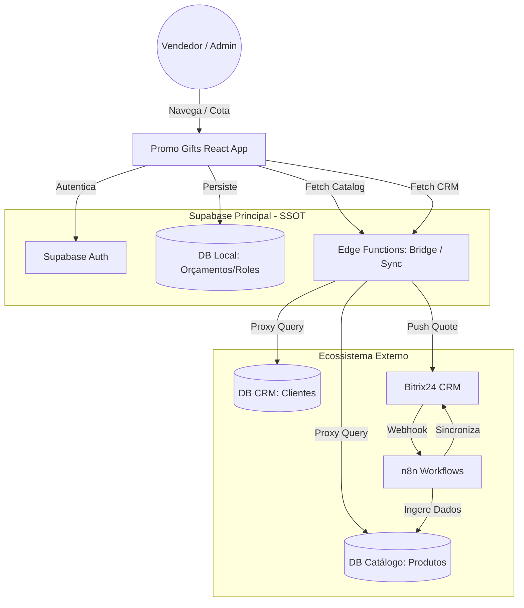

# 🌐 Diagrama de Contexto C4

Este diagrama descreve o ecossistema de alto nível do Promo Gifts e suas integrações.

## Entidades Principais
- **User**: Atua no front-office (venda) ou back-office (gestão).
- **Promo Gifts App**: Integrador de dados via Federação de Bancos.
- **n8n**: O "maestro" do backend, garantindo que o catálogo esteja sempre atualizado via APIs de fornecedores.
- **Bitrix24**: Sistema de registro de oportunidades e funil de vendas.
