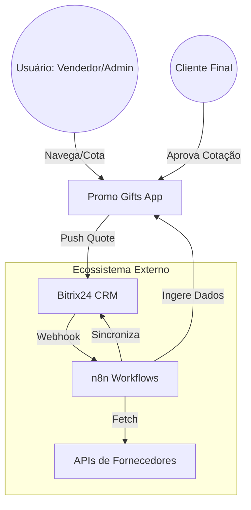
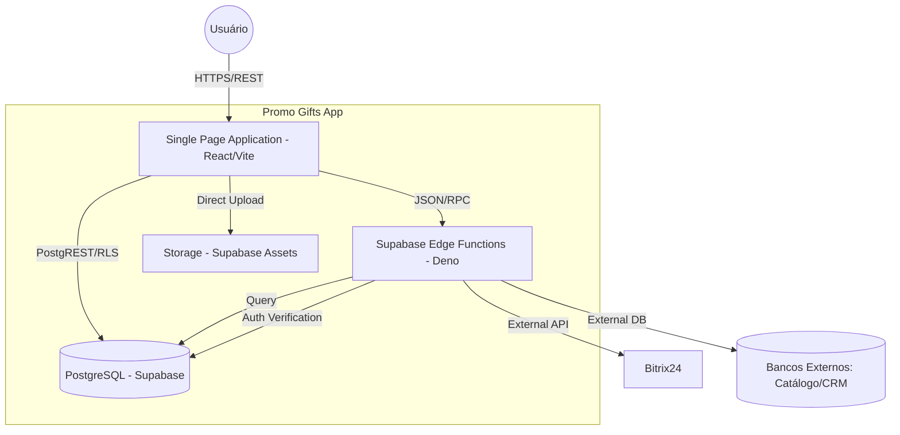
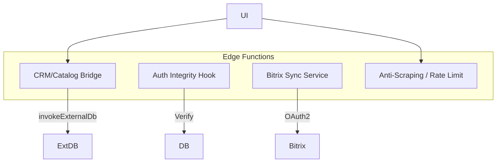

# 🌐 Diagrama C4 — Arquitetura do Sistema

Este documento descreve a arquitetura do Promo Gifts em múltiplos níveis de detalhe (C4 Model).

## Nível 1: Contexto do Sistema
Descreve o ecossistema de alto nível e suas integrações.

---

## Nível 2: Contêineres
Detalha os componentes internos do Promo Gifts App.

---

## Nível 3: Componentes (Edge Functions)
Detalha a lógica interna das Edge Functions.

## Entidades Principais
- **User**: Atua no front-office (venda) ou back-office (gestão).
- **SPA (React)**: Container de interface, gerencia estado complexo e caching (React Query).
- **Edge Functions**: Camada de federação de dados e segurança, protegendo chaves de bancos externos.
- **DB Local**: Mantém orçamentos, roles, configurações e cache de integridade.
- **n8n**: O "maestro" do backend, garantindo que o catálogo esteja sempre atualizado via APIs de fornecedores.
