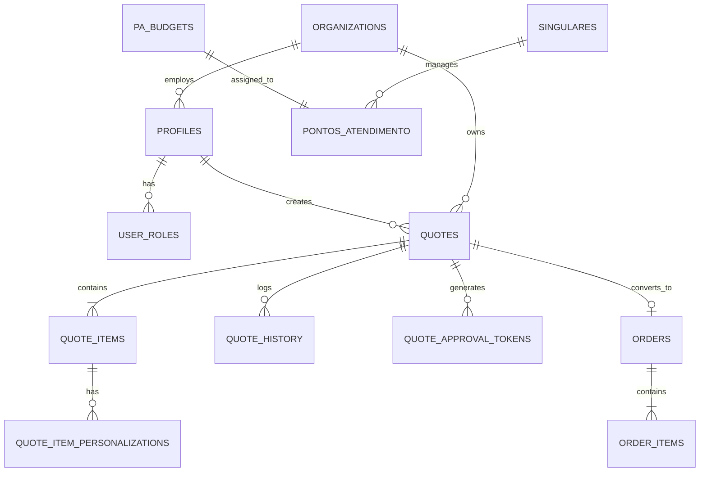

# 🗄️ Diagrama Entidade-Relacionamento (ER)

Este diagrama representa as tabelas principais do banco de dados **SSOT (Local)** e seus relacionamentos.

## Tabelas Principais

### Núcleo de Vendas
- **quotes**: Orçamentos gerados por vendedores (Status: draft, pending, approved...).
- **quote_items**: Produtos vinculados ao orçamento (Referenciam `product_id` do catálogo externo).
- **quote_item_personalizations**: Detalhes de gravação/técnica para cada item.
- **orders**: Pedidos aprovados e prontos para faturamento.

### Organização Sicoob
- **singulares**: Unidades centrais/cooperativas.
- **pontos_atendimento (PA)**: Unidades de ponta que realizam pedidos.
- **pa_budgets**: Limites de verba e alçada por PA/Mês.

### Segurança e Governança
- **profiles**: Dados estendidos do usuário Supabase Auth.
- **user_roles**: Papéis na hierarquia (dev, supervisor, agente).
- **quote_history**: Audit log completo de mudanças em orçamentos.
- **admin_audit_log**: Log de ações administrativas sensíveis.
