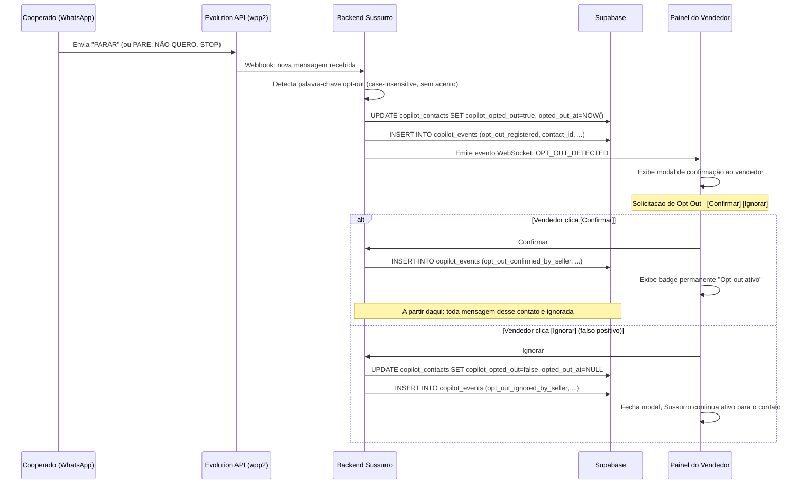

# E027 — Fluxo de Opt-Out

**Fase:** F03 — Conformidade, LGPD e Regras do WhatsApp  
**Data:** 2026-10-16  
**Status:** Rascunho

---

## 1. Diagrama do Fluxo Completo (Mermaid)



---

## 2. Diagrama ASCII

```
Cooperado          Evolution API    Backend Sussurro    Supabase         Painel Vendedor
    |                   |                  |                |                  |
    |-- "PARAR" ------->|                  |                |                  |
    |                   |-- webhook ------->|                |                  |
    |                   |                  |-- UPDATE ------>|                  |
    |                   |                  |-- INSERT ------>|                  |
    |                   |                  |-- WebSocket -------------------------------->
    |                   |                  |                |   [Modal confirmacao]       |
    |                   |                  |                |   [Confirmar] [Ignorar]     |
    |                   |                  |                |                             |
    |                   |                  |<-- confirmar -----------------------------------
    |                   |                  |-- INSERT ------>|                  |
    |                   |                  |                |   [Badge opt-out ativo]     |
    |   (mensagens futuras serao ignoradas pelo Sussurro)                       |
    |                   |                  |                |                             |
    |                   |                  |<-- ignorar (falso positivo) ---------------------
    |                   |                  |-- UPDATE copilot_opted_out=false ->|            |
    |                   |                  |-- INSERT opt_out_ignored ------>|               |
    |                   |                  |                |   [Modal fecha, Sussurro segue ativo]
```

---

## 3. Palavras-Chave Aceitas

```typescript
// src/copilot/opt-out-detector.ts
const OPT_OUT_KEYWORDS = [
  'parar', 'pare', 'nao quero', 'cancelar', 'stop',
  'sair', 'remover', 'desativar', 'desabilitar',
];

export function isOptOutRequest(text: string): boolean {
  const normalized = text
    .toLowerCase()
    .trim()
    .normalize('NFD')
    .replace(/[̀-ͯ]/g, '');

  // \b evita casar "pare" dentro de "compare", "parecer" etc.
  return OPT_OUT_KEYWORDS.some(keyword =>
    new RegExp(`\\b${keyword}\\b`).test(normalized),
  );
}
```

---

## 4. Registro Auditável em `copilot_events`

```sql
-- Evento de detecção automática. Este evento tem retenção de 5 anos
-- (nota de E024) — por isso event_data guarda só a palavra-chave
-- detectada, nunca a mensagem inteira: "pare de analisar, meu CPF é..."
-- manteria um CPF (ou outro dado sensível) retido muito além dos 90 dias
-- definidos para o conteúdo bruto das mensagens.
INSERT INTO copilot_events (
  contact_id, conversation_id,
  event_type,   -- 'opt_out_detected'
  event_data,   -- {"detected_keyword": "parar"} — NUNCA trigger_message
  channel, created_at
) VALUES (...);

-- Evento de confirmação pelo vendedor
INSERT INTO copilot_events (
  contact_id, conversation_id, actor_id,
  event_type,   -- 'opt_out_confirmed'
  event_data,   -- {"confirmed_by_seller_id": "uuid"}
  channel, created_at
) VALUES (...);

-- Evento de falso positivo descartado pelo vendedor (reverte copilot_opted_out)
INSERT INTO copilot_events (
  contact_id, conversation_id, actor_id,
  event_type,   -- 'opt_out_ignored'
  event_data,   -- {"ignored_by_seller_id": "uuid", "original_trigger_message": "..."}
  channel, created_at
) VALUES (...);
```

---

## 5. Interface do Painel

```html
<!-- Badge permanente após opt-out confirmado -->
<div class="opt-out-badge" role="alert">
  Opt-out ativo — analise de IA desativada para este contato.
  <a href="/copilot/contacts/{id}/opt-in">Reativar (requer confirmacao do cooperado)</a>
</div>

<!-- Area de sugestoes bloqueada -->
<div class="suggestions-blocked">
  <p>Sugestoes de IA desativadas para este contato.</p>
  <p>O cooperado solicitou opt-out em {data}.</p>
</div>
```

---

## 6. Fluxo de Re-opt-in

```
Cooperado envia: "ATIVAR", "QUERO", "SIM", "REATIVAR"
        ↓
Backend detecta palavra-chave de opt-in
        ↓
Painel exibe: "Cooperado deseja reativar analise de IA — confirmar?"
        ↓
Vendedor confirma
        ↓
UPDATE copilot_contacts SET copilot_opted_out = false
INSERT INTO copilot_events (opt_in_restored)
Badge opt-out removido do painel
```

---

## 7. SLA de Processamento

| Etapa | Tempo máximo |
|-------|-------------|
| Detecção da palavra-chave | < 5 segundos |
| Atualização do banco | < 2 segundos |
| Notificação ao painel | < 10 segundos |
| Cessação do processamento | Imediata (próxima mensagem) |
| Confirmação pelo vendedor | < 24 horas |

---

## Referências

- E023 — Mecanismo de Consentimento
- E028 — Trilha de Auditoria
- LGPD art. 18, VI (revogação do consentimento)
- WhatsApp Business Policy — opt-out obrigatório em 24h
