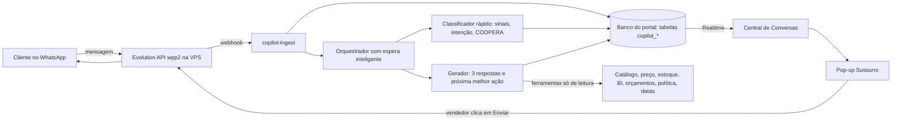

# Sussurro: copiloto de vendas em tempo real — plano de implementação em 150 etapas

> **Versão 1.0, 16/10/2026. Este documento é só o plano: nenhuma etapa foi executada.** O ponto de partida é o código de `main` no commit `942de1b`. Antes de cada fase, os fatos citados aqui precisam ser conferidos de novo.

## A ideia em uma frase

**A IA sussurra, o vendedor fala.** Dentro da Central de Conversas, um pop-up de IA acompanha cada mensagem do cliente em tempo real. Ele lê o momento do negócio, mostra o que ainda falta saber, sugere a próxima pergunta e três respostas prontas e oferece ações de um clique (mockup com a logo do cliente, kit, orçamento, dossiê para a diretoria), sempre com fonte para cada número. O Sussurro não manda nada sozinho: quem fala com o cliente é sempre o vendedor.

Esse desenho segue a regra da Meta que, desde 15/01/2026, proíbe chatbots de propósito geral na plataforma comercial do WhatsApp. A IA aqui ajuda o vendedor e não conversa com o cliente.

## Ponto de partida verificado no código

Hoje o portal **não tem** painel de conversa com o cliente nem análise de conversa em tempo real. O WhatsApp aparece só como link de compartilhamento de orçamento (`src/components/quotes/QuoteWhatsAppShare.tsx`). Mesmo assim, já existe muita coisa que o Sussurro vai reaproveitar sem reescrever:

| Já existe | Uso no Sussurro |
|---|---|
| `_shared/ai-usage.ts` (cota, registro de uso, custo e modelos reservas) | Toda chamada de IA passa por aqui: teto de gasto e troca de modelo |
| `bi-copilot` e hooks de BI (`useClientHealthScore`, afinidade, sazonalidade, comparação com o setor) | Contexto do cliente e da cooperativa |
| `expert-chat` e `semantic-search` (pg_trgm, cache de 5 min) | Busca de produto e conhecimento |
| `commemorative-dates` | Ganchos de data e contagem regressiva |
| `generate-mockup`, `analyze-logo-colors`, `sicoob-artwork-register` | Mockup relâmpago com a logo do cliente |
| `visual-search` | Foto que o cliente manda vira produto do catálogo |
| ElevenLabs Scribe (`elevenlabs-scribe-token`) | Áudio do cliente vira texto |
| `kit-ai-builder`, `sicoob-kit-quote`, `QuoteBuilderPage` | Kits e orçamento a partir da conversa |
| `bi-share-dossier`, `PublicDossierPage` | Dossiê para o comitê de compra |
| `discount_approval_requests` e badge de aprovações | Pedido de desconto dentro da conversa |
| `quote-followup-reminders`, `send-notification`, `send-scheduled-reports` | Retornos, avisos e relatórios |
| `webhook-inbound` (HMAC, `inbound_webhook_events`) | Padrão para receber a Evolution |
| `crm-db-bridge` (disjuntor `getBreaker`), `cnpj-lookup`, `bitrix-sync`, `sync-quote-bitrix` | Vínculo com cliente, CRM e Bitrix |
| `feature_flags`, `admin-audit-hook`, `rls-integration-tests`, `system-healthcheck` | Liga e desliga, auditoria, testes de acesso e monitoramento |

## Um minuto com o Sussurro

*Cenário ilustrativo: nomes, datas e números são fictícios.*

**09:02.** Ana, analista de marketing de uma cooperativa singular, escreve: *"Bom dia! Precisamos de brinde pra AGO, uns 300 cooperados. Vocês têm squeeze?"*

**09:02 e mais 3 segundos.** O ícone do Sussurro fica laranja.
- **Radar:** interesse potencial. Sinais: ocasião (AGO), quantidade (300), produto (squeeze).
- **COOPERA:** **C** preenchido (AGO), **E** parcial (squeeze, 300). Ainda faltam **O**rçamento, **O**casião e prazo, **P**essoas e **A**provação.
- **Sugestão consultiva:** *"Bom dia, Ana! Squeeze é uma ótima pedida pra AGO 👏 Pra eu já te mandar opções com a logo de vocês: a assembleia é em que dia? Assim garanto produção e entrega com folga."*
- **Por que essa sugestão:** saber a data antes de falar de preço, com uma pergunta só.
- **Ação de um clique:** *Gerar mockup do squeeze com a logo da cooperativa (arte já aprovada no portal).*

**09:06.** Ana: *"Dia 26/03. Mas ano passado achamos caro."*
- **Radar:** objeção de preço.
- **Memória do cliente:** comprou garrafas na AGO anterior e reclamou do frete.
- **Contagem regressiva:** para entregar em 26/03, a arte precisa ser aprovada até a data-limite calculada pela política de produção, com selo ✔ *verificado*.
- **Sugestão:** perguntar a verba e oferecer três kits (econômico, equilibrado e premium).
- **Alerta discreto:** não oferecer desconto agora; a alçada fica guardada para o fechamento.

**09:11.** Ana: *"Vou levar pra diretoria na quinta."*
- **Sinal:** "levar ao comitê". O campo **P**essoas recebe "Diretoria: decide".
- **Ação:** *Gerar dossiê para a diretoria*: proposta, mockups e prazos num link com validade e aviso de abertura.
- **Próximo passo sugerido:** *"Posso te chamar na sexta às 10h pra saber o que a diretoria achou?"* Ao aceitar, nasce uma tarefa no Bitrix.

**Sexta, 16h.** Ana não respondeu.
- O termômetro cai e aparece o alerta "esfriando".
- **Retorno com valor, em vez de "e aí?":** *"Ana, deixei pronto o mockup em azul e verde com a logo de vocês pra facilitar na diretoria 😉 Quer que eu já reserve a produção pra 26/03?"*

## Princípios que não se negociam

1. **Nenhum envio automático.** A IA sugere e o vendedor revisa e envia (E021).
2. **Número só com fonte.** Preço, prazo e estoque saem de consulta ao sistema. Número sem fonte recebe selo vermelho e não pode ser enviado em um clique (E078, E117).
3. **Bancos com papéis fixos.** O catálogo `doufsxqlfjyuvxuezpln` continua só de consulta. Os dados do copiloto ficam no banco do portal `cfmzkthhgliqelozlmwu`.
4. **Pergunta antes de preço, uma por vez.** O Sussurro conduz a descoberta e não transforma a conversa num interrogatório.
5. **Toda sugestão explica o motivo:** qual sinal, qual regra e qual fonte (E086).
6. **Reaproveitar antes de criar.** Diff mínimo sobre o que já funciona.
7. **Privacidade desde o desenho.** Dados pessoais são mascarados antes do modelo, e o RIPD vem antes da primeira conversa real (E022, E024).
8. **Medir contra a nossa linha de base.** Números de fornecedores e de estudos de ligações telefônicas são hipóteses a testar, não metas.
9. **Desligável em menos de 1 minuto**, por vendedor ou para todos (E141).

## O Método COOPERA

Este é o método de qualificação próprio da Promo Brindes. Ele adapta MEDDPICC, BANT e SPIN à compra institucional de cooperativas. O Sussurro preenche as letras ao vivo, sempre com a frase do cliente que comprova, e sugere a pergunta que falta.

| Letra | Significa | Pergunta-guia (exemplo) | Evidência típica |
|---|---|---|---|
| **C** | Contexto: por que agora | "O que vocês querem que o cooperado sinta ao receber?" | "é pra AGO" |
| **O** | Orçamento: verba, quem paga, alçada | "Vocês já reservaram uma verba para essa ação?" | "temos uns 15 mil" |
| **O** | Ocasião e prazo | "Qual a data do evento e onde precisa ser entregue?" | "26/03, na sede" |
| **P** | Pessoas: quem decide, influencia e aprova a arte | "Além de você, quem participa da decisão?" | "vou levar pra diretoria" |
| **E** | Escopo: produto, quantidade, personalização, distribuição | "Quantas unidades e como divide entre os PAs?" | "300, em 6 PAs" |
| **R** | Risco: objeção, concorrente, problema anterior | "Teve algo em compras anteriores que vocês não querem repetir?" | "ano passado atrasou" |
| **A** | Aprovação: próximo passo com data | "Qual o próximo passo e quando falamos de novo?" | "quinta tenho reunião" |

## Arquitetura

**Por que nessa ordem:**
- A entrada de mensagens não depende da IA. Se o provedor cair, a conversa continua (E119, E129).
- A análise barata roda a cada mensagem. A geração de texto, que é mais cara, só roda quando vale a pena (E124).
- Tudo que o pop-up mostra vem de um estado único por conversa (`copilot_insights`), publicado por Realtime (E060).

### Dados novos (banco do portal)

| Tabela | Guarda | Quem vê |
|---|---|---|
| `copilot_contacts` | Número, vínculo com cliente e cooperativa | Vendedor dono, gestão |
| `copilot_conversations` | Conversa, vendedor atribuído, estado | Vendedor dono, gestão |
| `copilot_messages` | Mensagens e mídias (Storage privado) | Vendedor dono, gestão |
| `copilot_insights` | Radar, COOPERA, termômetro, resumo (com versão) | Vendedor dono, gestão |
| `copilot_suggestions` | Sugestões, versão do prompt, modelo, fontes | Vendedor dono, gestão |
| `copilot_feedback` | Aceitou, editou, descartou e motivo | Vendedor dono, gestão |
| `copilot_events` | Trilha técnica para auditoria | Admin |

### Metas de tempo propostas (percentil 95, a confirmar no modo sombra)

| Trecho | Meta |
|---|---|
| Mensagem do cliente até aparecer no painel | ≤ 2 s |
| Até Radar e COOPERA atualizados | ≤ 4 s |
| Até a primeira sugestão começar a aparecer | ≤ 6 s |
| Pausa na digitação até o texto fantasma | ≤ 1 s |
| Clique em "gerar mockup" até o mockup | ≤ 60 s |

## Como vamos saber se funcionou

- **Métrica principal:** valor de orçamentos aprovados que nasceram de conversas assistidas, comparado à linha de base da E003.
- **Métricas de proteção:** tempo da primeira resposta, erro factual (meta: zero número sem fonte enviado), satisfação do vendedor e reclamação de cliente.
- **Uso da IA:** taxa de aceite, **quanto o vendedor editou** (distância de edição; o Zendesk conta sugestão editada como aceita e nós medimos o tamanho da edição), descarte com motivo e tempo até enviar.
- **Hipóteses de pesquisa a testar com nossos dados (E106), sem virar meta cega:**
  - Responder dentro de 1 hora aumenta muito a chance de qualificar o contato (estudo da HBR com 1,25 milhão de leads, citado em fontes secundárias; conferir o original).
  - Os melhores vendedores falam menos e ouvem mais (Gong, em ligações, não em WhatsApp).
  - Na descoberta, menos perguntas e mais certeiras funcionam melhor que um interrogatório (fontes secundárias sobre dados do Gong).

## Decisões que são do Joaquim

Os três portões ficam fora do código. Sem decisão registrada, as etapas que dependem deles não começam.

**Portão G1 (E009)**

| Decisão | Opções | Recomendação |
|---|---|---|
| Canal do WhatsApp | **A)** Evolution `wpp2`, que já opera: sem custo por mensagem, mas não é oficial e o número pode ser bloqueado. **B)** API oficial da Meta em coexistência (o mesmo número no app Business e na API): é oficial e cobra por mensagem conforme a tabela vigente da Meta. | Começar com **A**, só lendo mensagens e enviando por clique humano, com o adaptador da E032 pronto para migrar para **B** se houver bloqueio ou quando o volume crescer. |
| Teto mensal de custo de IA | Valor em R$ | Definir um teto provisório agora, com base em benchmarks de mercado (não no teste da E122, que depende transitivamente deste próprio G1). Recalibrar com os preços reais de E126 assim que o teste de modelos terminar. Ao bater o teto, o sistema mostra só o Radar e para de gerar texto (E125). |
| Vendedores do piloto | Quem participa | Um top, um mediano e um novo, para medir o ganho em perfis diferentes. |
| Guarda das conversas | Meses | 12 meses de mensagens e 24 meses de indicadores sem texto, sujeito ao RIPD (E022). |

**Portão G2 (E143):** liberar o piloto com base no relatório do modo sombra.

**Portão G3 (E147):** seguir, ajustar ou parar com base nos números reais do piloto.

## Riscos principais e onde são tratados

| Risco | Efeito no negócio | Tratamento |
|---|---|---|
| Número bloqueado pela Meta (canal não oficial) | Atendimento para | E028, E032: adaptador e plano B na API oficial |
| IA inventa preço ou prazo | Prejuízo e perda de confiança | E068, E078, E117: selo de verificação e checagem pós-geração |
| Vendedor vira copia-e-cola | Atendimento robotizado | Três opções, Dojo, coaching e métrica de edição (E061, E100, E107, E131) |
| Excesso de alertas | O time desliga o Sussurro | E082, E087: modo discreto e limite de interrupção |
| Vazamento de dados de cooperado | Risco legal e de marca | E022 a E026, E029, E036 |
| Custo de IA fora de controle | Margem corroída | E122 a E126: modelo por tarefa, cache, gatilhos e teto |
| Cliente tenta manipular a IA pela mensagem | Sugestão indevida | E080, E116: mensagem tratada como dado e red team |
| Baixa adoção | Investimento parado | Piloto com perfis variados, tour e preferências (E088, E089, E142) |
| Dependência de um único provedor de IA | Indisponibilidade ou preço | Camada `_shared/ai-usage.ts` com modelos reservas (E122) |

## Regra para dar uma etapa como concluída

Uma etapa só está **concluída** quando o critério de aceite foi verificado com evidência: PR, consulta, teste, registro de decisão ou medição em produção. Código existir não é pronto. Etapa com DDL em produção, CI, segredos ou infraestrutura fica em PR aberta para aprovação do Joaquim. Os números das etapas identificam o trabalho e não indicam ordem de execução. A ordem real vem das dependências, e o que não depende de nada pode correr em paralelo.

**Camadas:** Negócio, Vendas, Dados, Jurídico, Segurança, Design, Banco, Edge (funções), Front, IA, Infra, Ops, QA.

## As 15 fases

| Fase | Etapas | Resultado esperado |
|---|---|---|
| F01. Descoberta e tese comercial | E001–E010 | Problema, linha de base e decisões de negócio conhecidos antes de escrever código. |
| F02. Método COOPERA e cérebro de vendas | E011–E020 | O conhecimento que a IA usa existe, tem dono e está escrito em formato que a máquina consegue ler. |
| F03. Conformidade, LGPD e regras do WhatsApp | E021–E030 | A função nasce dentro da lei e das regras da Meta; nada vai para produção sem base legal escrita. |
| F04. Canal WhatsApp e modelo de dados | E031–E040 | As mensagens entram, ficam guardadas com segurança e aparecem para a pessoa certa. |
| F05. Central de Conversas (o chat panel) | E041–E050 | O vendedor atende todos os clientes de uma tela só, no computador ou no celular. |
| F06. Motor de análise em tempo real | E051–E060 | A cada mensagem, o sistema entende o momento do negócio em poucos segundos. |
| F07. Gerador de respostas e próxima melhor ação | E061–E070 | O vendedor recebe a resposta certa e o passo certo, com motivo e fonte. |
| F08. Ferramentas e verdade dos números | E071–E080 | A IA consulta o sistema antes de afirmar; todo número vem com fonte. |
| F09. O pop-up Sussurro | E081–E090 | Ajuda que aparece na hora certa e some quando não é necessária. |
| F10. Superpoderes de venda | E091–E100 | O que faz o vendedor parecer ter uma agência inteira trabalhando com ele durante a conversa. |
| F11. Gestor: escuta silenciosa e coaching | E101–E110 | O gerente acompanha o time ao vivo e treina com casos reais, sem microgerenciar. |
| F12. Qualidade e segurança da IA | E111–E120 | Toda mudança de prompt ou modelo passa por prova antes de chegar ao vendedor. |
| F13. Velocidade, custo e observabilidade | E121–E130 | Rápido o bastante para a conversa, barato o bastante para escalar, visível o bastante para consertar. |
| F14. Aprendizado contínuo e integrações | E131–E140 | O Sussurro fica melhor toda semana e conversa com o resto da operação. |
| F15. Piloto, lançamento e escala | E141–E150 | Vendedores reais, clientes reais, números reais. |

## As 150 etapas

### F01 · Descoberta e tese comercial (E001–E010)

*Resultado: Problema, linha de base e decisões de negócio conhecidos antes de escrever código.*

#### E001 · Escrever a tese de valor em uma página

`Negócio` · depende de: —

- **O quê:** Entrevistar o Joaquim e três vendedores (um top, um mediano, um novo) e fixar três resultados de negócio: responder mais rápido, transformar mais conversas em orçamento e espalhar a abordagem do melhor vendedor para todo o time. Registrar o que fica fora: a IA nunca conversa sozinha com o cliente.
- **Aceite:** Página aprovada pelo Joaquim com os três resultados, o público (vendedores da Promo Brindes atendendo cooperativas Sicoob) e a lista explícita do que não será feito.

#### E002 · Mapear a jornada real de venda no WhatsApp

`Negócio` · depende de: E001

- **O quê:** Reconstituir, a partir de conversas reais do `wpp2` (amostra anonimizada), negócios do Bitrix e orçamentos do portal, o caminho do primeiro "bom dia" até o pedido entregue: etapas, tempos, quem participa e onde a venda morre.
- **Aceite:** Mapa da jornada com tempo mediano por etapa e os cinco maiores pontos de perda, cada um ligado a exemplos reais.

#### E003 · Medir a linha de base dos últimos 90 dias

`Dados` · depende de: E002

- **O quê:** Calcular por vendedor: tempo da primeira resposta, tempo médio de resposta, % de conversas que viram orçamento, % de orçamentos aprovados, ticket médio e ciclo de venda. Nada estimado: só número com consulta reproduzível.
- **Aceite:** Consultas versionadas em `docs/` e tabela de baseline revisada; métricas sem fonte ficam marcadas como "não mensurável hoje".

#### E004 · Dissecar o melhor vendedor

`Negócio` · depende de: E002

- **O quê:** Ler as conversas ganhas dos dois vendedores com maior conversão e extrair padrões: que perguntas fazem, quando falam de preço, quando mandam mockup, como recuperam o cliente que sumiu e como fecham o próximo passo.
- **Aceite:** Lista com pelo menos 15 padrões, cada um com trecho real anonimizado e hipótese de por que funciona.

#### E005 · Desenhar as personas do comprador cooperativista

`Negócio` · depende de: E002

- **O quê:** Descrever quem compra brinde numa cooperativa: gerente de PA, analista de marketing da singular, diretoria/conselho, suprimentos e a central. Para cada uma: o que quer, do que tem medo, quem aprova e qual linguagem usa.
- **Aceite:** Cinco personas validadas por dois vendedores, com exemplos de mensagens típicas de cada uma.

#### E006 · Montar o calendário cooperativista de ocasiões

`Negócio` · depende de: E001

- **O quê:** Listar as ocasiões que geram compra: AGO (nas cooperativas de crédito, nos quatro primeiros meses do ano; confirmar base legal), Dia Internacional do Cooperativismo (1º sábado de julho), Dia C (último sábado de agosto; em 2026 foi 29/08), aniversário da cooperativa, inauguração de PA, campanhas de captação, fim de ano e datas do varejo. Cruzar com a função `commemorative-dates`.
- **Aceite:** Calendário com fonte para cada data; o que não tiver fonte oficial fica marcado como "confirmar".

#### E007 · Benchmark de mercado: o que copiar e o que superar

`Negócio` · depende de: E001

- **O quê:** Comparar Gong, Balto, Cresta, Zendesk Copilot, Intercom Copilot, Salesforce/Microsoft e Blip em 20 capacidades (transcrição, próxima melhor ação, objeções, coaching, aceite de sugestão). Registrar que números de ganho divulgados por fornecedores são autodeclarados.
- **Aceite:** Matriz capacidades × fornecedores × nosso escopo, com três diferenciais que nenhum deles tem para o mercado de brindes cooperativos.

#### E008 · Definir a métrica principal e as métricas de proteção

`Dados` · depende de: E003

- **O quê:** Métrica principal: valor de orçamentos aprovados originados em conversas assistidas. Proteção: tempo de primeira resposta, taxa de aceite de sugestão, taxa de erro factual, satisfação do vendedor e reclamação de cliente.
- **Aceite:** Árvore de métricas com fórmula, fonte e dono de cada indicador.

#### E009 · Portão G1: decisões do dono

`Negócio` · depende de: E003, E007

- **O quê:** Levar ao Joaquim quatro escolhas: canal (Evolution `wpp2` ou API oficial em coexistência), teto mensal de custo de IA, vendedores do piloto e prazo de guarda das conversas. Cada escolha com custo, risco e recomendação.
- **Aceite:** Registro de decisão assinado pelo Joaquim; sem G1 não começa nenhuma etapa de banco ou de canal.

#### E010 · Roteiro com marcos e critérios de saída

`Negócio` · depende de: E009

- **O quê:** Definir três marcos: M1 Sombra (IA analisa, ninguém vê), M2 Piloto (dois ou três vendedores) e M3 Geral. Cada marco com critério objetivo de passagem e de recuo.
- **Aceite:** Roteiro publicado com critérios mensuráveis de avanço e de desligamento por marco.

### F02 · Método COOPERA e cérebro de vendas (E011–E020)

*Resultado: O conhecimento que a IA usa existe, tem dono e está escrito em formato que a máquina consegue ler.*

#### E011 · Criar o Método COOPERA

`Vendas` · depende de: E004, E005

- **O quê:** Adaptar MEDDPICC, BANT e SPIN à compra cooperativista de brindes em sete letras: Contexto (por que agora), Orçamento (verba, quem paga, alçada), Ocasião e prazo (data do evento, entrega), Pessoas (quem decide, influencia e aprova a arte), Escopo (produto, quantidade, personalização, distribuição por PA), Risco (objeções, concorrente, problema anterior) e Aprovação (próximo passo com data).
- **Aceite:** Definição de cada letra com critério objetivo de "preenchido", aprovada por dois vendedores e pelo Joaquim.

#### E012 · Banco de "próxima melhor pergunta"

`Vendas` · depende de: E011

- **O quê:** Escrever de cinco a oito perguntas abertas por letra do COOPERA, no tom de quem atende cooperativa, seguindo a lógica SPIN (situação, problema, implicação, necessidade). Regra: no máximo uma ou duas perguntas por mensagem, para não virar interrogatório.
- **Aceite:** Pelo menos 40 perguntas revisadas pelos melhores vendedores, cada uma ligada à letra que ajuda a preencher.

#### E013 · Biblioteca de objeções com respostas aprovadas

`Vendas` · depende de: E004

- **O quê:** Catalogar objeções reais ("tá caro", "já temos fornecedor", "preciso ver com a diretoria", "o prazo não dá", "a central já negociou", "verba só ano que vem", "quero amostra", "a marca Sicoob tem regras") com três respostas aprovadas, a evidência que cada uma exige e quando não usar.
- **Aceite:** Pelo menos 25 objeções documentadas; nenhuma resposta promete preço, prazo ou desconto sem fonte.

#### E014 · Regras de marca e de promessa

`Vendas` · depende de: E011

- **O quê:** Transformar em regra o que pode e o que não pode ser dito sobre aplicação da marca Sicoob, aprovação de arte e despesa, mantendo o princípio do portal: aprovar arte não é autorizar a despesa.
- **Aceite:** Arquivo de regras legível por máquina, revisado pelo responsável de marca, com casos permitidos e proibidos.

#### E015 · Política comercial em formato de máquina

`Vendas` · depende de: E011

- **O quê:** Codificar faixas de desconto por alçada (ligadas a `discount_approval_requests`), pedido mínimo, prazo de produção por técnica de personalização, regras de frete e validade de proposta.
- **Aceite:** Arquivo versionado com testes de leitura; a IA não consegue sugerir desconto acima da alçada de quem está atendendo.

#### E016 · Glossário cooperativista

`Vendas` · depende de: E005

- **O quê:** Explicar à IA termos como singular, central, confederação, PA, cooperado, AGO/AGE, conselho de administração e FATES. A IA nunca afirma que uma compra pode usar FATES; isso depende da regra vigente e da decisão da cooperativa.
- **Aceite:** Glossário com pelo menos 50 termos, cada um com definição, exemplo de uso e cuidados.

#### E017 · Guia de tom de voz no WhatsApp

`Vendas` · depende de: E004

- **O quê:** Definir como a Promo Brindes fala: formalidade que acompanha o cliente, uso de emoji, saudação por horário, mensagens curtas, áudio só quando o cliente usa áudio e nada de textão.
- **Aceite:** Guia com 20 pares "certo e errado" tirados de conversas reais.

#### E018 · Coleção de mensagens que venderam

`Dados` · depende de: E004, E022

- **O quê:** Selecionar 200 trechos de conversas ganhas, anonimizados e rotulados por situação (abertura, descoberta, objeção, fechamento, recuperação), para servir de exemplo à IA e de material de treino ao time.
- **Aceite:** Conjunto rotulado com base legal validada; nenhum trecho com dado pessoal identificável.

#### E019 · Base de conhecimento consultável

`IA` · depende de: E013, E015, E016

- **O quê:** Indexar política, objeções, glossário, cases, FAQ de produção e produtos-âncora por ocasião, reaproveitando o mecanismo de `semantic-search` (pg_trgm) e acrescentando busca vetorial só se o teste mostrar ganho.
- **Aceite:** Em 50 perguntas de teste, o documento certo aparece entre os três primeiros em pelo menos 90% dos casos.

#### E020 · Governança do conhecimento

`Ops` · depende de: E019

- **O quê:** Cada fonte tem dono, data de revisão e validade. Conteúdo vencido sai da busca automaticamente; revisão mensal com os vendedores.
- **Aceite:** Campo de validade e rotina de desativação testados; painel mostra o que vence nos próximos 30 dias.

### F03 · Conformidade, LGPD e regras do WhatsApp (E021–E030)

*Resultado: A função nasce dentro da lei e das regras da Meta; nada vai para produção sem base legal escrita.*

#### E021 · Princípio inegociável: a IA sussurra, o vendedor fala

`Segurança` · depende de: E001

- **O quê:** Nenhuma mensagem chega ao cliente sem clique humano. A IA sugere, o vendedor revisa e envia. Isso é requisito bloqueante, não preferência.
- **Aceite:** Teste automatizado prova que não existe caminho de envio sem ação do usuário logado.

#### E022 · Base legal e relatório de impacto (RIPD)

`Jurídico` · depende de: E009

- **O quê:** Com o encarregado de dados e o jurídico, definir finalidade (apoio ao atendimento comercial), base legal (a validar entre procedimentos preliminares de contrato e legítimo interesse com teste de balanceamento), minimização e riscos.
- **Aceite:** RIPD assinado; sem ele nenhuma conversa real é enviada a modelo de IA.

#### E023 · Transparência ao cliente

`Jurídico` · depende de: E022

- **O quê:** Atualizar o aviso de privacidade e, se o jurídico pedir, a mensagem de primeiro contato, informando o uso de ferramentas de apoio ao atendimento, sem prometer o que não fazemos.
- **Aceite:** Texto aprovado e publicado; data de publicação registrada.

#### E024 · Mascarar dados pessoais antes da IA

`Segurança` · depende de: E022

- **O quê:** Antes de qualquer chamada ao modelo, trocar CPF, CNPJ de pessoa física, telefone, e-mail, dados bancários e endereço por marcadores; a reversão só acontece no servidor ao montar a sugestão.
- **Aceite:** Teste com 100 mensagens sintéticas sem nenhum dado pessoal no conteúdo enviado ao provedor.

#### E025 · Contrato com o provedor de IA

`Jurídico` · depende de: E022

- **O quê:** Garantir por escrito: dados não usados para treino, retenção zero ou mínima, localização e acordo de tratamento de dados.
- **Aceite:** Termos arquivados para cada provedor usado; provedor sem termos não entra.

#### E026 · Retenção e descarte

`Banco` · depende de: E022

- **O quê:** Aplicar o prazo decidido no G1: mensagens por X meses, indicadores agregados por mais tempo, e atender pedido de eliminação do titular.
- **Aceite:** Rotina de expurgo testada em ambiente de teste e procedimento de atendimento ao titular documentado.

#### E027 · Conformidade com a política do WhatsApp Business

`Jurídico` · depende de: E021

- **O quê:** Desde 15/01/2026 a Meta proíbe chatbots de propósito geral na plataforma comercial. O Sussurro é apoio interno ao vendedor e não conversa com o cliente; manter assim, sem disparo em massa e respeitando quem pede para sair.
- **Aceite:** Checklist de conformidade revisado e anexado ao RIPD.

#### E028 · Risco do canal não oficial

`Segurança` · depende de: E009

- **O quê:** A Evolution com Baileys não é a API oficial da Meta: o número pode ser bloqueado. Desenhar o plano B: o mesmo número na API oficial em modo coexistência (app e API juntos), atrás do mesmo adaptador.
- **Aceite:** Análise de risco aprovada e adaptador desenhado de modo que trocar de canal não mexa no resto do sistema.

#### E029 · Detector de dado sensível de cooperado

`Segurança` · depende de: E024

- **O quê:** Cliente de banco cooperativo pode mandar extrato, lista de cooperados ou dado bancário. Detectar, alertar o vendedor e não guardar o anexo além do necessário.
- **Aceite:** Detector com casos de teste e alerta visível no painel.

#### E030 · Trilha de auditoria completa

`Segurança` · depende de: E021

- **O quê:** Registrar quem viu cada sugestão, quem aceitou, o que foi enviado de fato, versão do prompt e modelo usado, reaproveitando `admin-audit-hook`.
- **Aceite:** Trilha consultável por conversa, sem dado pessoal em texto aberto nos logs.

### F04 · Canal WhatsApp e modelo de dados (E031–E040)

*Resultado: As mensagens entram, ficam guardadas com segurança e aparecem para a pessoa certa.*

#### E031 · Inventário da instância `wpp2`

`Infra` · depende de: E009

- **O quê:** Levantar versão da Evolution, eventos ligados, formato do nome do evento (`MESSAGES_UPSERT` ou `messages.upsert`), envio por evento ou por URL única e comportamento de reenvio.
- **Aceite:** Payloads reais capturados e anonimizados, guardados como fixtures de teste.

#### E032 · Adaptador de canal

`Edge` · depende de: E028, E031

- **O quê:** Criar um contrato único `ChannelAdapter` (receber, enviar, mídia, status de entrega) com implementação Evolution agora e espaço para a API oficial depois.
- **Aceite:** Contrato tipado e testes de contrato rodando contra as fixtures.

#### E033 · Função de entrada `copilot-ingest`

`Edge` · depende de: E032

- **O quê:** Antes de criar a função, confirmar vaga disponível no limite de 100 Edge Functions publicadas (hoje no limite, com deploy anterior retornando HTTP 402) e liberar espaço despublicando ou removendo uma função atualmente publicada e em desuso (publicar `error-monitor` não ajuda: ele já é `source-only` e não ocupa uma das 100 vagas, então publicá-lo consumiria outra em vez de liberar). Só então: receber o webhook, validar segredo e origem (VPS), aplicar limite de tamanho, descartar repetidos pelo ID da mensagem e registrar o evento, no mesmo padrão de `webhook-inbound` (HMAC, `inbound_webhook_events`, limite de 1 MB).
- **Aceite:** Função publicada com sucesso no projeto remoto (não só local) e confirmada via `supabase_functions_list`; reenvio do mesmo evento não duplica; segredo inválido recebe 401; nada é perdido em teste de 1.000 eventos.

#### E034 · Modelo de dados no banco do portal

`Banco` · depende de: E022, E031

- **O quê:** Criar no banco `cfmzkthhgliqelozlmwu`: `copilot_contacts`, `copilot_conversations`, `copilot_messages`, `copilot_insights`, `copilot_suggestions`, `copilot_feedback` e `copilot_events`, com índices para a lista de conversas.
- **Aceite:** Migration aplicada no projeto remoto `cfmzkthhgliqelozlmwu` (não só revisada em PR) e schema das 7 tabelas confirmado via `supabase_db_list_tables`; aprovação do Joaquim registrada antes do apply (DDL em produção não tem merge automático).

#### E035 · Ligar telefone a cliente e cooperativa

`Edge` · depende de: E034

- **O quê:** Casar o número com o cliente do CRM via `crm-db-bridge` e com a organização do portal; usar `cnpj-lookup` quando aparecer CNPJ na conversa.
- **Aceite:** Pelo menos 90% dos contatos da amostra ligados automaticamente; o resto cai numa fila de vinculação manual.

#### E036 · Regras de acesso (RLS) por papel

`Banco` · depende de: E034

- **O quê:** Vendedor vê só as conversas dele; gerente e supervisor veem a equipe; admin vê tudo; as funções usam a chave de serviço só no servidor.
- **Aceite:** Casos em `rls-integration-tests` cobrindo os quatro papéis, incluindo tentativa de ler conversa alheia.

#### E037 · Importar o histórico recente

`Dados` · depende de: E034, E022, E026

- **O quê:** Trazer os últimos meses de conversas do `wpp2` para dar contexto à IA e alimentar o conjunto de avaliação, dentro da base legal definida. Só depois de E026 (prazo de retenção e rotina de descarte) existir — senão a importação cria uma cópia nova de dados pessoais sem controle de retenção.
- **Aceite:** Importação que pode rodar duas vezes sem duplicar, com contagem conferida contra a origem.

#### E038 · Guardar mídias com segurança

`Edge` · depende de: E034

- **O quê:** Áudio, imagem e documento vão para Storage privado com link assinado e verificação de duplicidade.
- **Aceite:** Mídia só abre para quem tem acesso à conversa; teste com usuário sem permissão retorna negado.

#### E039 · Enviar pelo painel e espelhar o celular

`Edge` · depende de: E032, E036

- **O quê:** A mensagem escrita no painel sai pelo adaptador com status (enviado, entregue, lido). Se o vendedor responder pelo celular, a mensagem também aparece no painel.
- **Aceite:** Em teste de 50 mensagens, a conversa no painel é idêntica à do celular.

#### E040 · Tempo real no painel

`Front` · depende de: E034, E036

- **O quê:** Assinatura de canal do Supabase Realtime por conversa, com autorização, no padrão já usado em `sicoob-orders-realtime`.
- **Aceite:** Mensagem nova aparece no painel em até 2 segundos no percentil 95 em teste controlado.

### F05 · Central de Conversas (o chat panel) (E041–E050)

*Resultado: O vendedor atende todos os clientes de uma tela só, no computador ou no celular.*

#### E041 · Rota `/conversas` em três colunas

`Front` · depende de: E040

- **O quê:** Lista de conversas, conversa aberta e o Sussurro ao lado, com carregamento sob demanda como já é feito no `ExpertChatDialog`.
- **Aceite:** Rota protegida por papel e dentro das metas de desempenho do projeto (LCP 2,5 s, INP 200 ms, CLS 0,1).

#### E042 · Lista inteligente de conversas

`Front` · depende de: E041

- **O quê:** Filtros: sem resposta, esfriando, quentes, por cooperativa, por vendedor. Ordenação padrão pela temperatura do negócio e pelo tempo de espera do cliente.
- **Aceite:** Filtros corretos com 1.000 conversas de teste e troca de filtro sem travar a tela.

#### E043 · Leitura fiel da conversa

`Front` · depende de: E041

- **O quê:** Bolhas, áudio com player e transcrição, imagem, documento, mensagem citada e status de leitura.
- **Aceite:** Os oito tipos de mensagem mais comuns aparecem iguais ao WhatsApp em teste visual.

#### E044 · Caixa de escrita completa

`Front` · depende de: E041

- **O quê:** Rascunho salvo por conversa, atalhos, emoji, anexo e agendamento de envio.
- **Aceite:** Rascunho continua lá ao trocar de conversa e ao recarregar a página.

#### E045 · Cartão do cliente no topo

`Front` · depende de: E035

- **O quê:** Cooperativa, PA, último pedido, saúde do cliente (`useClientHealthScore`), verba disponível e orçamentos abertos.
- **Aceite:** Dados batem com as telas de origem em dez clientes de teste.

#### E046 · Atribuir e transferir conversa

`Front` · depende de: E036

- **O quê:** Passar a conversa para outro vendedor com histórico e motivo.
- **Aceite:** Transferência registrada na auditoria e visível para os dois vendedores.

#### E047 · Avisos de cliente esperando

`Edge` · depende de: E040

- **O quê:** Notificação de nova mensagem e de cliente esperando mais que X minutos, via `send-notification` (PWA).
- **Aceite:** Notificação recebida em Android e iOS de teste com o app instalado.

#### E048 · Versão celular

`Front` · depende de: E043

- **O quê:** Painel usável por quem está na rua; o Sussurro vira uma gaveta que sobe de baixo.
- **Aceite:** Tarefa "responder usando sugestão" concluída no celular por três vendedores sem ajuda.

#### E049 · Acessibilidade WCAG 2.2 AA

`Front` · depende de: E043

- **O quê:** Navegação por teclado, foco visível, contraste e leitor de tela anunciando sugestão nova sem interromper (aria-live polite).
- **Aceite:** Auditoria automática sem violação crítica e teste manual com teclado aprovado.

#### E050 · Sem internet, sem pânico

`Front` · depende de: E044

- **O quê:** Estados de vazio, erro, offline e reconexão; envio que falhou fica marcado para tentar de novo.
- **Aceite:** Queda de rede não perde rascunho nem duplica mensagem.

### F06 · Motor de análise em tempo real (E051–E060)

*Resultado: A cada mensagem, o sistema entende o momento do negócio em poucos segundos.*

#### E051 · Orquestrador de eventos com espera inteligente

`Edge` · depende de: E033

- **O quê:** Cada mensagem gera um evento; o orquestrador espera alguns segundos quando o cliente manda várias mensagens seguidas e só então decide que análise rodar.
- **Aceite:** Rajada de cinco mensagens do cliente gera uma análise, não cinco.

#### E052 · Classificador rápido por mensagem

`IA` · depende de: E051, E053

- **O quê:** Modelo pequeno com saída em JSON validado: intenção, sinal de compra, objeção, sentimento, urgência e pedido explícito.
- **Aceite:** Acerto igual ou acima da meta definida na E113, medido no conjunto de avaliação.

#### E053 · Taxonomia de sinais de compra

`IA` · depende de: E011

- **O quê:** Partir das cinco classes do estudo SalesLLM (intenção clara, interesse potencial, sem intenção, engajamento protocolar, hostil) e somar sinais do nosso mercado: pediu preço, pediu prazo, citou data de evento, citou verba aprovada, pediu amostra, pediu mockup, citou concorrente, "vou levar ao conselho".
- **Aceite:** Taxonomia versionada com pelo menos três exemplos reais por sinal.

#### E054 · Extrator COOPERA com evidência

`IA` · depende de: E011, E052

- **O quê:** Preencher as letras do COOPERA a partir da conversa, sempre com a frase do cliente que comprova e um grau de confiança. Sem evidência, a letra fica vazia.
- **Aceite:** 100% das letras preenchidas trazem a citação; conferência humana em 50 conversas.

#### E055 · Termômetro do negócio

`IA` · depende de: E054, E035

- **O quê:** Nota de 0 a 100 que combina intenção, quanto do COOPERA já se sabe, recência e histórico do cliente no BI, sempre explicando de onde veio cada ponto. Depende do telefone já vinculado ao cliente e à cooperativa (E035) — sem isso não se sabe qual histórico consultar.
- **Aceite:** Teste sobre o histórico mostra que nota alta antecipa orçamento aprovado; a correlação medida fica registrada.

#### E056 · Detector de conversa esfriando

`IA` · depende de: E052

- **O quê:** Medir tempo desde a última mensagem do cliente, respostas cada vez mais curtas e mensagem lida sem resposta.
- **Aceite:** No histórico, o alerta dispara antes da perda em pelo menos 70% das conversas perdidas.

#### E057 · Detector de risco

`IA` · depende de: E015, E052

- **O quê:** Avisar quando o vendedor está prestes a prometer prazo impossível ou desconto fora da alçada, quando o cliente está irritado ou quando cita problema de pedido anterior.
- **Aceite:** Casos de teste para cada risco, todos detectados.

#### E058 · Resumo vivo da conversa

`IA` · depende de: E052

- **O quê:** Resumo que se atualiza a cada poucas mensagens, para a IA trabalhar com contexto curto, barato e fiel.
- **Aceite:** Nota humana média de pelo menos 4 em 5 para fidelidade em 30 conversas.

#### E059 · Memória do cliente entre conversas

`IA` · depende de: E035, E058

- **O quê:** Lembrar preferências, produtos já comprados, arte aprovada e quem decide, sempre com fonte e data. O vendedor pode corrigir ou apagar.
- **Aceite:** Cada memória mostra fonte e data; correção feita pelo vendedor passa a valer na próxima análise.

#### E060 · Estado único da conversa

`Edge` · depende de: E054, E055, E058

- **O quê:** Gravar a leitura consolidada em `copilot_insights` com versão e publicar a mudança por Realtime para o pop-up. Depende do resumo vivo (E058) já existir — `copilot_insights` guarda esse resumo, e sem ele o estado "consolidado" fica incompleto.
- **Aceite:** Pop-up recebe a leitura nova em até 4 segundos no percentil 95 após a mensagem do cliente.

### F07 · Gerador de respostas e próxima melhor ação (E061–E070)

*Resultado: O vendedor recebe a resposta certa e o passo certo, com motivo e fonte.*

#### E061 · Três respostas, três tons

`IA` · depende de: E060, E017

- **O quê:** Para cada momento, gerar três opções: consultiva, direta e calorosa. Cada uma diz qual letra do COOPERA ajuda a avançar.
- **Aceite:** Três opções realmente diferentes em 95% dos casos de teste.

#### E062 · Próxima melhor pergunta

`IA` · depende de: E012, E054

- **O quê:** Quando falta uma letra do COOPERA, sugerir a pergunta certa no momento certo, sem empilhar perguntas.
- **Aceite:** Nenhuma sugestão com mais de duas perguntas; avaliação humana de oportunidade da pergunta acima da meta.

#### E063 · Próxima melhor ação além do texto

`IA` · depende de: E060

- **O quê:** Sugerir ações: gerar mockup, montar kit, criar orçamento, agendar retorno, chamar o gerente, pedir aprovação de desconto. Cada sugestão vira um botão que usa a função que já existe.
- **Aceite:** Todas as ações abrem o fluxo existente já preenchido com o contexto da conversa.

#### E064 · Texto fantasma enquanto digita

`Front` · depende de: E061

- **O quê:** Completar a frase que o vendedor está escrevendo; Tab aceita, continuar digitando descarta.
- **Aceite:** Sugestão aparece em até 1 segundo após a pausa e nunca trava a digitação.

#### E065 · Reescrever o rascunho do vendedor

`IA` · depende de: E061

- **O quê:** Botões: melhorar, encurtar, mais formal, mais caloroso, corrigir português.
- **Aceite:** Reescrita preserva números, nomes e datas em 100% dos casos de teste.

#### E066 · Espelhar o estilo do cliente

`IA` · depende de: E017, E058

- **O quê:** Acompanhar a formalidade e o uso de emoji do cliente e da cooperativa.
- **Aceite:** Avaliação humana de adequação de tom de pelo menos 4 em 5.

#### E067 · Etiqueta de horário

`Front` · depende de: E044

- **O quê:** Avisar quando o vendedor vai mandar mensagem fora do horário comercial e oferecer agendamento.
- **Aceite:** Agendamento respeita fuso e sai no horário certo em teste.

#### E068 · Travas de conteúdo

`IA` · depende de: E014, E015

- **O quê:** Proibido inventar preço, prazo ou estoque; proibido prometer desconto acima da alçada; proibido falar em nome da marca Sicoob fora das regras.
- **Aceite:** Bateria de 100 casos adversariais sem nenhuma violação bloqueante.

#### E069 · Sugestão em fluxo contínuo

`Edge` · depende de: E061

- **O quê:** A sugestão aparece palavra por palavra e é cancelada se o cliente mandar mensagem nova no meio.
- **Aceite:** Sugestão velha nunca aparece como se fosse atual.

#### E070 · Registro de versões de prompt

`IA` · depende de: E061

- **O quê:** Cada prompt tem versão, autor e data; cada sugestão grava a versão e o modelo usados; dá para comparar duas versões lado a lado.
- **Aceite:** Qualquer sugestão do histórico é rastreável até a versão exata do prompt.

### F08 · Ferramentas e verdade dos números (E071–E080)

*Resultado: A IA consulta o sistema antes de afirmar; todo número vem com fonte.*

#### E071 · Ferramenta `buscar_produtos`

`Edge` · depende de: E019

- **O quê:** Busca no catálogo `doufsxqlfjyuvxuezpln` só para leitura, reaproveitando `semantic-search` e os filtros do portal.
- **Aceite:** Teste de permissão prova que a ferramenta não consegue escrever no catálogo.

#### E072 · Ferramenta `consultar_preco_estoque`

`Edge` · depende de: E071

- **O quê:** Preço por faixa de quantidade e personalização, com a mesma regra do simulador de preços, e estoque com horário da consulta.
- **Aceite:** Preço sugerido igual ao do simulador em 50 casos.

#### E073 · Ferramenta `contexto_cliente_bi`

`Edge` · depende de: E035

- **O quê:** Saúde do cliente, afinidade, sazonalidade e comparação com o setor, usando as mesmas RPCs do `bi-copilot` (`get_client_top_products`, `get_industry_benchmark_stats`).
- **Aceite:** Nenhuma regra de BI duplicada; resultado igual ao da tela de BI.

#### E074 · Ferramenta `orcamentos_e_pedidos`

`Edge` · depende de: E036

- **O quê:** Orçamentos abertos e aprovados, pedidos e ocorrências do cliente.
- **Aceite:** Respeita a RLS do vendedor que está atendendo.

#### E075 · Ferramenta `politica_comercial`

`Edge` · depende de: E015

- **O quê:** Consultar a política e a alçada de desconto de quem está atendendo.
- **Aceite:** Toda sugestão que fala de condição comercial cita a regra usada.

#### E076 · Ferramenta `datas_comemorativas`

`Edge` · depende de: E006

- **O quê:** Juntar `commemorative-dates` e o calendário cooperativista da E006.
- **Aceite:** Gancho de data sempre cita a data e a fonte.

#### E077 · Ferramenta `prazo_producao_entrega`

`Edge` · depende de: E015

- **O quê:** Calcular prazo por técnica, quantidade e destino, com folga e premissas visíveis.
- **Aceite:** Prazo exibido com as premissas; casos de teste batem com a política.

#### E078 · Selo de verificação dos números

`IA` · depende de: E071, E072, E077

- **O quê:** Todo preço, prazo ou quantidade numa sugestão precisa vir de uma consulta. Número sem fonte ganha selo vermelho "não verificado" e o envio em um clique fica bloqueado.
- **Aceite:** Zero números sem selo nos testes; selo leva à consulta que gerou o número.

#### E079 · Cache de ferramentas

`Edge` · depende de: E071

- **O quê:** Guardar respostas por pouco tempo para ganhar velocidade e economizar, no padrão de 5 minutos já usado em `semantic-search`.
- **Aceite:** Taxa de acerto do cache medida e publicada no painel de custo.

#### E080 · Defesa contra injeção de instruções

`Segurança` · depende de: E071

- **O quê:** Mensagem do cliente é dado, nunca ordem. Ferramentas só leem. Toda saída é validada por esquema.
- **Aceite:** 50 tentativas de injeção sem nenhum efeito.

### F09 · O pop-up Sussurro (E081–E090)

*Resultado: Ajuda que aparece na hora certa e some quando não é necessária.*

#### E081 · Desenho do pop-up em quatro abas

`Design` · depende de: E041

- **O quê:** Painel flutuante e acoplável dentro da conversa: Agora (sugestões), Radar (sinais e termômetro), COOPERA (checklist) e Cliente (memória).
- **Aceite:** Protótipo testado com três vendedores, problemas encontrados registrados e corrigidos.

#### E082 · Modo discreto

`Front` · depende de: E081

- **O quê:** Só um ícone que pulsa na cor do termômetro; abre com atalho (Ctrl+Espaço).
- **Aceite:** Vendedor consegue ignorar o Sussurro sem ser atrapalhado.

#### E083 · Cartões com ações claras

`Front` · depende de: E081, E061

- **O quê:** Usar (leva ao campo de texto, não envia), Editar, Copiar e Descartar com motivo em um clique.
- **Aceite:** Motivo informado em pelo menos 80% dos descartes.

#### E084 · Radar em linha do tempo

`Front` · depende de: E060

- **O quê:** Marcadores na conversa: preço pedido aqui, objeção aqui, data citada aqui.
- **Aceite:** Clicar no marcador leva até a mensagem.

#### E085 · Checklist COOPERA vivo

`Front` · depende de: E054

- **O quê:** As letras acendem quando preenchidas; passar o mouse mostra a frase que comprova.
- **Aceite:** Estado igual ao de `copilot_insights` em teste.

#### E086 · Botão "por que isso?"

`Front` · depende de: E061

- **O quê:** Mostra o sinal detectado, a regra aplicada e a fonte.
- **Aceite:** Presente em 100% das sugestões.

#### E087 · Alertas sem fadiga

`Front` · depende de: E057

- **O quê:** Três níveis (informação, atenção, crítico) e no máximo um alerta crítico por vez.
- **Aceite:** Teste de uma semana com três vendedores sem reclamação de excesso de alerta.

#### E088 · Tour de boas-vindas

`Front` · depende de: E081

- **O quê:** Tour curto no padrão de `BITourGuide` e `KitOnboardingTour`.
- **Aceite:** Tour de até 60 segundos concluído por 100% do piloto.

#### E089 · Preferências do vendedor

`Front` · depende de: E081

- **O quê:** Tom padrão, frequência de alertas, liga e desliga o texto fantasma.
- **Aceite:** Preferências salvas e respeitadas em todas as conversas.

#### E090 · Modo tela compartilhada

`Front` · depende de: E081

- **O quê:** Um botão esconde dados pessoais do painel quando o vendedor apresenta a tela.
- **Aceite:** Nenhum dado pessoal visível com o modo ligado.

### F10 · Superpoderes de venda (E091–E100)

*Resultado: O que faz o vendedor parecer ter uma agência inteira trabalhando com ele durante a conversa.*

#### E091 · Mockup relâmpago

`IA` · depende de: E063

- **O quê:** Cliente fala de um produto e o Sussurro oferece: gerar mockup com a logo da cooperativa (`generate-mockup`, `analyze-logo-colors` e arte registrada em `sicoob-artwork-register`). O vendedor vê antes e decide se manda.
- **Aceite:** Mockup pronto em até 60 segundos com a logo certa em dez casos de teste.

#### E092 · Foto vira produto

`IA` · depende de: E038

- **O quê:** Cliente manda foto de um brinde (da concorrência ou de referência) e `visual-search` encontra similares no catálogo, com preço.
- **Aceite:** Em 30 fotos de teste, um similar aparece entre os três primeiros em pelo menos 70%.

#### E093 · Áudio vira texto e vira análise

`IA` · depende de: E038

- **O quê:** Transcrever áudio do cliente com o ElevenLabs Scribe que o portal já usa e analisar como texto.
- **Aceite:** Erro de transcrição medido em 30 áudios reais; áudio que não transcreveu fica sinalizado.

#### E094 · Três kits em um clique

`IA` · depende de: E054

- **O quê:** Com ocasião, verba e quantidade do COOPERA, chamar `kit-ai-builder` e devolver três kits: econômico, equilibrado e premium (ancoragem de preço).
- **Aceite:** Os três kits respeitam a verba informada e usam preço verificado.

#### E095 · Orçamento nascido da conversa

`IA` · depende de: E054, E072

- **O quê:** Extrair itens, quantidades, personalização e endereço e pré-preencher o construtor de orçamento (`QuoteBuilderPage` e `sicoob-kit-quote`) para o vendedor revisar.
- **Aceite:** Pelo menos 80% dos campos corretos em 30 conversas.

#### E096 · Dossiê para o comitê

`IA` · depende de: E053

- **O quê:** Quando surge "vou levar à diretoria" ou "ao conselho", gerar uma página com proposta, justificativa, prazos e mockups para o comprador encaminhar (`bi-share-dossier` e `PublicDossierPage`). O acesso anônimo usa uma API ou snapshot do dossiê limitado pelo próprio token (não as consultas autenticadas de `orders` e RPCs concedidas só a `authenticated`), para o comprador externo nunca cair no fallback `MOCK_CLIENT_STATS`.
- **Aceite:** Link público com validade e registro de abertura; teste de aceite confere, com sessão anônima real, que o conteúdo exibido é o dossiê verdadeiro da proposta (não o mock), não apenas que o token é válido.

#### E097 · Contagem regressiva honesta

`IA` · depende de: E076, E077

- **O quê:** Cruzar a data do evento com o prazo de produção e dizer: "para chegar até X, a arte precisa ser aprovada até Y". Sem urgência falsa.
- **Aceite:** Cálculo da data-limite correto em todos os casos de teste.

#### E098 · Mapa do comitê de compra

`IA` · depende de: E054

- **O quê:** Identificar as pessoas citadas na conversa e o papel de cada uma (decide, influencia, aprova arte, paga) e sugerir o material certo para cada papel.
- **Aceite:** Mapa editável pelo vendedor e salvo na memória do cliente.

#### E099 · Recuperação de cliente que sumiu

`IA` · depende de: E056

- **O quê:** Sequência de retorno que leva algo de valor (novidade, amostra, data próxima, mockup pronto) em vez de "e aí?", integrada a `quote-followup-reminders`.
- **Aceite:** Sequência para sozinha quando o cliente responde.

#### E100 · Dojo: treino com comprador simulado

`IA` · depende de: E005, E011

- **O quê:** O vendedor treina contra um comprador simulado com persona cooperativista e recebe nota COOPERA, na linha do simulador de cliente do estudo SalesLLM.
- **Aceite:** Cinco cenários prontos; a nota do Dojo acompanha a avaliação humana em teste.

### F11 · Gestor: escuta silenciosa e coaching (E101–E110)

*Resultado: O gerente acompanha o time ao vivo e treina com casos reais, sem microgerenciar.*

#### E101 · Painel ao vivo do gestor

`Front` · depende de: E060

- **O quê:** Todas as conversas com termômetro, tempo de espera e risco.
- **Aceite:** Atualização em tempo real e acesso só para gestor e supervisor.

#### E102 · Sussurro humano

`Front` · depende de: E101

- **O quê:** O gestor manda uma dica particular ao vendedor dentro do Sussurro, por canal interno que nunca chega ao cliente.
- **Aceite:** Dica entregue em até 2 segundos e registrada na auditoria.

#### E103 · Escalonamento automático

`Edge` · depende de: E057

- **O quê:** Conversa crítica (cliente irritado, desconto alto, pedido grande) chama o gestor.
- **Aceite:** Regras configuráveis e testadas.

#### E104 · Aprovação de desconto dentro da conversa

`Edge` · depende de: E063, E015

- **O quê:** A ação "pedir desconto" cria `discount_approval_requests` já com o contexto; o gestor aprova pelo celular e o badge de aprovações atualiza.
- **Aceite:** Fluxo completo testado do pedido à resposta no painel do vendedor.

#### E105 · Boletim de cada conversa

`IA` · depende de: E054

- **O quê:** Ao encerrar: quanto do COOPERA foi preenchido, tempo de resposta, perguntas feitas, quando falou de preço e se saiu com próximo passo datado.
- **Aceite:** Boletim gerado em todas as conversas encerradas do piloto.

#### E106 · Métricas de conversa calibradas com nossos dados

`Dados` · depende de: E105

- **O quê:** Medir proporção de texto vendedor/cliente, número de perguntas, momento do preço e próximo passo. Os números do Gong vêm de ligações, não de WhatsApp: servem de hipótese, não de meta.
- **Aceite:** Correlação de cada métrica com venda ganha medida no nosso histórico antes de virar meta.

#### E107 · Coaching semanal automático

`IA` · depende de: E105

- **O quê:** Para cada vendedor, três pontos fortes e três oportunidades com exemplos reais da semana.
- **Aceite:** Gestor dá nota de utilidade de pelo menos 4 em 5.

#### E108 · Gamificação sem humilhação

`Negócio` · depende de: E105

- **O quê:** Metas de tempo de resposta e COOPERA, com reconhecimento e sem ranking público constrangedor.
- **Aceite:** Modelo aprovado pelo Joaquim antes de ligar.

#### E109 · Jogadas da semana

`Vendas` · depende de: E105

- **O quê:** Curadoria semanal dos melhores trechos para todo o time.
- **Aceite:** Publicação semanal durante todo o piloto.

#### E110 · Relatório mensal ao Joaquim

`Dados` · depende de: E008

- **O quê:** Impacto contra a linha de base, custo de IA e riscos, enviado por `send-scheduled-reports`.
- **Aceite:** Primeiro relatório entregue com números conferidos.

### F12 · Qualidade e segurança da IA (E111–E120)

*Resultado: Toda mudança de prompt ou modelo passa por prova antes de chegar ao vendedor.*

#### E111 · Conjunto de avaliação de 300 situações

`Dados` · depende de: E018, E037

- **O quê:** Situações reais anonimizadas e rotuladas por duas pessoas: sinal, letra COOPERA e melhor resposta.
- **Aceite:** Concordância entre as duas pessoas medida; casos de discordância revisados.

#### E112 · Rubrica de nota da sugestão

`IA` · depende de: E011

- **O quê:** Correção factual, respeito à política, avanço no COOPERA, tom e concisão, de 1 a 5, com exemplos de cada nota.
- **Aceite:** Rubrica aprovada pelos vendedores do piloto.

#### E113 · Metas de qualidade por peça

`IA` · depende de: E111, E112

- **O quê:** Meta de acerto para classificador, extrator e gerador definida a partir do desempenho humano no mesmo conjunto.
- **Aceite:** Tabela de metas aprovada; nada vai para piloto abaixo da meta.

#### E114 · Juiz automático calibrado

`IA` · depende de: E112

- **O quê:** Usar um modelo como avaliador só depois de medir que ele concorda com avaliadores humanos.
- **Aceite:** Correlação registrada; onde a concordância for baixa, a avaliação continua humana.

#### E115 · Regressão no CI

`QA` · depende de: E113, E114

- **O quê:** Toda mudança de prompt ou modelo roda o conjunto de avaliação e a bateria adversarial e é barrada se piorar.
- **Aceite:** Workflow no CI em PR aberta para aprovação do Joaquim (mudança de CI não tem merge automático).

#### E116 · Ataque controlado (red team)

`Segurança` · depende de: E080

- **O quê:** Tentar extrair o prompt, fazer a IA prometer desconto, vazar dado de outro cliente e injetar ordem pela mensagem do cliente.
- **Aceite:** Relatório sem nenhum achado crítico aberto.

#### E117 · Checagem pós-geração

`IA` · depende de: E078

- **O quê:** Depois de gerar, conferir produto, preço e prazo citados contra as ferramentas antes de mostrar.
- **Aceite:** Zero números não verificados nas mensagens efetivamente enviadas.

#### E118 · Justiça entre clientes

`IA` · depende de: E111

- **O quê:** Garantir tratamento igual para cooperativas grandes e pequenas e entre regiões; não usar dado sensível como sinal.
- **Aceite:** Análise por segmento sem diferença injustificada.

#### E119 · Falha da IA não para a venda

`QA` · depende de: E060

- **O quê:** Se a IA cair, o painel continua funcionando sem sugestões e avisa de forma discreta.
- **Aceite:** Teste de queda do provedor com painel funcionando normalmente.

#### E120 · Marco M1: modo sombra

`IA` · depende de: E061, E111, E024, E025, E026, E125, E021

- **O quê:** Por duas semanas a IA gera sugestões sem mostrar e compara com o que o vendedor mandou e com o resultado. Só começa com mascaramento de dados pessoais (E024), contrato de tratamento com o provedor (E025), rotina de retenção e descarte (E026) e o teto de gasto já reservado por chamada (E125) concluídos — conversa real não pode ir ao provedor sem esses quatro, nem sem o bloqueio de envio automático (E021) já comprovado.
- **Aceite:** Relatório do modo sombra apresentado no portão G2.

### F13 · Velocidade, custo e observabilidade (E121–E130)

*Resultado: Rápido o bastante para a conversa, barato o bastante para escalar, visível o bastante para consertar.*

#### E121 · Orçamento de tempo por etapa

`Infra` · depende de: E060

- **O quê:** Metas por etapa: entrada no painel, leitura do Radar, primeira sugestão e texto fantasma, com SLO publicado.
- **Aceite:** SLOs publicados e medidos desde o modo sombra.

#### E122 · Escolher modelo por tarefa

`IA` · depende de: E111

- **O quê:** Modelo pequeno para classificar, médio para redigir, grande só sob demanda ("estratégia do negócio"). Comparar os modelos que o gateway atual já oferece via `_shared/ai-usage.ts` com a família Claude mais recente, no nosso conjunto de avaliação.
- **Aceite:** Escolha registrada por qualidade, tempo e custo, com os números do teste.

#### E123 · Cache de prompt

`IA` · depende de: E122

- **O quê:** Separar a parte fixa (política, método, glossário) para ser reaproveitada entre chamadas e enviar só o que mudou.
- **Aceite:** Redução de custo medida antes e depois.

#### E124 · Só analisar quando vale a pena

`Edge` · depende de: E051

- **O quê:** Rodar análise com mensagem do cliente ou pedido do vendedor, com espera inteligente e nada em conversa parada.
- **Aceite:** Custo por conversa medido e dentro do teto do G1.

#### E125 · Cotas e teto de gasto

`Edge` · depende de: E009, E126

- **O quê:** Criar reserva atômica de cota própria do Sussurro baseada em custo estimado (não em contagem de chamadas, que é como `acquire_ai_quota`/`check_ai_quota` funcionam hoje): usar os preços de E126 para calcular `estimated_cost_usd` por chamada, debitar de um teto em R$ dedicado ao copiloto — separado de outros módulos que usam a mesma cota — e alertar em 80% do teto mensal.
- **Aceite:** Ao estourar o teto em R$ do Sussurro (não o número de chamadas), o sistema passa a mostrar só o Radar, sem gerar texto; chamadas de outros módulos não consomem essa cota e poucas chamadas caras também disparam o corte.

#### E126 · Tabela de preço dos modelos atualizada

`Edge` · depende de: E122

- **O quê:** Atualizar a tabela de custo em `_shared/ai-usage.ts` para os modelos escolhidos.
- **Aceite:** Custo estimado pelo sistema difere da fatura em menos de 10%.

#### E127 · Rastreio de ponta a ponta

`Ops` · depende de: E060

- **O quê:** Cada sugestão rastreável da entrada da mensagem até a ação do vendedor, com painéis em `get-app-logs` e `error-monitor`.
- **Aceite:** Rastreio completo consultável para qualquer sugestão.

#### E128 · Teste de carga

`QA` · depende de: E121

- **O quê:** 50 vendedores simultâneos e picos de mensagens.
- **Aceite:** SLOs mantidos sob carga.

#### E129 · Resiliência

`Edge` · depende de: E033

- **O quê:** Disjuntor no padrão `getBreaker` do `crm-db-bridge`, novas tentativas com espera crescente e fila.
- **Aceite:** Queda do provedor de IA não derruba a entrada de mensagens.

#### E130 · Saúde do copiloto no monitoramento

`Ops` · depende de: E031

- **O quê:** Incluir em `system-healthcheck` e `connections-health-check`: `wpp2` conectado, webhook chegando e provedor de IA respondendo.
- **Aceite:** Alerta disparado quando o `wpp2` desconecta em teste.

### F14 · Aprendizado contínuo e integrações (E131–E140)

*Resultado: O Sussurro fica melhor toda semana e conversa com o resto da operação.*

#### E131 · Sinais de uso das sugestões

`Dados` · depende de: E083

- **O quê:** Aceitou, editou, descartou e tempo até enviar. Medir também o quanto foi editado (distância de edição): o Zendesk conta sugestão editada como aceita; nós medimos quanto mudou.
- **Aceite:** Métricas por versão de prompt disponíveis no painel.

#### E132 · Atribuição de resultado

`Dados` · depende de: E131

- **O quê:** Ligar conversa, orçamento e pedido e marcar quais sugestões foram usadas em vendas ganhas.
- **Aceite:** Modelo de atribuição documentado e revisado.

#### E133 · Playbook vivo

`IA` · depende de: E132

- **O quê:** Ranking das respostas por objeção pela taxa real de avanço, como a análise de vitória do Balto, só depois de volume mínimo de casos.
- **Aceite:** Ranking aparece só com amostra mínima definida.

#### E134 · Ciclo mensal de melhoria

`Ops` · depende de: E133

- **O quê:** Revisão mensal de prompts e conhecimento com aprovação registrada.
- **Aceite:** Histórico de mudanças de prompt com motivo e resultado.

#### E135 · Bitrix: resumo na timeline

`Edge` · depende de: E105

- **O quê:** Enviar resumo, COOPERA e termômetro para a linha do tempo do negócio no Bitrix (`bitrix-sync`, `sync-quote-bitrix`).
- **Aceite:** Registro aparece no Bitrix sem duplicar.

#### E136 · Bitrix: tarefa do próximo passo

`Edge` · depende de: E135

- **O quê:** Criar tarefa no Bitrix a partir do "próximo passo com data".
- **Aceite:** Tarefa criada com prazo e responsável certos.

#### E137 · Temperatura no Kanban de orçamentos

`Front` · depende de: E055

- **O quê:** O card em `QuotesKanbanPage` mostra a temperatura da conversa ligada.
- **Aceite:** Card atualiza quando o termômetro muda.

#### E138 · Prova técnica para ligações

`IA` · depende de: E060

- **O quê:** Testar o mesmo motor sobre transcrição de ligação em tempo real (fase futura).
- **Aceite:** Relatório com viabilidade, tempo e custo.

#### E139 · Exportação de dados do copiloto

`Dados` · depende de: E034

- **O quê:** Exportar dados por cliente via `process-batch-export`.
- **Aceite:** Exportação por cliente testada.

#### E140 · Documentação e manual de operação

`Ops` · depende de: E127

- **O quê:** Documento técnico em `docs/` e manual com "como desligar em emergência".
- **Aceite:** Manual testado por alguém que não construiu a função.

### F15 · Piloto, lançamento e escala (E141–E150)

*Resultado: Vendedores reais, clientes reais, números reais.*

#### E141 · Chave liga e desliga

`Banco` · depende de: E034

- **O quê:** Flag `copilot_sussurro` na tabela `feature_flags` por vendedor e desligamento geral.
- **Aceite:** Desligar tudo em menos de 1 minuto sem novo deploy.

#### E142 · Treino do piloto

`Vendas` · depende de: E100, E088

- **O quê:** Dois ou três vendedores (um top, um mediano, um novo) treinam no Dojo e com o guia.
- **Aceite:** Todos concluem o treino antes do piloto.

#### E143 · Portão G2 e Piloto 1: só Radar

`Negócio` · depende de: E120, E141, E081, E084, E085, E021

- **O quê:** Com o relatório do modo sombra aprovado, ligar só Radar e COOPERA por duas semanas, sem sugestão de texto. Exige o pop-up (E081), a linha do tempo do Radar (E084) e o checklist COOPERA (E085) já prontos — senão o piloto liga para vendedores reais sem as duas interfaces que deveria avaliar.
- **Aceite:** Relatório do Piloto 1 com uso, utilidade e problemas.

#### E144 · Piloto 2: sugestões e ações

`Negócio` · depende de: E143, E113, E142, E021

- **O quê:** Ligar sugestões, ações e superpoderes por quatro semanas, só para os vendedores do piloto já treinados (E142) e só com as peças (classificador, extrator, gerador) que atingiram a meta de E113; cada ação ou superpoder específico só entra se a etapa que o implementa já está concluída. Antes de ligar, protocolo e grupo de controle (ou o desenho antes/depois) já estão definidos e instrumentados — pré-registrados, não escolhidos depois de ver o resultado.
- **Aceite:** Métricas comparadas com a linha de base da E003.

#### E145 · Experimento com grupo de controle

`Dados` · depende de: E144

- **O quê:** Executar a análise pré-registrada do experimento (grupo de controle ou antes/depois, já definido e instrumentado em E144) comparando vendedores com e sem Sussurro no mesmo período.
- **Aceite:** Análise pré-registrada com intervalo de confiança; resultado sem significância é reportado como tal; nenhuma definição de grupo ou protocolo é feita depois de ver os resultados.

#### E146 · Ouvir vendedores e clientes

`Negócio` · depende de: E144

- **O quê:** Pesquisa com o time e percepção do atendimento pelos clientes.
- **Aceite:** Notas e comentários consolidados.

#### E147 · Portão G3: decisão do Joaquim

`Negócio` · depende de: E145, E146

- **O quê:** Levar números reais e recomendação para seguir, ajustar ou parar.
- **Aceite:** Decisão registrada.

#### E148 · Ligar para todo o time em etapas

`Ops` · depende de: E147, E149, E128, E021

- **O quê:** 25%, depois 50%, depois 100% dos vendedores. Só começa com o dono e a rotina de operação (E149) e o teste de carga de 50 vendedores simultâneos (E128) já concluídos — senão o rollout acontece sem responsável definido e a primeira validação de capacidade vira o próprio tráfego real.
- **Aceite:** Nenhuma métrica de proteção piora em cada etapa.

#### E149 · Dono e rotina de operação

`Ops` · depende de: E147

- **O quê:** Dono do produto, revisão semanal de qualidade e prazo para corrigir problema. Definido antes do rollout (E148) começar, não depois.
- **Aceite:** Matriz de responsabilidades publicada.

#### E150 · Revisão de 90 dias e versão 2

`Negócio` · depende de: E149

- **O quê:** Medir impacto real e planejar a próxima versão: ligações, e-mail, API oficial e outros canais. Pronto é em produção com tráfego real e impacto medido.
- **Aceite:** Relatório de 90 dias com impacto medido e roteiro da versão 2 aprovado.

## Referências da pesquisa

Fontes consultadas em 16/10/2026. Números divulgados por fornecedores são autodeclarados e servem de hipótese, não de prova.

- Política do WhatsApp para chatbots de propósito geral (vigente desde 15/01/2026): [respond.io](https://respond.io/blog/whatsapp-general-purpose-chatbots-ban), [TechRadar](https://techradar.com/ai-platforms-assistants/meta-will-ban-rival-ai-chatbots-from-whatsapp)
- Coexistência do app Business com a API oficial: [Meta for Developers](https://developers.facebook.com/documentation/business-messaging/whatsapp/embedded-signup/version-3-public-preview/), [Telnyx](https://telnyx.com/release-notes/whatsapp-coexistence)
- Webhooks da Evolution API (formato do envelope e `MESSAGES_UPSERT`): [documentação espelhada](https://www.mintlify.com/EvolutionAPI/evolution-api/concepts/webhooks), [eventos](https://mintlify.com/EvolutionAPI/evolution-api/events/webhooks)
- Panorama de assistentes em tempo real (agent assist): [AssemblyAI](https://www.assemblyai.com/blog/best-agent-assist-software), [Level AI](https://thelevel.ai/blog/real-time-agent-assist), [Verint](https://www.verint.com/fr/copilots-agent-assist/)
- Respostas que vencem objeções e análise de vitória por frase (fornecedor): [Balto](https://www.balto.ai/blog/best-ai-for-objection-handling-on-outbound-sales-calls/), [TrustRadius: Cresta × Balto](https://www.trustradius.com/compare-products/cresta-vs-balto)
- Como o Zendesk mede o aceite de sugestões (editada conta como aceita): [Zendesk](https://support.zendesk.com/hc/en-us/articles/9308443151258-Analyzing-your-Copilot-activity); revisão humana no Intercom Copilot: [eesel](https://www.eesel.ai/blog/intercom-copilot)
- Copilotos de atendimento no Brasil: [Mobile Time sobre a Blip](https://www.mobiletime.com.br/noticias/27/09/2023/blip-anuncia-novidades-para-empresas-com-ai-copilots/)
- Benchmark de vendas com LLM, classes de intenção de compra e simulador de cliente: [SalesLLM (arXiv 2604.07054)](https://arxiv.org/abs/2604.07054)
- Sinais de compra em chat ao vivo: [Velaro](https://help.velaro.com/kb/article/709/crm-buying-signals)
- Proporção fala/escuta e perguntas em ligações (Gong): [Gong](https://www.gong.io/blog/sales-skills), [Hyperbound](https://www.hyperbound.ai/blog/talk-listen-ratio-sales-deals)
- Tempo de resposta a contatos (HBR, "The Short Life of Online Sales Leads", 2011; citado por fonte secundária): [Venture Harbour](https://ventureharbour.com/how-fast-do-marketing-leads-turn-cold-and-how-to-stop-it-happening/)
- Tamanho do comitê de compra B2B (Gartner e Forrester, por fonte secundária): [Prospeo](https://prospeo.io/s/b2b-decision-making)
- Dia C 2026 (último sábado de agosto, 29/08): [MundoCoop: inscrições](https://mundocoop.com.br/social/dia-c-2026-abre-inscricoes-para-acoes-de-voluntariado-cooperativista/), [MundoCoop: Campo Grande](https://mundocoop.com.br/social/dia-c-em-campo-grande-reune-cooperativas-com-servicos-gratuitos-e-atividades-de-lazer/)
- LGPD no WhatsApp e IA com dados pessoais: [Message Central](https://www.messagecentral.com/pt-br/blog/lgpd-whatsapp-business), [Migalhas](https://www.migalhas.com.br/depeso/411814/a-protecao-dos-dados-pessoais-na-era-da-ia). A base legal final depende do RIPD (E022) e não destas fontes.
